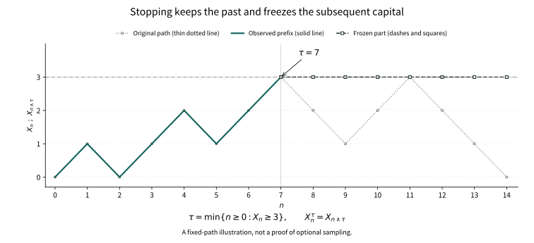

# Chapter 16: What If the Player Chooses When to Stop?

A player writes down a rule before the game begins: leave the table as soon as the net gain reaches one unit.

The player asks neither for a biased coin nor for knowledge of the next toss. Only the accounting time changes. If play may continue forever, the first winning moment seems bound to arrive; counting the capital then no longer looks like an experiment with mean gain zero.

In Chapter 15, fairness at each step already constrained oscillations of the path. But this player's endpoint is chosen by the path itself. We must prove anew whether a conditional average at fixed times survives that choice.

## 16.1 A rule must be executable at the time

First fix a discrete-time filtration \((\mathcal F_n)_{n\ge0}\). A random variable \(T\) with values in \(\mathbb N_0\cup\{\infty\}\) is a stopping time if

\[
\{T\le n\}\in\mathcal F_n\qquad(n\ge0).
\]

This does not require the player to know the departure time at time zero. At time \(n\), the player must know whether departure has already occurred. Equivalently, \(\{T=n\}\in\mathcal F_n\): take consecutive differences in one direction and finite unions in the other. Consequently \(\{T\ge k\}\in\mathcal F_{k-1}\). This last event will supply the indicator of a legitimate bet.

For simple symmetric random walk \(S_n\), the first visit to 1 is a stopping time: whether 1 has been visited so far uses only steps already taken. The last visit to 0 before a fixed horizon \(N\) generally is not. After leaving 0 one needs future information to decide whether that visit was the last. For example, with \(N=2\), the last zero \(L\) satisfies \(\{L=0\}=\{S_2\ne0\}\), an event outside the trivial \(\mathcal F_0\).

The distinction between a random time and a stopping time concerns information, rather than whether the time is random.

## 16.2 What is known when play stops?

For a possibly infinite stopping time define

\[
\mathcal F_T=\{A\in\mathcal F:\ A\cap\{T\le n\}\in\mathcal F_n\text{ for every }n\}.
\]

The ambient \(\mathcal F\) matters: the condition imposes no restriction on information on \(\{T=\infty\}\). An equivalent condition on finite slices is \(A\cap\{T=n\}\in\mathcal F_n\). Complements and countable unions verify directly that this is a sigma-field, and \(T\) is measurable for it.

In particular, for every \(B\in\mathcal F\),

\[
B\cap\{T=\infty\}\in\mathcal F_T,
\]

because its intersection with every \(\{T\le n\}\) is empty. This is the definition's convention on the infinite-time slice, not a claim that all environmental information is visible at a finite time. Even though \(\{T=\infty\}\) itself belongs to \(\mathcal F_\infty\), its intersection with a hidden event need not belong to that sigma-field generated by finite records. This is why we must later distinguish an arbitrary closing variable from the process's actual terminal value.

If \(S\le T\), then \(\mathcal F_S\subseteq\mathcal F_T\), since

\[
A\cap\{T\le n\}=(A\cap\{S\le n\})\cap\{T\le n\}\in\mathcal F_n.
\]

If \(X_n\) is adapted, assign the deterministic value 0 on \(T=\infty\) for now. Then \(X_T\) is \(\mathcal F_T\)-measurable: on \(\{T\le n\}\) it is a finite pasting of the variables \(X_k\mathbf1_{\{T=k\}}\). This convention does not assert that 0 is a limit at infinity. A terminal limit will be used only after its existence has been proved.

The minimum and maximum of stopping times are stopping times. If \(S\le T\), one also checks that \(A\in\mathcal F_S\) implies \(A\cap\{S<k\le T\}\in\mathcal F_{k-1}\). That is exactly the information needed for an account opened at \(S\) and closed at \(T\).

## 16.3 Freezing a path does not reveal its future

Put \(X^T_n=X_{n\wedge T}\). This is adapted by splitting into \(T=0,\ldots,n-1\) and \(T\ge n\). Finite pasting also preserves integrability. The crucial pathwise identity is

\[
X^T_n=X_0+\sum_{k=1}^n\mathbf1_{\{T\ge k\}}(X_k-X_{k-1}).
\]

Whether the \(k\)th increment is counted is decided before it occurs. Conditional averaging therefore shows that if \(X\) is a martingale, \(X^T\) remains a martingale; submartingales and supermartingales retain their respective inequalities. No random-time theorem has been assumed: this is finite summation.

The same computation works for any bounded \(\mathcal F_{k-1}\)-measurable stake \(H_k\). Multiplying martingale increments by these predetermined factors gives a martingale after finite summation. For submartingales or supermartingales one additionally needs \(H_k\ge0\) to retain the inequality. Integrability after infinitely many bets does not follow automatically from this finite fact.

<figure class="publication-math-figure" id="visual-stopping-prefix">

<figcaption>

A first hit uses only the record already observed. This fixed nearest-neighbour path first reaches level 3 at step 7. The solid prefix is retained; the dashed line with square markers then stays at 3, while the thin dotted line shows the unstopped path. No randomness is sampled. This finite illustration neither proves optional sampling nor asserts expectation preservation for arbitrary stopping rules.

</figcaption>

[Static SVG](../assets/visuals/batch16-20/stopping-prefix.en.svg) · [Vector PDF](../assets/visuals/batch16-20/stopping-prefix.en.pdf)

</figure>

## 16.4 Why bounded endpoints preserve fairness

Let \(M\) be a martingale and \(S\le T\le N\) stopping times. The claim is stronger than equality of expectations:

\[
\mathbb E[M_T\mid\mathcal F_S]=M_S.
\]

For \(A\in\mathcal F_S\), expand

\[
\mathbb E[(M_T-M_S)\mathbf1_A]
=\sum_{k=1}^N\mathbb E[\mathbf1_{A\cap\{S<k\le T\}}(M_k-M_{k-1})]=0.
\]

Each indicator is \(\mathcal F_{k-1}\)-measurable, and each product is integrable. The preceding measurability argument puts \(M_S\) in \(\mathcal F_S\), so this is the definition of conditional expectation. The same sum is nonnegative for a submartingale and nonpositive for a supermartingale.

This is optional sampling at bounded stopping times. It does not require \(S,T\) to be independent of the process: the player may use the entire past. What matters is that no future increment is used and only finitely many integrable entries are settled.

## 16.5 Must a game between two barriers end?

Start at an integer \(x\in\{1,\ldots,a-1\}\). Move right with probability \(p\in(0,1)\), left with \(q=1-p\), and let \(T\) be the first visit to 0 or \(a\). One cannot write down \(S_T\) and simply assume that this visit occurs.

From any unabsorbed position, \(a\) consecutive right steps force absorption; their conditional probability is at least \(p^a\). Iteration over blocks gives

\[
P_x(T>ka)\le(1-p^a)^k.
\]

Thus \(T<\infty\) almost surely and \(E_xT<\infty\). In the fair case \(p=q=1/2\), bounded sampling at \(T\wedge n\) gives \(E_xS_{T\wedge n}=x\). The stopped positions lie between 0 and \(a\), so DCT yields

\[
P_x(S_T=a)=x/a.
\]

The horizon is random, but the capitals before and after settlement have a common deterministic bound. That bound makes passage through expectation safe.

## 16.6 The cost of waiting can also be calculated

For fair walk, \(S_n^2-n\) is a martingale: expansion of the square gives conditional cross term zero and squared increment one. Sampling at the bounded time already covered gives

\[
E_x(T\wedge n)=E_xS_{T\wedge n}^2-x^2.
\]

The left side increases to \(E_xT\); bounded convergence on the right gives \(a^2(x/a)-x^2\). Therefore

\[
E_xT=x(a-x).
\]

For \(p\ne q\), put \(r=q/p\). Since \(pr+q/r=1\), the process \(r^{S_n}\) is a martingale. Stopping inside the finite interval supplies a deterministic bound, and hence

\[
P_x(S_T=a)=\frac{1-r^x}{1-r^a}.
\]

As \(p\to1/2\) this tends to \(x/a\). Drift changes the harmonic readout: position itself suffices in the fair game, whereas an exponential removes the average drift in the biased game.

## 16.7 With only one barrier, averaging can fail

Start fair walk at 0 and let \(T\) be its first visit to 1. The finite-interval formula on \([-a,1]\) gives probability \(a/(a+1)\) of reaching 1 first. Thus \(P(T<\infty)=1\). Nevertheless,

\[
E S_{T\wedge n}=0,\qquad S_{T\wedge n}\longrightarrow S_T=1\quad\text{a.s.}
\]

The stopping rule is legitimate. What fails is uniform integrability of the finite settlements.

In fact \(ET=\infty\). If \(ET<\infty\), unit absolute increments would give

\[
|S_T-S_{T\wedge n}|\le(T-n)^+,
\]

whose expectation tends to zero. This would imply convergence in \(L^1\) and force \(ES_T=0\), contradicting \(S_T=1\). Almost sure eventual arrival and a finite average waiting cost are different assertions.

## 16.8 Where doubling stakes hide their risk

Another player stakes 1 initially, 2 after a loss, then 4, until the first win. Let \(\varepsilon_k\) be independent fair signs and \(T\) the first positive sign. The net gain is

\[
G_n=\sum_{k=1}^{n}2^{k-1}\mathbf1_{\{T\ge k\}}\varepsilon_k.
\]

At every finite horizon this is an integrable martingale with \(EG_n=0\). Before the first win the accumulated loss is \(-(2^n-1)\); once a win occurs the net gain is 1. Consequently \(T<\infty\) almost surely and \(G_T=1\), but \(G_{T\wedge n}=G_n\) is not uniformly integrable.

The uncontrolled tail can be calculated rather than merely named. The probability of no win is \(P(T>n)=2^{-n}\); on that event absolute loss is \(2^n-1\). For fixed \(K>1\), whenever \(2^n-1>K\),

\[
E[|G_n|\mathbf1_{\{|G_n|>K\}}]
=(2^n-1)2^{-n}=1-2^{-n}.
\]

However high the threshold, a later horizon leaves mean tail loss close to one. At the same time,

\[
E|G_n|=2(1-2^{-n})\le2.
\]

Even uniformly bounded absolute expectations therefore cannot secure settlement. Each finite account is integrable; its mass is concentrated on increasingly rare and increasingly expensive failure records.

Here even \(ET=2\) is finite. Integrability of the stopping time alone is therefore insufficient: the absolute-increment bound used above has disappeared. Fairness at finite horizons, integrable waiting, and an almost sure gain can coexist, paid for by unbounded stakes and uncontrolled rare losses.

## 16.9 An integrable terminal value supports unbounded settlement

Chapter 15 proved that a uniformly integrable martingale is exactly one of the form \(M_n=E[Z\mid\mathcal F_n]\) with \(Z\in L^1\). Put \(\mathcal F_\infty=\sigma(\bigcup_n\mathcal F_n)\), and use the already established limit \(M_\infty=E[Z\mid\mathcal F_\infty]\) on \(T=\infty\).

For any stopping time \(T\), split \(A\in\mathcal F_T\) into the events \(T=k\). Conditional expectation on each slice gives

\[
E[M_T\mathbf1_{A\cap\{T<\infty\}}]
=E[Z\mathbf1_{A\cap\{T<\infty\}}].
\]

Absolute integrability also needs justification: first use \(E[|M_k|\mathbf1_{A\cap\{T=k\}}]\le E[|Z|\mathbf1_{A\cap\{T=k\}}]\) and then sum. On the infinite-time slice the same identity is not automatic if the ambient \(\mathcal F\) is larger than \(\mathcal F_\infty\).

The sampling theorem itself does not require shrinking the ambient \(\mathcal F\). Instead use the canonical terminal value \(M_\infty\): Chapter 15 gives \(M_k=E[M_\infty\mid\mathcal F_k]\). Sum over the finite slices as before; on \(T=\infty\) both integrands are already \(M_\infty\), even when the event on that slice is not in \(\mathcal F_\infty\). The finite-slice absolute integrals sum to at most \(E|M_\infty|\), and the infinite slice is integrable as well. Thus \(M_T=E[M_\infty\mid\mathcal F_T]\). Taking \(Z=M_\infty\) in the first identity below and using the tower property with \(\mathcal F_S\subseteq\mathcal F_T\) yields

\[
M_T=E[Z\mid\mathcal F_T],\qquad
E[M_T\mid\mathcal F_S]=M_S\quad(S\le T).
\]

Both \(S\le T\) may be infinite, with terminal values always interpreted as \(M_\infty\). If the original arbitrary closing variable \(Z\) is retained, the first identity needs an additional condition on the infinite slice: \(\mathcal F=\mathcal F_\infty\) is sufficient, and an almost surely finite \(T\) avoids the issue. The distinction is real: let every \(\mathcal F_n\) be trivial, let \(Z\) be a hidden fair sign, and set \(T\equiv\infty\). Then \(M_T=M_\infty=0\), whereas the ambient \(\mathcal F_T=\mathcal F\) gives \(E[Z\mid\mathcal F_T]=Z\). It is the formula for an arbitrary closing variable that fails, not sampling with the canonical terminal value.

The terminal representation also explains why unbounded sampling consumes no additional tail budget. For any sub-sigma-field \(\mathcal G\), put \(V=E[M_\infty\mid\mathcal G]\). For positive \(a,K\), the event \(\{|V|>K\}\) is \(\mathcal G\)-measurable. Conditional triangle inequality, truncation and Markov's bound give

\[
\begin{aligned}
E[|V|\mathbf1_{\{|V|>K\}}]
&\le E[|M_\infty|\mathbf1_{\{|V|>K\}}]\\
&\le E[|M_\infty|\mathbf1_{\{|M_\infty|>a\}}]
+\frac{aE|M_\infty|}{K}.
\end{aligned}
\]

First make \(a\) large to control the first term, then make \(K\) large to control the second. The bound is independent of \(\mathcal G\), so all conditional averages of the same integrable terminal value form a uniformly integrable family. Taking \(\mathcal G=\mathcal F_T\) controls \(M_T\) simultaneously over all stopping times, including rules with an infinite-time slice, without finding a new dominating random variable for each rule.

## 16.10 Can one stop without uniform integrability of the entire game?

Yes. For an almost surely finite \(T\), suppose the stopped family \(\{M_{n\wedge T}:n\ge0\}\) is uniformly integrable. Chapter 15 shows convergence in \(L^1\) to \(M_T\), so \(EM_T=EM_0\). More generally, for \(S\le T\) the stopped martingale is closed; the preceding result gives \(E[M_T\mid\mathcal F_S]=M_S\). This condition concerns the rule actually used, rather than play after departure.

The stopped-family condition also permits \(T=\infty\). Put \(N_n=M_{n\wedge T}\); uniform integrability gives an integrable terminal value \(Y\) with \(N_n=E[Y\mid\mathcal F_n]\). On \(T<\infty\) the path eventually freezes, so \(Y=M_T\); on the infinite slice define settlement by \(Y\). Apply 16.9 to this stopped process: for \(S\le T\), \(E[Y\mid\mathcal F_S]=M_S\), also taking \(Y\) when \(S=\infty\). The original process need not have a terminal value everywhere.

Here \(Y\) must be chosen as the stopped process's actual almost sure and \(L^1\) limit,

\[
Y=\lim_{n\to\infty}N_n,\qquad Y\in L^1(\mathcal F_\infty),
\]

rather than another environmental variable with the same conditional averages at finite times. If \(S\) is finite and \(S\le T\), the stopped value is \(N_S=M_S\). If \(S=\infty\), then \(T=\infty\) too, and both sides are settled using this \(Y\). Uniform integrability of the stopped family thus closes the account actually frozen by the rule. On records with \(T<\infty\), the original process, if continued, may still fail to have a limit.

A convenient sufficient condition is \(ET<\infty\) together with \(|M_k-M_{k-1}|\le C\) almost surely. Then

\[
|M_{n\wedge T}|\le|M_0|+CT\in L^1,
\]

so the stopped family is uniformly integrable. In finite-interval gambling a bound on stopped position does the same job. These controls are different, but both restrict the tails in which a limit could conceal its mean.

For a nonnegative supermartingale and an almost surely finite \(T\), bounded sampling and Fatou yield only \(EM_T\le EM_0\); equality is generally unavailable. Uniform integrability of the whole supermartingale, or of the appropriate stopped family, permits the analogous limiting argument with the appropriate conditional inequality.

## 16.11 Why first visits fit the language naturally

For an adapted discrete process and a measurable state set \(B\), define \(T_B=\inf\{n\ge0:X_n\in B\}\), with the infimum of the empty set equal to infinity. Since

\[
\{T_B\le n\}=\bigcup_{k=0}^n\{X_k\in B\},
\]

this is always a stopping time; so is the first return starting at time 1. Searching for a new visit after a stopping time \(S\) remains legitimate: split according to \(S=k\le n\) and take finite unions, using only information available by \(n\).

This explains why return rules may be iterated. It does not yet say that the process starts independently afresh after each return. Stopping times make the rule legal; whether the new law depends only on present position is an additional structure.

## 16.12 What continuous paths do and do not provide

Chapter 4's particle does not appear only at integer times. The discrete theorem cannot simply stand in for continuous-time sampling, but a precise measurability fact can already be proved.

Let \(X_t\) be a continuous adapted process in a metric space and \(C\) closed. For fixed \(t\), continuity and compactness of the time interval give

\[
\{T_C\le t\}=\left\{\inf_{s\in([0,t]\cap\mathbb Q)\cup\{t\}}d(X_s,C)=0\right\}\in\mathcal F_t.
\]

Thus the first visit to a closed set is legitimate. With merely right-continuous paths, for an open set \(O\) one first has \(\{T_O<t\}=\bigcup_{r\in\mathbb Q,\,0\le r<t}\{X_r\in O\}\). Under a right-continuous filtration, \(\{T_O\le t\}=\bigcap_m\{T_O<t+1/m\}\in\mathcal F_t\). These proofs cover exactly the stated path and set classes.

For right-continuous paths hitting a closed set, the first proof cannot be copied: a path may approach 0 before time 1 and jump to 1 at time 1, attaining distance infimum zero without visiting 0. General debut results require deeper measurable-projection tools. We have neither treated them as obvious nor assumed that an arbitrary martingale has a right-continuous version. Continuous-time sampling, usual conditions, and regularization still require their own proofs when that path theory is introduced.

## Chapter 16 Epilogue: A legal rule still needs a settleable account

Leaving at the first gain need not contradict fairness at each step. The danger is passing from finite accounts to an uncontrolled endpoint: the mean wait can be infinite, stakes can magnify rare losses, or stopped capital can lack common integrable control.

A stopping time answers whether the decision can be made then. Uniform integrability answers whether the final account can be settled. These are different questions.

A legitimate return leaves something else unguaranteed. When the player reaches the same position again, will the future remember the route taken there? If the present position summarizes the past, a stop may become a genuine new beginning.

## Historical sources and proof scope

The doubling games, finite-increment accounts, and counterexamples here are modern pedagogical reconstructions, not claims about identical wording in a historical author's book. For the transition from fair gambling to modern martingale theory, see [Doob's own interview](https://chance.dartmouth.edu/Doob/conversation.html), already cited in Chapter 15. The complete sampling proofs here concern discrete time. The continuous-time section proves only the explicitly stated first-hit measurability facts, without using Doob–Meyer or general regularization.
