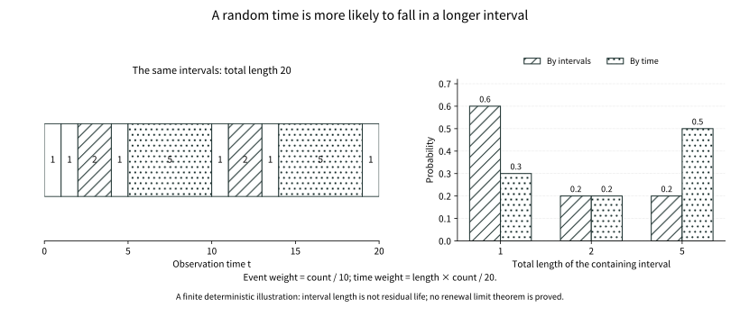

# Chapter 19: Waiting for a New Beginning

Each return to the origin starts another wait. If return restores the same future, a long record can be read in cycles between returns rather than in single steps.

Yet a cycle encountered at an arbitrary roadside observation time is not a cycle chosen uniformly by its arrival index. Short cycles pass quickly; long ones occupy more time. An observer with no predictive knowledge is consequently more likely to land in a longer wait.

Counting cycles by arrivals and locating oneself by elapsed time assign different probabilities to the same random intervals.

## 19.1 Rebuilding a clock from waiting intervals

Let \(X_1,X_2,\ldots\) be independent identically distributed strictly positive real variables with law \(F\). Put

\[
S_0=0,\qquad S_n=X_1+\cdots+X_n,\qquad
N(t)=\max\{n:S_n\le t\}.
\]

The \(S_n\) are renewal times, and \(N(t)\) counts renewals by \(t\), excluding the initial point. Strict positivity prevents infinitely many zero-length cycles at one instant. Even with infinite mean, \(S_n\to\infty\) almost surely: choose \(\delta>0\) with \(p=P(X_1\ge\delta)>0\); the independent Bernoulli strong law supplies infinitely many such intervals. Thus the count is finite for each finite \(t\).

The model assumes independent cycles. Successive returns to a recurrent Markov state provide such cycles after the initial return. A transient state's missing return mass must be handled separately, not treated as a finite waiting interval.

## 19.2 Finite-time counts need a mean budget too

Define the renewal measure

\[
U(B)=\sum_{n\ge0}P(S_n\in B),\qquad U([0,t])=1+EN(t).
\]

Choose the preceding \(\delta,p\). If \(S_n\le h\), at most \(\lfloor h/\delta\rfloor\) among the first \(n\) intervals can be successes of length at least \(\delta\). The trial count needed for the next success is a sum of finitely many geometric waits of mean \(1/p\). Hence

\[
U([0,h])\le\frac{\lfloor h/\delta\rfloor+1}{p}<\infty.
\]

More importantly, for every \(t\ge0\), \(U([t,t+h])\le U([0,h])\). Consider the first renewal entering \([t,\infty)\). If it overshoots the interval there are no points inside; otherwise the remaining count is no larger than the count in a fresh renewal process over length \(h\). Split by the index of first entry and use independence of subsequent intervals to prove the expectation bound. Denote the common bound by \(C_h\). It will control every tail passage for which pointwise convergence alone is inadequate.

## 19.3 The strong law first supplies the average pace

Write \(\mu=EX_1\in(0,\infty]\). With finite mean, the strong law and \(S_{N(t)}\le t<S_{N(t)+1}\) give \(N(t)/t\to1/\mu\) almost surely. With infinite mean, apply the strong law to every truncation \(X_k\wedge a\), then let \(a\to\infty\), obtaining \(S_n/n\to\infty\). The same conclusion holds with \(1/\infty=0\).

Convergence of mean counts needs another argument. Set \(\mu_a=E(X_1\wedge a)\). The event \(\{N(t)+1\ge k\}=\{S_{k-1}\le t\}\) is independent of the next interval, so Tonelli gives

\[
\mu_a E[N(t)+1]
=E\sum_{k=1}^{N(t)+1}(X_k\wedge a)\le t+a.
\]

Section 19.2 ensures finiteness; truncation bounds the last crossing interval by \(a\). Thus \(\limsup EN(t)/t\le1/\mu_a\). Let \(a\to\infty\) and use Fatou for the opposite lower bound to prove the elementary renewal theorem:

\[
\frac{EN(t)}t\longrightarrow\frac1\mu.
\]

This is more careful than formally substituting a random index into an expectation. Pathwise rate comes first, and a bounded overshoot budget supplies the mean rate.

## 19.4 The renewal equation records a restart

The renewal measure satisfies \(U=\delta_0+F*U\). For a function \(g\), write \((U*g)(t)=\int_{[0,t]}g(t-s)U(ds)\). Whenever the absolute convolution is finite, it solves

\[
z(t)=g(t)+\int_{(0,t]}z(t-x)F(dx).
\]

This is the renewal equation. Successive substitution produces \(g+F*g+F^{*2}*g+\cdots\). For locally bounded \(g\), 19.2 ensures absolute convergence on bounded time intervals. The solution is unique in the same locally bounded class: after iteration the remainder is bounded by \(P(S_n\le t)\) times a local bound, and this probability tends to zero.

The elementary renewal theorem concerns an average over a growing interval. It does not directly count renewals in a short recent window. Age, remaining lifetime and delay require a genuine local renewal limit.

A second subtraction of the strong-law limit cannot solve this. Knowing only that an increasing function satisfies \(V(t)=t/\mu+o(t)\) still allows the error \(o(t)\) to vary substantially inside a short window. Deterministic intervals \(X_1=1\) are the simplest warning: \(U([0,t])=1+\lfloor t\rfloor\) has the correct long-run average, but a window shorter than one alternates between seeing zero and one point as its phase changes.

The local theorem must therefore exclude residual oscillation along the time axis, not an incorrect average rate. We retain the local budget from 19.2, move the observation window farther out, and first study any shape that could remain locally. The renewal equation will then decide which shapes are possible.

## 19.5 Can the clock remain locked to a grid?

The waiting law is arithmetic with span \(d\) if \(d>0\) is the largest number with \(P(X_1\in d\mathbb Z)=1\); otherwise it is nonarithmetic. This is an additive group through zero, not Chapter 13's affine lattice span for a fixed number of summands. Support \(\{1,3\}\) has renewal span 1 despite parity restrictions at fixed sample size. The discrete waiting law on \(\{1,\sqrt2\}\) is nonarithmetic.

Infinite addition does not automatically erase this distinction. With every interval equal to 1, observation phase persists forever. The nonarithmetic proof must exclude hidden periodicity rather than confusing lack of density with presence of a period.

## 19.6 Why a permutation zero–one lemma is needed

A renewal depends on the sum of the intervals accumulated so far. Permuting finitely many intervals changes early arrival order, but not sufficiently late partial sums. This concrete symmetry fits our problem better than saying that distant variables are independent of the past: the limit under study may still use every interval and need not be an obvious tail event.

The required zero–one law turns invariance under finite rearrangement into determinism. It does not make every symmetric statistic constant; a finite sample sum is certainly random. The decisive condition is that a readout of an infinite record be unchanged by every finite permutation.

We first prove the special tool required. For an iid sequence, an event \(A\) invariant under every finite coordinate permutation has probability \(P(A)\) equal to zero or one. Chapter 15's upward conditional-expectation theorem approximates \(\mathbf1_A\) in \(L^1\) by finite-prefix conditional averages. Threshold at one half to obtain an event \(B\) in the first \(m\) coordinates with \(P(A\triangle B)<\varepsilon\).

The finite approximation deserves to be explicit. Put \(\mathcal H_m=\sigma(X_1,\ldots,X_m)\) and \(D_m=E[\mathbf1_A\mid\mathcal H_m]\). Upward convergence gives \(E|D_m-\mathbf1_A|\to0\). For \(B=\{D_m>1/2\}\),

\[
P(A\triangle B)\le 2E|D_m-\mathbf1_A|.
\]

At every misclassified point the conditional average differs from the true indicator by at least one half. Finite-prefix approximation does not assume that the whole event depends on finitely many coordinates; it makes the probability of an incorrect decision arbitrarily small.

For any finite-prefix event \(C\), use a finite permutation moving all coordinates of \(B\) beyond those of \(C\). The resulting \(B'\) is independent of \(C\), and iid symmetry together with invariance of \(A\) still gives \(P(A\triangle B')<\varepsilon\). Therefore

\[
|P(A\cap C)-P(A)P(C)|\le2\varepsilon.
\]

Let epsilon vanish, then extend \(C\) to the full sequence sigma-field by pi–lambda. The event \(A\) is independent of itself. Applied to all rational level sets of a bounded permutation-invariant variable, this makes the variable almost surely constant. This proves the needed Hewitt–Savage-type lemma without importing later exchangeability or ergodic theory.

## 19.7 A bounded harmonic readout cannot retain nonarithmetic oscillation

Let bounded continuous \(h\) satisfy \(h(t)=\int h(t-x)F(dx)\). For fixed \(t\), the variables \(h(t-S_n)\) form a bounded martingale, with an almost sure and \(L^1\) limit. A finite permutation eventually leaves partial sums unchanged, hence leaves that limit unchanged. The preceding lemma makes the limit constant, with mean \(h(t)\). The closed-martingale identity then forces \(h(t-X_1)=h(t)\) almost surely.

The strongest step sends the random limit back to finite time. Define \(H_t=\limsup_n h(t-S_n)\) on every record. A finite permutation eventually leaves partial sums unchanged, so this variable really has the invariance required above. Martingale convergence also identifies it with the actual limit. Hence \(H_t=h(t)\) almost surely, and boundedness gives

\[
h(t-S_n)=E[H_t\mid\mathcal H_n]=h(t).
\]

Taking \(n=1\) gives exact invariance under a random step. We have not guessed invariance under each step from invariance on average: the zero–one law and the closed-martingale identity bridge precisely that gap.

Continuity extends the identity to every step in the support, for each \(t\). Thus \(h\) is invariant under the additive group generated by the support. A subgroup of the line that is not a discrete \(d\mathbb Z\) contains arbitrarily small positive elements; integer multiples approximate any real number, so the group is dense. Nonarithmeticity and continuity force \(h\) to be constant.

Extending an almost-sure step identity to the support also has a deterministic reason. For fixed \(t\), the \(x\) satisfying \(h(t-x)=h(t)\) form a closed set of full \(F\)-measure, hence contain the support of \(F\). This works for every \(t\) separately and yields a function identity at all translated positions. Replacing \(t\) by \(t+x\) gives invariance in the reverse direction too.

Why are a grid and a dense group the only alternatives? Let \(G\) be the group generated by the support. If the infimum \(d\) of its positive elements is positive, differences of elements approaching that infimum eventually have absolute value below \(d\), so must vanish. Thus \(d\in G\); division with remainder makes every group element a multiple of \(d\), giving \(G=d\mathbb Z\). If the infimum is zero, integer multiples of arbitrarily small positive elements approximate any real number. Nonarithmeticity therefore removes exactly the periods that a nonconstant continuous harmonic readout could retain.

For a bounded function on the integers and positive integer increments, the same martingale proof applies. If the support has greatest common divisor one, it generates the entire integer group, and the function is constant there. This harmonic mechanism explains how the local renewal limit removes periodic oscillation.

## 19.8 Finding the constant on a lattice first

Rescale arithmetic span to 1. Put \(u_n=U(\{n\})\), zero at negative indices. Strictly positive integer intervals allow at most one renewal at any point of a path, so \(0\le u_n\le1\). The renewal recursion is \(u_n=\mathbf1_{\{n=0\}}+\sum_{k\ge1}p_ku_{n-k}\).

From any integer sequence tending to infinity, extract a subsequence simultaneously for every fixed integer offset so that \(u_{n_j+\ell}\to v(\ell)\). Domination by 1 passes the recursion through the sum, giving \(v(\ell)=\sum_kp_kv(\ell-k)\). The integer harmonic lemma makes \(v\equiv c\).

Exactly one renewal cycle contains each time, yielding the identity

\[
1=\sum_{k=0}^nP(X_1>k)u_{n-k}.
\]

With finite mean, the tail weights sum to \(\mu\). Truncation followed by the bound 1 controls the remainder, giving \(1=c\mu\). Every subsequence has this same limit, hence \(u_n\to1/\mu\). Restoring span gives \(d/\mu\). We have identified mass at individual allowable renewal points, rather than only an averaged cycle rate.

## 19.9 Without a grid, select a local limit

Moving a window far out is not renormalizing a probability. The renewal measure usually has infinite mass on the whole line, so probability tightness and prevention of mass escape cannot simply be invoked. We only require a common budget in every fixed-length window. That permits local subsequential convergence, while still allowing the candidate limit to be zero.

The selection tool is exactly the real-line result already proved in T-STIELTJES: uniform mass bounds on each compact interval give one subsequence converging for every continuous compactly supported test function simultaneously. Choosing unrelated subsequences for different tests would leave the renewal equation without a common limiting measure.

The nonarithmetic conclusions here through 19.11 assume strictly positive iid intervals, a nonarithmetic law and \(0<\mu<\infty\); the arithmetic case separately retains its phase. Extend \(U\) by zero on the negative half-line. For any \(t_j\to\infty\), write \(U_t(B)=U(t+B)\). The uniform local bound in 19.2 gives a subsequence of these translated measures converging against continuous compactly supported test functions to a locally finite measure \(\lambda\). [T-STIELTJES](../foundations/t-stieltjes.md#t-stieltjes-selection) proves this selection through rational diagonal extraction, monotone functions and a pushforward of level-axis length.

Write \(U_t(g)=\int g(y)U_t(dy)\). The translated renewal equation is \(U_t(g)=g(-t)+\int U_t(g(\,\cdot+x))F(dx)\), fixing the direction of translation. If the support of \(g\) lies in an interval of length \(H\), every inner absolute integral is at most \(\|g\|_\infty C_H\), uniformly in \(x,t\). For each fixed \(x\) the translated test function is still continuous and compactly supported. Pass to the subsequential limit and then use this common bound under the probability \(F\), together with \(g(-t_j)\to0\), to obtain \(\lambda=F*\lambda\). More explicitly, for any continuous compactly supported \(g\), the function

\[
h(t)=\int g(t-y)\lambda(dy)
\]

is bounded and continuous and satisfies the harmonic equation of 19.7. The uniform interval bound gives boundedness; uniform continuity of \(g\) and the mass bound on a slightly enlarged support give continuity. Thus \(h\) is constant.

The limit measure inherits a slightly enlarged uniform window budget. Cover any interval of length \(H\) by a continuous piecewise linear function supported on an interval wider by only 2. Passing its integrals to the subsequential limit bounds the interval's \(\lambda\)-mass by \(C_{H+2}\). Continuity of the smoothed readout can consequently be quantified: for \(|r|\le1\),

\[
|h(t+r)-h(t)|\le C_{H+4}\,\omega_g(|r|),
\]

where \(\omega_g\) is the uniform continuity modulus of \(g\) extended over the line. The bound is independent of \(t\) and vanishes as \(r\to0\). The same window budget bounds absolute integrals before Fubini interchanges the convolutions, giving \(h(t)=\int h(t-x)F(dx)\). Every hypothesis of the harmonic lemma thus comes from local mass control, not from an unproved density.

It follows that \(\lambda\) is translation invariant: every test function has equal integrals under every translate. Approximate intervals from inside and outside by continuous piecewise linear functions to obtain equality of translated interval masses. Point masses must vanish, since arbitrarily many distinct translates of an atom would violate local finiteness. Interval mass therefore depends only on length, is additive and monotone in length. Establish linearity for rational lengths, then squeeze real lengths between rationals. Consequently \(\lambda=c\,dx\).

## 19.10 The normalization cannot be guessed

It remains to find \(c\). Each path's renewal intervals partition the time axis, so for \(t\ge0\),

\[
1=\int_{[0,t]}\overline F(t-s)U(ds),\qquad \overline F(x)=P(X_1>x).
\]

Translate along the selected \(t_j\). On a fixed window \([-A,0]\), the integrand is bounded and monotone, with at most countably many jumps. The limit measure \(c\,dx\) gives them no mass, so Riemann step approximation allows passage to the limit.

This identity observes an unfinished cycle: after a renewal at \(s\), the probability of no further renewal by \(t\) is \(\overline F(t-s)\). Distinct renewal indices describe disjoint last-renewal events, and their sum is exactly one. Unlike an asymptotic mean count, this is an exact budget valid at each time.

Fix \(A\) and take the selected \(t_j>A\). In coordinates \(y=s-t_j\), the integrand inside the window is \(\mathbf1_{[-A,0]}(y)\overline F(-y)\). It is bounded and Riemann integrable; T-STIELTJES handles its endpoints when passing to the candidate \(c\,dy\). The remaining task is to ensure that no mean mass has been lost outside the window.

Outside that window, merely writing DCT would be insufficient. For fixed mesh \(h>0\), the uniform local bound controls the tail by

\[
C_h\sum_{k\ge\lfloor A/h\rfloor-1}\overline F(kh).
\]

More explicitly, take \(A\ge3h\) and put \(K=\lfloor A/h\rfloor-1\). The tail function is decreasing, hence

\[
\sum_{k\ge K}\overline F(kh)\le\frac1h\int_{(K-1)h}^{\infty}\overline F(u)\,du\longrightarrow0
\quad(A\to\infty).
\]

The mesh \(h\) is fixed before \(A\) grows; no uncontrolled \(C_h/h\) is allowed to vary along with the mesh. First let \(j\to\infty\) inside the fixed window. The difference between budget one and \(c\int_0^A\overline F\) is bounded by this common tail bound. Only then let \(A\to\infty\). Finite mean enters not to select a local limit, but to carry the infinite cycle budget through that limit.

Finite mean makes the decreasing tail function integrable, so this fixed-mesh tail sum vanishes. Therefore \(1=c\int_0^\infty\overline F(x)dx=c\mu\). All subsequential candidates coincide, proving the full local renewal limit

\[
U((t,t+h])\longrightarrow h/\mu\qquad(h>0).
\]

A unique subsequential candidate must still yield convergence at all times. If the integral of some continuous compactly supported test failed to approach the identified value, there would be times tending to infinity whose integrals stay at least a fixed positive distance away. Local selection would extract a subsequence, but the preceding argument would again force its limit to be \(dx/\mu\), a contradiction. For window indicators, the Riemann bounds and vanishing endpoint atoms in T-STIELTJES then give the interval limit above.

This explains why we studied arbitrary local candidates instead of guessing a density from the elementary theorem. Uniqueness of local shape removes oscillation; the global budget identifies the constant. They solve different difficulties.

This covers every strictly positive nonarithmetic waiting law with finite mean, without density, second-moment or spread-out assumptions. No unproved ergodic theorem has entered.

## 19.11 What integrability does the key renewal theorem need?

Take a Borel measurable real function \(g\), so its integral against a possibly singular renewal measure is actually defined. Direct Riemann integrability controls actual point values, not merely a Lebesgue almost-everywhere equivalence class.

Extend \(g\) by zero on negative arguments. It is directly Riemann integrable if its positive and negative parts have mesh upper and lower sums converging to the same finite values as the mesh vanishes, and its absolute-value upper sum is finite for a sufficiently fine fixed mesh. This controls both local oscillation and distant spikes. Mere Lebesgue integrability does not control sampling by the renewal measure at particular time points.

For a nonnegative function let \(I_k(h)=[kh,(k+1)h)\), \(a_k(h)=\sup_{I_k(h)}g\) and \(b_k(h)=\inf_{I_k(h)}g\). The mesh sums are

\[
\overline R_h(g)=h\sum_{k\ge0}a_k(h),\qquad
\underline R_h(g)=h\sum_{k\ge0}b_k(h).
\]

They must tend to the same finite value as \(h\downarrow0\). For signed functions treat positive and negative parts separately, retaining a finite absolute upper sum on a fixed mesh. Compared with a finite integral, this supplies an additional visible budget: every cell must account for its largest value that the renewal measure might hit.

A nonnegative decreasing integrable function with finite initial value is an example: upper and lower sums differ by at most \(h g(0)\), and the upper sum is at most \(h g(0)+\int_0^\infty g\). Finitely many jumps do not change the conclusion. This includes the truncated tail functions that will arise from age and residual life; the test class is dictated by the problem.

Writing the full tail estimate reveals its role. Fix a mesh \(h\) with finite absolute upper sum, and let \(a_k^{*}(h)=\sup_{I_k(h)}|g|\). At every observation time,

\[
\int_{\substack{0\le s\le t\\t-s\ge A}}|g(t-s)|\,U(ds)
\le C_h\sum_{k\ge\lfloor A/h\rfloor}a_k^{*}(h)\longrightarrow0
\quad(A\to\infty).
\]

Each term uses just one reflected window of length \(h\); any part lying on the negative half-line has zero renewal mass. The right side is the tail of an already summable fixed sequence, entirely independent of \(t\). Inside a finite window, DRI also gives ordinary Riemann integrability, allowing the local limit to apply. Only after combining the two parts is the limit of the entire convolution justified.

For compactly supported Riemann-integrable functions, the interval limit of 19.10 and step bounds first give the convolution limit. For general \(g\), the fixed-mesh far convolution tail is bounded by \(C_h\) times the corresponding upper-envelope tail sum; it vanishes as the truncation bound \(A\to\infty\), uniformly over observation times \(t\ge0\). Truncate, take the long-time limit, then enlarge the truncation. This proves the nonarithmetic key renewal theorem:

\[
\int_{[0,t]}g(t-s)U(ds)\longrightarrow\frac1\mu\int_0^\infty g(s)ds.
\]

For arithmetic span \(d\), a sum cannot be replaced by an integral. At fixed phase \(r\in[0,d)\), if the sampled sequence is absolutely summable, 19.8 and the bound \(u_n\le1\) give

\[
(U*g)(nd+r)\longrightarrow\frac d\mu\sum_{k\ge0}g(kd+r).
\]

The arithmetic formula can also be checked directly. Along \(t=nd+r\), expand the convolution as \(\sum_{k=0}^n u_{n-k}g(kd+r)\), where \(u_j=U(\{jd\})\). For fixed \(k\), the coefficient tends to \(d/\mu\) and never exceeds one; the absolutely summable sampled sequence supplies domination. DRI ensures that summability: choose mesh \(h<d/2\), so distinct sample points occupy distinct cells, and their absolute values sum to at most the fixed-mesh upper-envelope sum.

Direct Riemann integrability guarantees this summability. Unit deterministic periods and a narrow window function already show why removing phase can destroy existence of a common limit. Another counterexample concerns integrability itself: let \(g=\mathbf1_{\mathbb N_0}\). Its Lebesgue integral is zero, yet at every integer time the initial renewal point alone contributes at least one to the convolution. This function is not directly Riemann integrable. Even a nonarithmetic waiting law therefore does not make ordinary Lebesgue integrability sufficient.

## 19.12 Accumulating rewards within cycles

Allow cycles to carry rewards, with iid pairs \((X_k,R_k)\), \(E|R_1|<\infty\) and \(\mu<\infty\). Reward and duration within a cycle may be dependent. Completed-cycle reward satisfies

\[
\frac1t\sum_{k=1}^{N(t)}R_k
=\frac{N(t)}t\frac1{N(t)}\sum_{k=1}^{N(t)}R_k
\longrightarrow\frac{ER_1}{\mu}\quad\text{a.s.}
\]

This applies a strong law along a random subsequence already tending to infinity; \(N(t)\) need not be independent of rewards. If absolute accrued reward in an unfinished cycle is bounded by its \(V_k\), where \((X_k,R_k,V_k)\) are iid and \(EV_1<\infty\), tail-integral comparison and Borel–Cantelli give \(V_k/k\to0\) almost surely. Hence \(V_{N(t)+1}/t\to0\), and reward accrued continuously within a cycle has the same limit.

This renewal reward theorem is pathwise. Convergence of expectations would require suitable additional control such as uniform integrability; the strong law alone does not authorize it.

## 19.13 Which interval contains an arbitrary observation time?

Define age \(A_t=t-S_{N(t)}\) and residual life \(R_t=S_{N(t)+1}-t\). For \(a,b\ge0\), splitting by the last renewal expresses the probability of \(A_t>a,R_t>b\) as the integral of \(\overline F(t+b-s)\) over \(s<t-a\). Its forcing function \(g(u)=\mathbf1_{\{u>a\}}\overline F(u+b)\) is piecewise monotone and integrable, hence directly Riemann integrable.

The last renewal index is not an independently chosen index. Fix \(n\) first, observe \(S_n\), and use independence of the next interval from that prefix. Nonnegative summation permits Tonelli and gives exactly

\[
P(A_t>a,R_t>b)
=\int_{[0,t]}\mathbf1_{\{t-s>a\}}\overline F(t+b-s)\,U(ds).
\]

The strict inequality also retains the convention for observations exactly at renewal epochs. The forcing function has one upward jump at \(a\) and decreases thereafter; finite mean controls its tail integral. The conditions of 19.11 have therefore been checked individually, rather than inferred from resemblance to a density.

In the nonarithmetic finite-mean case, the key renewal theorem gives

\[
P(A_t>a,R_t>b)\longrightarrow
\frac1\mu\int_{a+b}^\infty\overline F(u)du
=\frac{E(X_1-a-b)^+}{\mu}.
\]

This comes from an exact last-cycle decomposition rather than inserting an independent sample at a random time. In the arithmetic case use the phase-dependent sum of 19.11. If every cycle has length 1, age is the observation time's fractional part and residual life is fixed by the same phase.

## 19.14 Why longer intervals are easier to encounter

Construct the limiting joint law by first taking length-biased \(L\), with \(P(L\in dx)=xF(dx)/\mu\), then independent \(V\sim\mathrm{Unif}(0,1)\), and setting age to \(VL\), residual to \((1-V)L\). Given the length, positions satisfying both inequalities occupy length \((L-a-b)^+\). Integration under the length-biased law recovers 19.13.

Length bias is visible along an actual record as well as identifiable by a formula. For any bounded Borel function \(\psi\), a complete interval of length \(X_k\) contributes readout \(X_k\psi(X_k)\). The reward theorem of 19.12 and control of the unfinished interval give

\[
\frac1T\int_0^T\psi\bigl(X_{N(s)+1}\bigr)\,ds
\longrightarrow\frac{E[X_1\psi(X_1)]}{\mu}\quad\text{a.s.}
\]

Uniformly choosing an observation time in an increasingly long record therefore produces the length-biased law. This time-average statement does not even require nonarithmeticity. Unlike a fixed late-time distribution, uniform time observation averages over the grid phase as well.

Given encountered length \(\ell\), the fraction of interior positions with age and residual exceeding \(a,b\) is \((\ell-a-b)^+/\ell\). Multiplying by \(\ell F(d\ell)/\mu\) cancels the denominator and gives the preceding tail integral. The late-time law from the renewal theorem and the time weights from cycle rewards thus express the same geometry.

This is the inspection paradox: the observer learns no hidden fact, but longer intervals occupy more time. The deterministic sample in the figure displays this weighting without replacing the infinite renewal proof.

With finite second moment, the encountered whole interval has mean \(EX_1^2/\mu\); age and residual each have mean \(EX_1^2/(2\mu)\). With infinite second moment these remain extended nonnegative integral identities. It would be wrong to conclude that residual life always exceeds the mean ordinary whole interval: for a constant interval it is half that length. What is necessarily length-biased is the entire interval encountered by the observer.

<figure class="publication-math-figure" id="visual-inspection-length-bias">

<figcaption>

The same ten intervals produce different length distributions under uniform interval sampling and uniform time observation. Lengths 1, 2 and 5 occur 6, 2 and 2 times: their event weights are 0.6, 0.2 and 0.2, but their time weights are 0.3, 0.2 and 0.5. Longer intervals occupy more time, raising the mean containing-interval length from 2 to 3.2. This deterministic illustration on a total length of 20 is not a proof of stationary renewal construction or a renewal limit theorem. Containing-interval length is not residual life.

</figcaption>

[Static SVG](../assets/visuals/batch16-20/inspection-length-bias.en.svg) · [Vector PDF](../assets/visuals/batch16-20/inspection-length-bias.en.pdf)

</figure>

## 19.15 Making the whole renewal record stationary

Take bilateral iid intervals and root a renewal point at zero, obtaining a locally finite configuration \(\Phi\) on both sides. Use only the sigma-field generated by counts in bounded intervals, without assuming general point-process or Palm theory. Let \(\theta_s\) move the observation origin to \(s\). Length-bias the central interval, place the origin uniformly inside it, and append independent ordinary intervals in both directions. This constructs a probability \(Q\) satisfying, for every bounded measurable configuration function \(H\),

\[
QH=\frac1\mu E\int_0^{X_1}H(\theta_s\Phi)ds.
\]

Both the probability and measurability of this construction can be made explicit without general point-process theory. For the point-rooted record, take bilateral iid intervals \((X_k)_{k\in\mathbb Z}\), use 19.1 on the positive side, and define \(S_{-n}=-\sum_{j=0}^{n-1}X_{-j}\) for \(n\ge1\) on the negative side. Take an independent length-biased central interval \(L\) and uniform variable \(V\), place its ends at \(-VL\) and \((1-V)L\), and append ordinary iid intervals on both sides. The two outward partial sums diverge, so bounded windows contain finitely many points. Conditional on central length, the uniform-position factor \(1/L\) cancels the size-bias factor \(L/\mu\), yielding the cycle-integral formula above. Taking \(H=1\) checks total mass one.

For a bounded Borel interval \(B\), the translated count is \(\sum_{k\in\mathbb Z}\mathbf1_{\{S_k-s\in B\}}\), jointly measurable in the interval sequence and \(s\). Counts generate the configuration sigma-field; a function monotone-class argument then makes general bounded measurable \(H(\theta_s\Phi)\) jointly measurable too. Moving the observation origin randomly is an actual measurable experiment, not a formal symbol.

This gives more than an age-residual pair: it makes the entire configuration stationary. For \(t>0\), the exact difference of translated integration intervals is

\[
\mu\{Q(H\circ\theta_t)-QH\}
=E\int_{X_1}^{X_1+t}H(\theta_u\Phi)du
-E\int_0^tH(\theta_u\Phi)du=0.
\]

The stationarity proof uses the same bilateral iid record after rerooting; it does not assume independence between central length and the entire rerooted record. With \(u=X_1+v\), the first expected integral becomes \(E\int_0^tH(\theta_v(\theta_{X_1}\Phi))\,dv\). Rerooting merely shifts every interval index by one, so \(\theta_{X_1}\Phi\) has the original point-rooted law. Fixed length \(t\) and boundedness permit Fubini, making the two terms cancel exactly. A law rooted at an arrival has been converted into a stationary law observed in time; these are different initial laws.

Moving the point root from 0 to the next renewal at \(X_1\) merely reindexes the bilateral iid intervals, preserving their joint law. Both final integrals have fixed length \(t\), so boundedness ensures integrability. Negative shifts follow by inverse composition. This proves stationarity rather than guessing a stationary residual density. With arithmetic intervals, stationarity under all real shifts also randomizes the grid phase through the uniform interior location; fixed-grid observations retain their discrete phase version.

## 19.16 Which wish fails when the mean is infinite?

If \(P(X_1>x)=(1+x)^{-\alpha}\), \(0<\alpha<1\), every interval is still finite and renewals occur indefinitely, but \(EN(t)/t\to0\) and \(N(t)/t\to0\) almost surely. There is no probability obtained by normalizing \(xF(dx)\) with a finite \(\mu\); age and residual cannot use 19.13's finite-mean equilibrium formula.

Local limits and equilibrium probabilities must be separated here. Local selection and harmonic identification do not require finite mean; even when \(\mu=\infty\), a candidate is \(c\,dx\). Using only the fixed-window inequality from the cycle budget gives \(1\ge c\int_0^A\overline F(u)\,du\) for every \(A\). Hence \(c=0\), and nonarithmetic fixed-length window masses tend to zero. In the arithmetic case, retaining finitely many terms of the tail-sum identity in 19.8 likewise forces every subsequential constant to be zero.

This does not produce a zero probability law for age and residual life. Mass in finite windows can disappear into increasingly long cycles. The tail function required for the age problem now has infinite integral and fails the DRI hypothesis of the key theorem; \(xF(dx)\) cannot be normalized either. Infinite mean still allows a provable local zero limit, but removes the budget that made a typical observation cycle into a probability law.

Cycles still fill the time axis, but a finite mean cycle no longer supplies a normalizing budget. This does not say every infinite-mean limit is impossible. It identifies exactly why the stationary length bias and finite-mean limits in this chapter need their hypotheses.

## Chapter 19 Epilogue: An arrival and a time have different weights

Sampling by arrivals counts every cycle once. Sampling by time gives every cycle weight proportional to length. The same random record therefore admits two different notions of a typical observation.

The strong law gives the average pace, the local renewal limit stabilizes short windows, and length bias explains the observer's longer interval. All depend on restart structure, but each needs its own tail, periodicity and integrability assumptions.

So far restarts form a line: one cycle ends and the next follows. If one ending produces several new individuals, each beginning the same experiment independently, the line branches into a family.

## Historical sources and scope

Blackwell's 1948 [A renewal theorem](https://doi.org/10.1215/S0012-7094-48-01517-8) and 1953 [Extension of a renewal theorem](https://msp.org/pjm/1953/3-2/pjm-v3-n2-p03-p.pdf) are original sources for local renewal theory. Smith's 1958 survey [Renewal Theory and its Ramifications](https://doi.org/10.1111/j.2517-6161.1958.tb00294.x) discusses renewal and regenerative applications. The harmonic, permutation and cycle-integral proofs here are modern reconstructions for strictly positive iid cycles. They do not establish renewal theory for general signed increments, an ergodic theorem or Palm duality.
