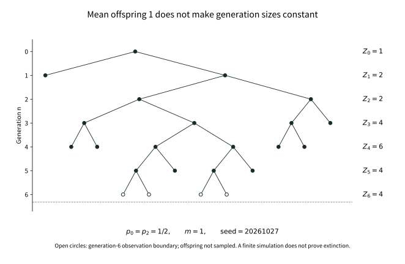

# Chapter 20: How Does One Ancestor Become a Random Family?

Record a family's population generation by generation. Its mean is the easiest quantity to calculate: if individuals reproduce independently with mean offspring \(m\), one ancestor has \(m^n\) descendants on average in generation \(n\). When \(m>1\), that mean follows an increasing exponential curve.

An extinct tree certainly cannot follow that curve. Yet even among families that survive forever, the mean need not supply the right scale. A family can continue indefinitely while its population divided by \(m^n\) tends to zero. The issue is no longer just why some families die out, but why an average can overstate the growth of almost every surviving tree.

A more accurate calculation of mean population cannot resolve the distinction. We must discover whether the mean comes from many families of ordinary size or from increasingly rare, increasingly enormous ones. Observing trees with weight proportional to their descendants will turn the latter contributions from elusive exceptions into phenomena that can be studied directly under another probability law.

## 20.1 Let an actual family tree grow

First specify the family. An offspring count \(L\) is a nonnegative integer with \(p_k=P(L=k)\). Every born individual independently uses this same reproduction rule. The count is always finite; its mean is a separate question, not a prescribed population multiplier.

Label potential individuals by finite words of positive integers: the empty word is the ancestor, and \(uj\) is child \(j\) of individual \(u\). This label set is countable. Assign independent counts \(L_u\) to every word, then retain the ancestor and recursively the children with \(j\le L_u\). Experiments assigned to unborn words do not become observations of the actual family. Chapter 8's countable product space supports the construction.

Write \(Z_n\) for the number of actual individuals in generation \(n\). Every generation is finite: starting from one ancestor, finitely many individuals each have finitely many children. Listing reproduction experiments within each generation gives

\[
Z_0=1,\qquad Z_{n+1}=\sum_{j=1}^{Z_n}L_{n,j}.
\]

This is the single-type Galton–Watson process. Let \(\mathcal F_n\) reveal the actual tree through generation \(n\): it specifies who is present, but not those individuals' offspring counts. Given \(\mathcal F_n\), the reproduction experiments on the right remain independent with the original offspring law. Revealing their results prematurely would change the conditional averages used below.

The nineteenth-century disappearance of surnames provides one historical entrance to this model. Watson and Galton's paper published in 1875 studied how many representatives of a paternal surname remain after several generations, explicitly simplifying matters through nonoverlapping generations. We retain that real question, but our individuals are abstract reproduction units. Independence, identical laws and separate generations are stated assumptions, not facts about population history, and later martingale arguments must not be attributed retrospectively to the early authors.

## 20.2 Why extinction selects the smallest root

With many independent families in one generation, enumerating every possible composition of the next generation quickly becomes unwieldy. The offspring generating function collects those combinations into a single readout:

\[
f(s)=E[s^L]=\sum_{k=0}^{\infty}p_ks^k,\qquad 0\le s\le1,\qquad 0^0=1.
\]

Given the current tree, offspring counts are independent, so \(E[s^{Z_{n+1}}\mid\mathcal F_n]=f(s)^{Z_n}\). Writing \(f_n(s)=E[s^{Z_n}]\), we obtain \(f_{n+1}=f_n\circ f\) with \(f_0(s)=s\), hence \(f_n=f^{\circ n}\). Different families within a generation require multiplication; successive generations require composition. The two operations record different independence structures.

Set \(s=0\) and write \(q_n=P(Z_n=0)=f^{\circ n}(0)\). Zero population cannot recover, so these extinction events increase and \(q_n\uparrow q\), with \(q\) the probability of eventual extinction. Bounded convergence makes \(f\) continuous on \([0,1]\), giving \(q=f(q)\). The equation alone is insufficient, since 1 is always a root.

If \(a\in[0,1]\) satisfies \(f(a)=a\), iteration of the increasing function \(f\), starting with \(0\le a\), gives \(q_n\le a\) for every \(n\). Therefore

\[
q=\min\{s\in[0,1]:f(s)=s\}.
\]

Minimality comes from the increasing limit of finite-generation events, not an arbitrary choice after solving an equation. Starting from \(r\) ancestors, independent subtrees give population generating function \((f^{\circ n}(s))^r\) and extinction probability \(q^r\). Any finite initial family can now be treated without enumerating its whole genealogy afresh.

## 20.3 The mean separates regimes, not individual futures

Assume henceforth a finite mean \(m=EL\). If \(m=0\), offspring is zero almost surely and extinction occurs in the next generation. Otherwise monotone convergence of the nonnegative series gives \(f'(1-)=m\). Convexity of the generating function links the mean to its fixed-point geometry.

When \(m<1\), we have \(f'(s)\le m<1\) for \(0<s<1\). Thus \(f(s)-s\) decreases strictly to zero at 1 and has no other root. When \(m=1\) but \(L\not\equiv1\), the mean condition forces \(p_0>0\) and some \(p_k>0\) with \(k\ge2\). Strict convexity places the graph above its tangent \(s\mapsto s\) at 1, giving \(f(s)>s\) for \(s<1\). Both families become extinct almost surely.

If \(L\equiv1\), exactly one individual persists in every generation: this critical exception must be separated. When \(m>1\), the left derivative makes \(f(s)-s<0\) for \(s<1\) sufficiently close to 1, while its value at 0 is nonnegative. Continuity gives a root \(q<1\), and strict convexity allows only the roots \(q,1\). If \(p_0=0\), the smaller root is 0; if \(p_0>0\), then \(0<q<1\).

For example, \(p_0=1/4,p_2=3/4\) gives \(m=3/2\) and the smaller fixed point \(q=1/3\). Mean population increases while a third of families disappear. With \(p_0=p_2=1/2\), the mean is one but extinction is almost sure. These calculations distinguish mean from survival, but do not yet tell us whether the mean-growth scale is appropriate on surviving records.

## 20.4 How much population remains on the mean-growth scale?

Given the tree already grown, next-generation mean population is \(mZ_n\), hence \(EZ_n=m^n\). For \(m>0\), divide out this predictable growth and put

\[
W_n=\frac{Z_n}{m^n},\qquad
E[W_{n+1}\mid\mathcal F_n]=W_n,\qquad EW_n=1.
\]

This is a nonnegative martingale, not an independent sequence: one ancestor's descendants influence many subsequent generations together. Chapter 15 gives \(W_n\to W<\infty\) almost surely, while Fatou gives only \(EW\le1\). Extinction implies \(W=0\), but the converse remains unproved.

If \(W>0\) on survival, then \(Z_n\) is asymptotically a positive random multiple of \(m^n\). If \(W=0\) even on survival, that scale is too large; a zero normalized limit does not mean eventual zero population. Our original question separates into two: how much expectation survives in the limit, and whether extinction alone accounts for a zero limit. Conflating them would miss the chapter's central phenomenon.

Expectation one averages many possible trees; it guarantees nothing for an individual tree. Nonnegativity makes the part of \(W_n\) below a fixed threshold easy to pass through a limit. Rare very large \(W_n\) are the difficulty. Uniform integrability asks exactly whether their upper-tail contributions vanish uniformly. Finding the right offspring condition requires examining this first-moment contribution directly, beyond survival probability alone.

## 20.5 A second moment gives one route, not the final boundary

Now restrict to \(1<m<\infty\), temporarily assuming \(\sigma^2=\operatorname{Var}L<\infty\). Given the generation-\(n\) tree, next-generation conditional variance is \(\sigma^2Z_n\). Total variance gives

\[
\operatorname{Var}Z_{n+1}
=m^2\operatorname{Var}Z_n+\sigma^2m^n.
\]

Dividing by \(m^{2n+2}\), the difference between consecutive normalized variances is \(\sigma^2m^{-n-2}\). Summing the geometric series from \(Z_0=1\) yields

\[
\operatorname{Var}(W_n)
=\frac{\sigma^2}{m(m-1)}(1-m^{-n}).
\]

Thus \((W_n)\) is bounded in \(L^2\). Martingale \(L^2\) convergence gives \(L^1\) convergence and \(EW=1\). This completely proves a sufficient condition. But it controls squared deviations, whereas we want to preserve only first-moment population. When the second moment is infinite, this calculation ceases to work; it does not prove that first-moment mass must disappear.

Estimating the contribution of every rare enormous family directly is still difficult. An alternative lets the contributions themselves determine the chance of observation: a tree contributing more to mean population is selected more often in a new experiment. Changing probability is motivated by the quantity under study, which already carries a population weight.

## 20.6 Select a descendant at a finite generation first

Fix a generation \(n\). Write \(t\) for the finite ordered tree through that generation and \(P_n(t)\) for its original probability. The truncation records offspring counts at depths below \(n\) and births in generation \(n\), not that generation's own offspring counts. There are countably many such finite trees.

On pairs consisting of a finite tree and a marked generation-\(n\) individual, define a new probability

\[
Q_n^*(t,v)=\frac{P_n(t)}{m^n},
\qquad v\in t,\quad |v|=n.
\]

Every descendant in a given tree \(t\) receives the same weight. Summing over all trees and marks gives total mass \(E_PZ_n/m^n=1\), so this is indeed a probability. Forgetting the mark gives

\[
Q_n(t)=\frac{Z_n(t)}{m^n}P_n(t),\qquad
Q_n^*(v\mid t)=\frac1{Z_n(t)}\quad(Q_n(t)>0).
\]

A uniform endpoint and population weighting appear in the same formula. The former specifies how an individual is selected after the tree has been selected; the latter specifies how the tree was selected in the first place. Drawing a nonempty tree under the original law and then choosing someone uniformly would give individuals weights inversely proportional to family size. That is a different experiment.

The mathematical structure is exactly that of length bias. If the sampled units are time points, intervals containing more time points receive greater weight. If the units are individuals in a generation, families containing more such individuals receive greater weight. It is the sampling unit that changes, not a vague preference for long intervals or large families.

Yet \(Q_n^*\) still describes just one fixed generation. Selecting individuals in successively later generations does not by itself prove that these finite experiments belong to one infinite tree. A density written at a finite horizon cannot supply that conclusion. We need a growth procedure that actually realizes these probabilities.

## 20.7 How a spine realizes population weighting

For every \(n\ge1\), the root's offspring distribution in the new experiment is

\[
Q_n(L=k)=\frac{k\,p_k\,m^{n-1}}{m^n}
=\frac{kp_k}{m},\qquad k\ge1.
\]

Each of the \(k\) ordinary child subtrees contributes \(m^{n-1}\) descendants on average at generation \(n\). This produces the size-biased count \(\widehat L\) naturally. Its probabilities sum to one and exclude zero, but its mean can be infinite.

Mark a genealogical line beginning at the root. Each marked individual reproduces according to \(\widehat L\), then selects one child uniformly to continue the mark. All other children and all unmarked individuals reproduce independently according to the original \(L\). The marked line is the spine. For offspring count \(k\) and continuing child \(j\), its one-step joint rule is

\[
Q^*(\widehat L=k,\ J=j)=\frac{kp_k}{m}\frac1k
=\frac{p_k}{m},\qquad 1\le j\le k.
\]

The underlying space can also be specified. An actual tree is a subset of the finite words: it contains the root and every individual's ancestors, and each individual's children form a finite initial sequence. Birth indicators identify it with a measurable subset of a countable-coordinate space; the constraints use countably many set operations. Its sigma-field is generated by birth indicators, equivalently \(\mathcal F_\infty=\sigma(\bigcup_n\mathcal F_n)\). The marked space adds a marked word at every generation, constrained to follow parent-child edges.

At every finite legal state, only finitely many individuals are born. The reproduction and continuation rules give a probability kernel on countable next states. The sequential construction of Chapter 17 and [T-SEQUENTIAL](../foundations/t-sequential.md#t-sequential-extension) therefore supplies the law \(Q^*\) of the entire marked tree. Forgetting marks gives \(Q\); pushing the original independent reproduction experiment onto the same actual-tree space gives \(P\). The two laws compare the same tree information, excluding experiments at unborn individuals, without assuming any infinite-horizon density.

Now verify that this infinite construction realizes the finite experiment of 20.6. Write \(\tau_n\) for the tree truncated at generation \(n\) and \(V_n\) for its marked word. Fix \(\tau_n=t\) and a generation-\(n\) individual \(v\). Along the ancestral line to \(v\), every reproduction factor \(p_k\) is replaced by \(p_k/m\); all off-line factors remain unchanged. Hence

\[
Q^*(\tau_n=t,V_n=v)=\frac{P(\tau_n=t)}{m^n},\qquad
Q(A)=E_P[W_n\mathbf1_A]\quad(A\in\mathcal F_n).
\]

The first identity recovers the uniform endpoint conditional on the truncated tree. Summing over countably many finite-tree events yields the second identity for every event of \(\mathcal F_n\). It also shows consistency of \((Q_n)\), since \(E_P[W_{n+1}\mid\mathcal F_n]=W_n\). The actual infinite law has already been supplied by growth, without using the uniform integrability that remains to be proved.

The spine never terminates, so a \(Q\)-tree necessarily survives. This does not make \(Q\) the original law conditioned on survival. For example, with \(p_0=0\) the original tree already survives surely, but for nonconstant offspring the spine root's law still changes from \(p_k\) to \(kp_k/m\). Population weighting and conditioning on survival are different operations.

## 20.8 How finite-level densities retain or lose mass at infinity

Take the finite-level event \(A=\{W_n>K\}\). The preceding identity becomes

\[
Q(W_n>K)=E_P[W_n\mathbf1_{\{W_n>K\}}].
\]

The right side is exactly the contribution of large populations to the original mean; the left side is an ordinary event probability in the biased experiment. Thus \((W_n)\) is uniformly integrable under \(P\) exactly when its distributions under \(Q\) have uniformly vanishing upper tails. A difficult expectation question has become a population question under another reproduction rule.

We cannot infer \(dQ=W\,dP\) directly from finite-level relations. If that identity already held, integration would give \(EW=1\), excluding the very loss of expectation under investigation. To avoid circular reasoning, dominate both laws at once and put

\[
\mu=\frac{P+Q}{2},\qquad
\alpha=\frac{dP}{d\mu},\quad\beta=\frac{dQ}{d\mu},\qquad
\alpha+\beta=2\quad\mu\text{-a.e.}
\]

Both \(\alpha,\beta\) are bounded integrable variables. At a finite level, \(d\mu=(1+W_n)dP/2\), so for every \(A\in\mathcal F_n\),

\[
\int_A\frac2{1+W_n}\,d\mu
=\int_A\frac2{1+W_n}\frac{1+W_n}{2}\,dP=P(A).
\]

This is exactly the test-event definition of conditional expectation. The second identity follows because the two quantities sum to 2:

\[
E_\mu[\alpha\mid\mathcal F_n]=\frac2{1+W_n},\qquad
E_\mu[\beta\mid\mathcal F_n]=\frac{2W_n}{1+W_n}.
\]

Since finite-level information generates all tree information, upward convergence from Chapter 15 makes these quantities tend to \(\alpha,\beta\) outside a common \(\mu\)-null set. Convergence has been obtained under the common dominating measure: a statement holding only \(P\)-almost surely would not control the trees seen by the other law.

Put \(D=\{\alpha>0\}\). On this set the ratio of the two conditional averages gives \(W_n\to\beta/\alpha<\infty\). On \(D^c\), the first average tends to zero, forcing \(W_n\to\infty\). Also \(P(D^c)=\int_{D^c}\alpha\,d\mu=0\), so the finite limit under \(P\) is the previously established \(W\).

For every tree event \(A\in\mathcal F_\infty\), it follows that

\[
\begin{aligned}
Q_{\mathrm a}(A)&=Q(A\cap D)=\int_{A\cap D}\beta\,d\mu=\int_A W\,dP,\\
Q_{\mathrm s}(A)&=Q(A\cap D^c),\qquad
Q=Q_{\mathrm a}+Q_{\mathrm s},\quad Q_{\mathrm s}\perp P.
\end{aligned}
\]

The singularity means that the second measure is concentrated on the \(P\)-null set \(D^c\). This actually constructs the Lebesgue decomposition, rather than merely naming a limiting density. In particular,

\[
E_PW=Q(D)=Q(\limsup_n W_n<\infty),\qquad
1-E_PW=Q(D^c).
\]

Lost expectation is the mass of the biased law's singular part. It is not extinction probability: a set \(D^c\) of original probability zero can carry the entire biased law. Trees exceptionally rare at each finite generation can become typical infinite records after population weighting.

The calculation supplies the two tests we need. If \(\limsup W_n<\infty\) almost surely under \(Q\), then \(EW=1\), and the nonnegative martingale converges in \(L^1\) and is uniformly integrable. If \(\limsup W_n=\infty\) almost surely under \(Q\), then \(EW=0\), forcing nonnegative \(W\) to vanish almost surely under the original law. This is much stronger than failure of uniform integrability. We did not assume that \(W_n\) is a martingale under \(Q\); the bounded conditional averages above reveal its finite or infinite limit under that law.

## 20.9 Why the offspring tail enters through a logarithm

Looking down the spine, one child continues the mark in each generation, while the other children begin independent ordinary families. Let \(Y_k=\widehat L_k-1\) count the children born to the spine individual in generation \(k-1\) who enter these ordinary families in generation \(k\). Under \(Q^*\), the immigration counts are independent and identically distributed.

An ordinary family joining at generation \(k\) has mean population \(m^{n-k}\) in generation \(n\). Normalizing by the whole tree's scale \(m^n\) leaves mean contribution \(m^{-k}\). We should therefore compare \(Y_k\) with \(m^k\), rather than demand a finite undiscounted mean for \(Y_k\). The exponential scale points to a logarithmic tail condition.

Prove the tail fact needed here instead of hiding it inside the phrase subexponential growth. For \(V\ge0\), write \(\overline F(t)=P(V>t)\). The tail-integral formula and monotonicity give, for any \(c>0\),

\[
c\sum_{n\ge1}\overline F(cn)
\le EV
\le c+c\sum_{n\ge1}\overline F(cn).
\]

The constant on the right comes from \([0,c]\); compare the remaining intervals one by one. Thus \(EV<\infty\) exactly when the tail sum is finite. For iid \(V_k\) with \(EV_1<\infty\), first Borel–Cantelli for each positive rational \(c\), followed by a countable intersection, gives \(V_k/k\to0\). If \(EV_1=\infty\), the tail sum diverges for every positive integer \(c\). Independence permits second Borel–Cantelli, yielding

\[
\limsup_{k\to\infty}\frac{V_k}{k}=\infty
\qquad(EV_1=\infty).
\]

Apply this to \(V_k=\log^+Y_k\), with \(\log^+0=0\). Size bias gives

\[
E_{Q^*}\log^+Y_1
=\frac1m\sum_{j\ge1}jp_j\log^+(j-1).
\]

This notation also avoids a logarithm of a negative number when \(L=0\). If it is written as \(m^{-1}E[L\log^+(L-1)]\), the whole product at zero is defined to be zero. For \(j\ge2\), we have \(0\le\log j-\log(j-1)\le\log2\). Since \(EL<\infty\), the two logarithmic moments are finite or infinite together:

\[
E_{Q^*}\log^+Y_1<\infty
\quad\Longleftrightarrow\quad E_P[L\log^+L]<\infty.
\]

The two factors now have distinct origins. Selecting trees through descendants multiplies \(p_j\) by \(j\); comparing immigration with exponential growth turns offspring size into \(\log j\). Together they produce \(L\log L\). Demanding finite mean biased immigration would require \(E\widehat L=E L^2/m<\infty\), returning to the unnecessarily strong second-moment route.

## 20.10 Finite logarithmic moment: fix the immigration first

Assume \(E[L\log^+L]<\infty\). The preceding section gives \(\log^+Y_k/k\to0\) almost surely. Choose \(0<\varepsilon<\log m\). Eventually \(Y_k\le e^{\varepsilon k}\), so

\[
\sum_{k\ge1}\frac{Y_k}{m^k}<\infty
\qquad Q^*\text{-a.s.}
\]

We cannot yet add all immigrant-family limits. Each family has its own martingale limit, but the number of families increases with the observation generation. Interchanging an infinite sum with a limit could lose mass again. The proof must control total population at each generation, rather than assume individual subtree limits account for all of it.

First fix any deterministic sequence of nonnegative integers \(y_1,y_2,\ldots\) with \(\sum_k y_k/m^k<\infty\). Each entry is finite, but infinitely many entries may be nonzero. Attach an independent ordinary tree to every immigrant. If \(A_n\) is total off-spine population in generation \(n\), then

\[
A_0=0,\qquad A_{n+1}=\sum_{j=1}^{A_n}L_{n,j}+y_{n+1}.
\]

After fixing immigration, only ordinary-family reproduction remains random. With the filtration revealing that reproduction generation by generation, conditional averaging gives

\[
E\!\left[\frac{A_{n+1}}{m^{n+1}}\ \middle|\ \mathcal H_n\right]
=\frac{A_n}{m^n}+\frac{y_{n+1}}{m^{n+1}},\qquad
E\frac{A_n}{m^n}=\sum_{k=1}^n\frac{y_k}{m^k}.
\]

Consequently \(A_n/m^n\) is a nonnegative submartingale with uniformly bounded positive-part expectations. The same recursion guarantees integrability at every finite time. Chapter 15's submartingale convergence theorem therefore gives an almost surely finite limit, without a second offspring moment.

This normalization also records each immigration batch's contribution. If \(W_r^{(k,j)}\) is the ordinary normalized population after \(r\) generations of immigrant \(j\) arriving at generation \(k\), then at each fixed time,

\[
\frac{A_n}{m^n}
=\sum_{k=1}^n m^{-k}\sum_{j=1}^{y_k}W_{n-k}^{(k,j)}.
\]

This finite sum legitimately explains the factor \(m^{-k}\). We have not replaced it by an infinite sum of family limits. The submartingale theorem already handles all families' combined population in a given generation, avoiding that dangerous interchange.

To return to random immigration, place all \(Y_k\) and the ordinary subtrees of countably many candidate immigrants on a product space, independently of one another. Actual population is a measurable function of these coordinates: a finite generation uses finitely many reproduction calculations, split into countably many cases. For each immigration sequence with finite discounted sum, failure has probability zero under the ordinary-subtree product law. Tonelli integrates this failure indicator, and admissible sequences have \(Q^*\)-probability one, giving the joint almost sure conclusion.

The full tree also contains exactly one spine individual in each generation. Thus \(Z_n=1+A_n\), and \(W_n=m^{-n}+A_n/m^n\) converges to a finite value under \(Q\). The measure decomposition of 20.8 now gives

\[
EW=1,\qquad W_n\longrightarrow W\text{ in }L^1(P),
\qquad (W_n)\text{ is uniformly integrable under }P.
\]

Fixing immigration before averaging is essential because \(E_{Q^*}Y_1\) can be infinite. Requiring that mean to be finite would unnecessarily reduce the proof to finite variance. Nor is the whole \(W_n\) a submartingale after immigration is fixed: the spine contribution \(m^{-n}\) decreases. The convergence theorem applies to off-spine population \(A_n/m^n\).

## 20.11 Infinite logarithmic moment: what the biased experiment reveals

Now assume \(E[L\log^+L]=\infty\). This is more than failure of a step in the sufficient-direction proof. The tail-sum test and independent Borel–Cantelli give the opposite positive assertion: \(\limsup \log^+Y_k/k=\infty\). Choose an integer \(c>\log m\). Infinitely often \(Y_k>e^{ck}\), and along those generations,

\[
\frac{Z_k}{m^k}\ge\frac{Y_k+1}{m^k}
>e^{(c-\log m)k},\qquad
\limsup_k W_k=\infty\quad Q\text{-a.s.}
\]

These enormous populations do not require immigrants' subtrees to reproduce further: newborn off-spine children already overwhelm the normalization. Section 20.8 identifies all biased mass with the singular part, giving

\[
E_PW=0,\qquad W=0\quad P\text{-a.s.}
\]

The conclusions concern different laws: normalized population has infinite limsup in the biased tree, but tends to zero in the original tree. There is no contradiction. Biasing gives high weight precisely to rare enormous original contributions. The implication from one statement to the other requires the measure decomposition; biased reproduction must not be mistaken for the original tree's reproduction rule.

## 20.12 When does a zero limit mean extinction?

A finite logarithmic moment has given \(EW=1\). Determining the limit on surviving records still requires the tree's branching structure. Write \(Z_r^{(j)}\) for the population of the independent subtree of first-generation child \(j\). Pathwise,

\[
\frac{Z_n}{m^n}
=\frac1m\sum_{j=1}^{L}\frac{Z_{n-1}^{(j)}}{m^{n-1}}.
\]

Remove convergence failures simultaneously for the countably many potential subtree martingales. Every actual individual has finitely many children, so passing to the limit involves only a finite sum, giving

\[
W=\frac1m\sum_{j=1}^{L}W^{(j)}.
\]

Put \(r=P(W=0)\). Given \(L\), subtree limits are independent copies of the original \(W\), independent of root reproduction. Nonnegativity prevents cancellation: the sum is zero exactly when every subtree limit is zero, with the empty sum interpreted as zero. Hence

\[
r=E[r^L]=f(r).
\]

Extinction is contained in the zero-limit event, giving \(q\le r\). But \(EW=1\) excludes \(r=1\). The supercritical generating function has only the fixed points \(q,1\), so \(r=q\). Inclusion and equal probabilities identify the two events modulo a null set, rather than merely giving unrelated events with equal probability.

The single-type finite-mean supercritical conclusion is now complete. Under \(1<m<\infty\),

\[
\begin{aligned}
E[L\log^+L]<\infty
&\ \Longleftrightarrow\ EW=1\\
&\ \Longleftrightarrow\ (W_n)\text{ is uniformly integrable}\\
&\ \Longleftrightarrow\ P(W=0)=q.
\end{aligned}
\]

With a finite logarithmic moment, \(W>0\) almost surely on survival. With an infinite logarithmic moment, \(W=0\) almost surely, also conditional on the positive-probability survival event. The reverse equivalences omit no third possibility: the infinite-moment direction proved \(EW=0\) and \(P(W=0)=1>q\), while uniform integrability must preserve mean one. This is commonly called the Kesten–Stigum \(L\log L\) criterion. Here a nontrivial limit means not identically zero: deterministic offspring \(L\equiv k\ge2\) can give the constant limit one.

## 20.13 Infinite second moments can lead to opposite growth outcomes

A family of examples now tests both the boundary of the condition and our original question. For \(\gamma>1\), take \(c=1/10\) and put

\[
p_2=\frac12,\qquad
p_k=\frac{c}{k^2(\log k)^\gamma}\ (k\ge3),\qquad
p_0=\frac12-\sum_{k\ge3}p_k,\qquad p_1=0.
\]

Since \(\log k>1\) for \(k\ge3\), the tail probability sum is less than \(c\sum_{k\ge3}k^{-2}<1/2\), giving \(p_0>0\). These are genuine probabilities, with mean

\[
m=1+c\sum_{k\ge3}\frac1{k(\log k)^\gamma}\in(1,\infty).
\]

The integral test gives finite mean for \(\gamma>1\). The second moment contains \(\sum_{k\ge3}1/(\log k)^\gamma\), which diverges for every finite \(\gamma\). For \(r\ge2\), on a block \(2^r\le k<2^{r+1}\), its sum is at least \(2^r/((r+1)\log2)^\gamma\), so block contributions do not even tend to zero.

The tail of the logarithmic moment, however, is exactly

\[
c\sum_{k\ge3}\frac1{k(\log k)^{\gamma-1}}.
\]

For \(\gamma=3\), this sum is finite: despite infinite variance, normalized population converges in \(L^1\) and has a positive limit on survival. For \(\gamma=2\), it diverges: survival has positive probability, but \(Z_n/m^n\) tends to zero almost surely. The latter retains our explicit counterexample; the former shows that a second moment really is not the sharp boundary, rather than merely lacking a necessity proof.

The comparison concerns population's ratio to the mean scale, not an assertion of strictly different exponential rates. Consider just the positive sequence \(b_n=m^n/n\):

\[
\frac{b_n}{m^n}=\frac1n\longrightarrow0,\qquad
\frac{\log b_n}{n}=\log m-\frac{\log n}{n}\longrightarrow\log m.
\]

This is not another branching model. It identifies what a zero ratio alone can and cannot imply. We have not deduced a smaller exponential growth rate from a zero ratio or constructed a replacement normalization for heavy-tailed families here.

A zero normalized limit does not mean that surviving populations remain in a small range. In this supercritical model, \(Z_n\to\infty\) on survival. If \(p_0>0\), whenever population is in \(1,\ldots,K\), the conditional probability that everyone has no children next generation is at least \(p_0^K>0\). Let \(\sigma_1\) be the first visit to this population range and \(\sigma_{r+1}\) the next visit at or after \(\sigma_r+1\). They are stopping times of the population chain. Immediate extinction precludes another visit. Successive conditioning gives

\[
P(\sigma_r<\infty)\le(1-p_0^K)^{r-1}.
\]

Thus infinitely many visits to this range have probability zero. Population is nonzero on survival; excluding repeated visits simultaneously for countably many \(K\) gives \(Z_n\to\infty\). A positive extinction chance has not simply been substituted for eventual extinction: the chance of repeatedly missing it has been controlled.

If \(p_0=0\), population is nondecreasing. Supercriticality gives \(p_1<1\); at a finite population \(z\), the probability of staying at that size for successive generations is \((p_1^z)^r\), tending to zero as \(r\to\infty\). A countable union over possible eventual sizes and stabilization times excludes a finite population limit. Population tending to infinity and population vanishing relative to its mean scale are therefore compatible.

## 20.14 A precise constant for delayed critical extinction

Return to \(m=1\), exclude \(L\equiv1\), and assume \(0<\sigma^2=\operatorname{Var}L<\infty\). Extinction is almost sure, and the population martingale vanishes on every eventually extinct record. The exponential growth that discounted supercritical immigration is absent. A finite logarithmic moment cannot transfer the preceding nonzero-limit conclusion. The relevant quantity is now the chance of remaining alive at generation \(n\).

Put \(a_n=P(Z_n>0)\). Extinction classification gives \(a_n\downarrow0\), while survival has positive probability at each finite \(n\). Iteration of the generating function gives

\[
a_{n+1}=1-f(1-a_n).
\]

We need the second-order deviation of the generating function near 1, without silently adding a third moment to justify a third-order Taylor remainder. Here \(f''(s)=E[L(L-1)s^{L-2};L\ge2]\uparrow\sigma^2\). Integrating twice gives, for \(0<a<1\),

\[
f(1-a)=1-a+a^2\int_0^1(1-v)f''(1-av)\,dv.
\]

The integrand is nonnegative and bounded by \((1-v)\sigma^2\), so dominated convergence makes the integral tend to \(\sigma^2/2\). Consequently,

\[
a_{n+1}=a_n-\frac{\sigma^2}{2}a_n^2+o(a_n^2),
\qquad \frac{a_{n+1}}{a_n}\longrightarrow1.
\]

Directly summing this nonlinear recursion is awkward. Reciprocals turn the quadratic small term into a constant increment:

\[
\frac1{a_{n+1}}-\frac1{a_n}
=\frac{a_n-a_{n+1}}{a_n^2}\frac{a_n}{a_{n+1}}
\longrightarrow\frac{\sigma^2}{2}.
\]

Telescoping and Cesàro averaging give \(a_n^{-1}/n\to\sigma^2/2\), equivalently,

\[
nP(Z_n>0)\longrightarrow\frac2{\sigma^2}.
\]

Since \(EZ_n=1\) at criticality, we also obtain \(E[Z_n\mid Z_n>0]=1/a_n\sim\sigma^2n/2\). A constant unconditional mean is carried by fewer surviving records whose conditional mean populations grow larger. This is still a conditional mean, not a conditional distributional limit. It proves neither Yaglom's exponential limit nor a critical infinite-variance assertion.

## 20.15 Population and genealogy retain different information

The same population sequence can arise from different parent assignments. The population process is suited to extinction and scale; a whole tree also remembers every branch's ancestry. The spine method works by changing observation on this richer space, then forgetting the mark to answer a population question. The finite tree below makes both levels visible.

<figure class="publication-math-figure" id="visual-finite-gw-family">

<figcaption>

A finite record of a critical Galton–Watson family. Every individual whose reproduction is observed has either 0 or 2 children with equal probability, so mean offspring is 1. The MT19937 seed is 20261027; reproduction is sampled generation by generation, left to right. Populations in generations 0 through 6 are 1, 2, 2, 4, 6, 4 and 4. Generation 6 shows births only; its offspring are not sampled. The finite figure neither proves critical extinction nor determines this family’s infinite future.

</figcaption>

[Static SVG](../assets/visuals/batch16-20/finite-gw-family.en.svg) · [Vector PDF](../assets/visuals/batch16-20/finite-gw-family.en.pdf)

</figure>

Generation 6 is an observation boundary, not a completed infinite tree. A record that remains nonempty at that boundary does not refute critical extinction. Shapes conditional on large size, encodings and geometric limits require later random-tree tools. Here we have established the relationship between discrete single-type families and descendant weighting, not promoted a finite picture into a CRT construction.

## Chapter 20 Epilogue: Survival need not follow the mean curve

A family's future involves two different scales. The generating function asks whether anyone will remain to reproduce; normalized population asks whether a surviving tree retains the proportion predicted by mean growth. The same fixed-point equation eventually connects them, but only after verifying preservation of expectation can their answers be identified.

Size bias did not change the reproduction experienced by an original family. It changed which trees we observe, exposing rare large families in proportion to their contributions to mean population. The spine realizes that weighting as an actual genealogical line. The logarithmic condition determines whether enormous reproduction along it repeatedly overwhelms the exponential scale.

Survival, population tending to infinity, and a positive limit on the mean scale are therefore separate assertions requiring separate proofs. Some families keep growing while remaining much smaller than the mean curve; others retain a stable positive random proportion even without a second moment. The power and limitations of expectation appear within the same genealogical structure.

Making all individuals in a generation reproduce together supplied a tidy generational clock. If births and waiting occur separately in real time, genealogy remains but its clock must change. How branching connects with random time is another part of the picture this model naturally leaves open.

## Sources, modern reconstruction and proof scope

Watson and Galton's [1875 original paper](https://math.uchicago.edu/~shmuel/Modeling/Galton%20Watson.pdf), Journal of the Anthropological Institute 4, 138–144, documents the surname problem, generational generating-function calculations and nonoverlapping-generation assumption. The independent construction, probability-space formulation and martingale arguments here are modern reconstructions; the original population discussion is not treated as a modern theorem.

Kesten and Stigum's [1966 paper](https://doi.org/10.1214/aoms/1177699266) treats multidimensional Galton–Watson limit theory. Lyons, Pemantle and Peres's [1995 paper and public author version](https://arxiv.org/html/math/0404083v1) illuminate logarithmic criteria through size-biased trees. We checked our single-type supercritical route against its population weighting, infinite-level mass decomposition, spine immigration and Borel–Cantelli structure. Our decomposition is proved through a common dominating measure, and finite-logarithmic-moment immigration through submartingale convergence after fixing the sequence; exposition and organization are independently written.

The proved scope is strictly the single-type \(1<m<\infty\) \(L\log L\) equivalence and the explicitly finite-variance critical survival asymptotic. The LPP [2003 erratum](https://rdlyons.pages.iu.edu/errata/k-s.pdf) identifies a proof problem in its infinite-variance critical conditional limit assertion. We do not use that assertion or claim proofs for multiple types, random environments, infinite-mean branching or Yaglom's conditional limit.
