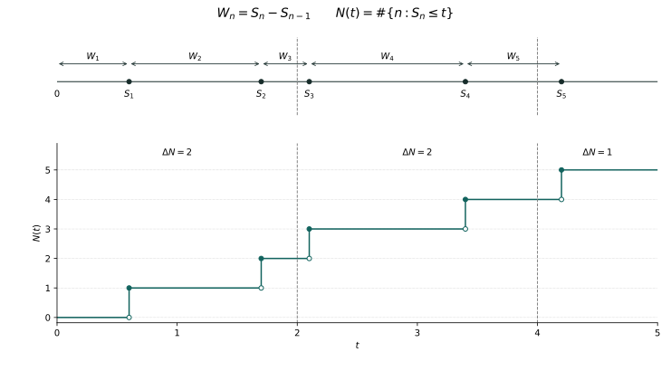

# Chapter 21: Waiting without Memory

Three people arrived in an hour. That sentence does not say whether they came together or entered separately and independently. Nor does it say whether, after fifty minutes without an arrival, the last ten minutes still resemble the first ten. The same count can conceal very different records in time.

Accumulated rare opportunities have already given us a Poisson distribution. The task now is not to calculate that distribution again, but to assign a common probability law to windows of different lengths and locations, including adjacent windows. The law of waiting will constrain relations between windows, and those relations will in turn determine the waiting law.

## 21.1 What a count preserves, and what it loses

Divide an interval of length t into n cells, independently allowing an arrival in each with probability λt/n. Here λ>0 and n is sufficiently large. Chapter 13 gives a Poisson approximation for the total number. To study the first and second half-hours together, however, we must retain the locations of the cells, not merely the sum of all the Bernoulli variables.

\[
P\{N(t)=k\}=e^{-\lambda t}\frac{(\lambda t)^k}{k!},\qquad k=0,1,\ldots .
\]

This formula specifies only a one-time distribution. Writing it for every t does not specify how two times occur jointly. The consistency problem from Chapter 8 now has a concrete temporal form. We could start with shrinking cells, but would still have to construct limiting paths and rule out infinitely many arrivals accumulating in finite time. A more direct route starts with the waits between successive arrivals.

Chapter 19 has already constructed a general renewal process: when one wait ends, draw the next independently. But a new cycle is not the same thing as a new time. If every wait lasts exactly one hour, having already waited fifty minutes is crucial information. Independence between renewal cycles does not make counts in arbitrary time windows independent.

For independence alone, use a nondegenerate renewal counterexample. Let iid waits be uniform on (1,2). Almost surely there is exactly one arrival by time2, falling in (0,3/2] or (3/2,2] with probability1/2 each. The two events of one arrival are mutually exclusive, with joint probability0 rather than1/4. Independence of renewal cycles truly does not imply independence of time windows.

## 21.2 Can elapsed time cease to matter?

Let W be a strictly positive, almost surely finite wait, and write B(t)=P(W>t). Given that s units have elapsed without an arrival, the probability of waiting another t is B(s+t)/B(s). To reuse the original waiting rule whenever the clock is inspected, this ratio must equal B(t). Memorylessness means precisely this requirement, not a philosophical claim that the future has no causes.

\[
P(W>s+t\mid W>s)=P(W>t),\qquad s,t\ge0,\quad P(W>s)>0.
\]

First consider what it excludes. If W is uniform on (0,1), then for 0≤s<1 and 0≤t<1−s the conditional probability above is (1−s−t)/(1−s). It depends on s. The maximum possible duration restricts the future: an older cycle cannot continue waiting in the same way as a new cycle.

The requirement determines the distribution uniquely. Since W>0, B(h) tends to1 as h decreases to0 and is positive near0. Subdivide any t into sufficiently small pieces and apply memorylessness repeatedly to obtain B(t)=B(t/n)ⁿ>0. Thus the conditional probability is defined for every finite s, and B(s+t)=B(s)B(t).

\[
g(t)=-\log B(t),\qquad g(s+t)=g(s)+g(t),\qquad g(t)\ge0.
\]

The function g is nondecreasing. Set λ=g(1). Additivity first gives g(q)=λq for nonnegative rational q. Rational approximation from both sides and monotonicity give g(t)=λt for every real t≥0. Almost sure finiteness of W forces B(t)→0 and excludes λ=0. Thus strictly positive, almost surely finite memoryless waits are exactly exponential waits of rate λ>0. Substitution proves the converse. A density was not assumed; it is a conclusion.

\[
B(t)=e^{-\lambda t},\qquad f_W(t)=\lambda e^{-\lambda t}\mathbf1_{(0,\infty)}(t),\qquad EW=\frac1\lambda.
\]

The mean follows from Chapter 6’s tail-integral formula. If W=∞ is allowed, λ=0 can describe an arrival that never occurs; it is not a finite waiting distribution. The geometric distribution is memoryless on an integer clock, but embedding it in real time does not make the identity hold for all real s and t. The clock itself participates in selecting the law.

## 21.3 Constructing the entire arrival record

On the countable product probability space established in Chapter 8, take independent identically distributed exponential waits W₁,W₂,…. Join them end to end. Set S₀=0 and Sₙ=W₁+⋯+Wₙ, and let N(t) count the completed waits by t. The endpoint convention matters: an arrival occurring exactly at t has already been counted.

\[
N(t)=\sum_{n\ge1}\mathbf1_{\{S_n\le t\}},\qquad \{S_n\le t\}=\{N(t)\ge n\}.
\]

We must first prove that the sum is finite at finite t. Fix δ>0. The independent events {Wₙ≥δ} all have probability e^(−λδ)>0. The independent direction of Borel–Cantelli from Chapter 7 ensures infinitely many such events almost surely. Each contributes at least δ to the sums, so Sₙ→∞. Strict positivity of all waits holds on one common event of probability1, since only countably many null events must be excluded.

From now on restrict the probability space to this measurable full-probability subspace, with its trace σ-algebra and restricted probability. All finite-dimensional independent laws are unchanged, while every bounded interval now has finitely many arrivals for every sample. Paths of N are nondecreasing and right-continuous, have left limits, jump only by1, and start at0. These are simple, locally finite counting paths. Each N(t) is a measurable countable sum, and the event identities relating partial sums Sₙ to counts hold everywhere. This treatment makes later stopping-time arguments in the raw natural filtration independent of an unstated completion. Nonexplosion has been proved, not hidden inside max.

The waits are the construction material, arrival times their cumulative sums, and the step count another reading of the same record. They are not three unrelated models. We must now prove that this record produces the window laws we sought.

**Three expressions of one record.** Waits are0.6,1.1,0.4,1.3,0.8, giving arrival times0.6,1.7,2.1,3.4,4.2. Counts in (0,2], (2,4], (4,5] are2,2,1. Filled dots select the post-jump value; open dots mark the excluded pre-jump value. These are deterministic illustrative data, not a sampled Poisson record or a proof of independent increments. The unshown next wait is unfinished. The [vector publication PDF](../assets/visuals/poisson-time/arrival-record.pdf) and SVG share the same exact parameters.

## 21.4 A cancellation on the ordered-time region

Fix t>0 and require exactly n arrivals. If their locations are 0<s₁<⋯<sₙ≤t, the joint density of the first n waits becomes λⁿexp(−λsₙ) under a triangular linear change of variables with Jacobian1. The next wait must exceed t−sₙ, independently contributing exp(−λ(t−sₙ)). Dependence on the final arrival location cancels.

\[
P\{(S_1,\ldots,S_n)\in d\mathbf s,\ N(t)=n\}=\lambda^n e^{-\lambda t}\mathbf1_{\{0<s_1<\cdots<s_n<t\}}\,d\mathbf s.
\]

This is a density identity on Borel subsets, not a positive probability assigned to an exact time point. Replacing ≤t by <t in the integral changes nothing: finitely many continuous random variables equal a specified t with probability0. For n=0, use P(W₁>t)=e^(−λt) directly.

The ordered region has volume tⁿ/n!. Partition the cube (0,t)ⁿ into n! strict coordinate orders; diagonals have volume0. Alternatively, integrate Vₙ(t)=∫₀ᵗVₙ₋₁(s)ds inductively from V₀=1. Integrating the constant density gives the Poisson mass function. No process limit has been assumed.

\[
P(N(t)=n)=e^{-\lambda t}\frac{(\lambda t)^n}{n!},\qquad EN(t)=\lambda t,\quad \operatorname{Var}N(t)=\lambda t.
\]

The mean and variance follow by differentiating the exponential series or using Chapter 13’s generating function. The mean λt is a consequence of construction, and λ acquires its meaning as an arrival rate per unit time. It does not say that every path grows at constant speed on every small interval.

## 21.5 Why separate windows really are independent

Calculating N(t) is not enough. Take 0=t₀<t₁<⋯<tᵣ=t and prescribe nⱼ arrivals in window (tⱼ₋₁,tⱼ], with total n=Σnⱼ. In the preceding ordered region, restrict the first n₁ locations to the first window, the next n₂ to the second, and so on. Locations within a window must still be ordered; ordering between windows is automatic.

\[
\begin{aligned}P\{N(t_j)-N(t_{j-1})=n_j,\ 1\le j\le r\}&=\lambda^n e^{-\lambda t}\prod_{j=1}^r\frac{(t_j-t_{j-1})^{n_j}}{n_j!}\\&=\prod_{j=1}^r e^{-\lambda(t_j-t_{j-1})}\frac{[\lambda(t_j-t_{j-1})]^{n_j}}{n_j!}.\end{aligned}
\]

Tonelli separates the nonnegative integral over the product region. Factorization of this joint probability proves independence of counts in disjoint windows. Dependence of each factor only on window length proves stationarity of increments. For disjoint windows separated by gaps, include the gaps in a partition and sum over their counts.

A homogeneous Poisson process of rate λ>0 can therefore be constructed from exponential waits, or described as a count starting at0 with independent stationary Poisson increments. For λ=0, take the identically zero process. Homogeneity means that time translation does not change increment laws. Independent arrivals whose rate changes with time are not this homogeneous model.

The shrinking Bernoulli-cell idea now has a precise role. For finitely many fixed windows, subdivide each into finer cells and independently assign success probability λΔ to a cell of length Δ. Chapter 13 gives the appropriate Poisson limit for each binomial count. Joint masses across windows are products and converge to the displayed formula. This explains a finite-dimensional rare-event approximation, not path-space convergence. Paths were established separately by the waiting construction.

Except where the zero-rate case is discussed explicitly, take λ>0 below and retain the simple right-continuous path convention. The object is the joint law of a whole process, not a separately chosen Poisson random variable for each time.

## 21.6 The past contains more than the last count

At time s we may have observed every earlier arrival location, not just N(s). Let Fₛ⁰=σ(N(u):0≤u≤s), the raw natural filtration. Independence of the future from the past requires independence of future increment vectors from the whole of Fₛ⁰. Independence from N(s) alone is insufficient.

Fix future times 0≤v₁<⋯<vₖ and finitely many historical times u₁,…,uₘ≤s. Include these times, s and s+vᵢ in one partition. The preceding independence result separates the future vector from those past coordinates. Historical cylinders form a π-system generating Fₛ⁰. For each future Borel event, historical events satisfying independence form a λ-system. The companion π–λ proof linked from Chapter 5 extends the identity to all of Fₛ⁰.

\[
E\!\left[f\bigl(N(s+v_i)-N(s):1\le i\le k\bigr)\mid\mathcal F_s^0\right]=E f\bigl(N(v_i):1\le i\le k\bigr).
\]

The identity holds for every bounded Borel function f, by indicators and simple-function approximation. We use this filtration below unless otherwise stated; no general continuous-time regularization has been imported. Completing the natural filtration preserves these conditional expectation identities, but an arbitrary enlargement of information may not.

## 21.7 Do independent stationary increments force the Poisson law?

Forget exponential waits. Assume only that N starts at0, has simple, locally finite, right-continuous nondecreasing integer paths on a common event of probability1, and has independent stationary increments. Must we additionally specify a Poisson law? The passage from single arrivals to a short-time probability law contains a step that needs proof.

Set q(t)=P(N(t)=0). Monotonicity and independent stationary increments give q(s+t)=q(s)q(t). Right-continuity and N(0)=0 imply N(h)→0 almost surely, hence q(h)→1. As in the waiting proof, q is positive at finite t, and monotone multiplicativity gives q(t)=e^(−λt) for a finite λ≥0. Only empty-window probabilities have been identified; clusters have not yet been ruled out.

Write p₂(h)=P(N(h)≥2) and n=⌊1/h⌋. A locally finite simple path has finitely many distinct arrivals in [0,1]. Their minimum separation is positive, with no minimum needed for fewer than two arrivals. For small enough h, no cell of length h contains two. Let Bₕ mean that one of the first n cells contains at least two. Its indicator tends to0 pathwise. Dominated convergence gives P(Bₕ)→0, while window independence gives an exact identity.

\[
P(B_h)=1-[1-p_2(h)]^{\lfloor1/h\rfloor}\longrightarrow0,\qquad p_2(h)=o(h).
\]

To check the last conclusion, if n p₂(h)≥ε>0 along a subsequence, then (1−p₂(h))ⁿ≤e^(−ε), a contradiction; now use nh→1. Thus one arrival has probability λh+o(h), while two or more have probability o(h). Simple paths have genuinely excluded batch jumps rather than merely supplied an attractive step diagram.

\[
P(N(h)=0)=1-\lambda h+o(h),\qquad P(N(h)=1)=\lambda h+o(h).
\]

For 0≤z≤1, put Gₕ(z)=E zᴺ⁽ʰ⁾, with 0⁰=1. The contribution from at least two arrivals is at most p₂(h), so Gₕ(z)=1−λh(1−z)+o(h). Divide fixed t into m equal windows. Independent stationary increments give Gₜ(z)=Gₜ/ₘ(z)ᵐ. Consequently:

\[
G_t(z)=\lim_{m\to\infty}\left[1-\frac{\lambda t(1-z)}m+o(m^{-1})\right]^m=e^{-\lambda t(1-z)}.
\]

Generating-function uniqueness from Chapter 13 identifies Poisson(λt), and independent increments determine all finite-dimensional laws. This proves the converse. For λ=0, counts at rational times are almost surely0; a countable intersection and right-continuity make the whole path zero. Allow jumps of size2 and N=2Q for a Poisson process Q retains independent stationary increments but loses Poisson counts. Simplicity cannot be discarded.

## 21.8 Identical Poisson marginals can hide different temporal relations

Even simple right-continuous paths do not let one-time laws imply independent increments. Couple all times through a single random number. Take U uniform on (0,1), let Fₖ(t) be the Poisson(t) cumulative distribution, and define a common-quantile process. The strict inequality chooses the right-continuous value at jumps.

\[
F_k(t)=e^{-t}\sum_{j=0}^k\frac{t^j}{j!},\qquad \widetilde N(t)=\min\{k\ge0:F_k(t)>U\}.
\]

For fixed t, P(Ñ(t)≤k)=Fₖ(t), so the marginal is Poisson(t). For fixed 0<U<1, each Fₖ decreases strictly and continuously from1 to0, while Fₖ₊₁(t)>Fₖ(t) for t>0. The roots of Fₖ(t)=U increase strictly. They cannot accumulate at finite T because Fₖ(T)→1>U. These too are simple, locally finite, right-continuous counting paths.

\[
P\{\widetilde N(1)=0,\widetilde N(2)=1\}=e^{-1}-e^{-2}\ne e^{-2}=P\{N(1)=0,N(2)=1\}.
\]

The left side intersects (0,e⁻¹) with [e⁻²,3e⁻²) for U, since 3e⁻²>e⁻¹. The right side is the product for independent unit windows containing0 and1 arrival. The issue is neither whether a path can be drawn nor whether each marginal is correct, but how randomness at distinct times is jointly arranged.

## 21.9 Recovering independent waits from the count record

The converse gives all finite-dimensional count laws, but independence of the waits must still be recovered. An exponential empty-window probability determines only the first wait. To avoid borrowing a general continuous-time strong Markov theorem, use the countable-coordinate uniqueness from Chapter 8.

Restrict the given process and the process constructed in Section3 to nonnegative rational times. Equal finite-dimensional laws give equal laws on the countable product space: cylinders form a π-system, and measure uniqueness extends equality to the product σ-algebra. Each arrival time is a measurable function of these rational coordinates.

\[
S_n=\inf\{q\in\mathbb Q_{\ge0}:N(q)\ge n\},\qquad \inf\varnothing=\infty.
\]

Measurability follows from {Sₙ<a}=∪_{q<a,q∈Q}{N(q)≥n}. Locally finite right-continuous simple paths make the infimum the actual nth arrival. For λ>0, P(N(t)<n)→0 as t→∞, so each Sₙ is almost surely finite; take a countable intersection. The joint law of (Sₙ−Sₙ₋₁)ₙ equals the independent exponential waiting law. This is equivalence of process and waiting laws, not pathwise equality of samples on different probability spaces.

The exponential-wait construction, the independent stationary Poisson-increment description, and the characterization by simple locally finite paths with independent stationary increments now form a complete equivalence. Waits construct paths, windows support conditional prediction, and the converse explains how path assumptions restrict short-time probabilities.

## 21.10 Where arrivals lie when the total is known

The cancellation in Section4 leaves another piece of information. Given N(t)=n≥1, divide the arrival density by the event probability. The rate λ disappears. The conditional joint density is the constant n!/tⁿ on the ordered simplex.

\[
f_{S_1,\ldots,S_n\mid N(t)=n}(\mathbf s)=\frac{n!}{t^n}\mathbf1_{\{0<s_1<\cdots<s_n<t\}}.
\]

This is the density of n independent Uniform(0,t) variables after sorting. The unsorted vector has density t⁻ⁿ on the cube. Excluding ties, n! permutations map to the ordered region, all with Jacobian1. Given the total, locations behave as independent uniform placements followed by sorting. Conversely, drawing a Poisson total and then placing its points this way gives the same finite-window record.

Ordered arrivals themselves are not independent: S₁≤S₂ is already a constraint. Given N(t)=n, subwindow counts are generally not independent either; they have a multinomial allocation. Window independence holds before conditioning on the total. Conditioning connects windows through a fixed sum, consistent with Chapter 10’s conditional-distribution viewpoint.

## 21.11 After a long wait, does the remainder start anew?

At deterministic s, the residual wait is Rₛ=S_{N(s)+1}−s. For r≥0, {Rₛ>r} is the event that (s,s+r] is empty. Section6 proves independence from Fₛ⁰, so the conditional tail is e^(−λr). This is stronger than the algebraic identity for one exponential wait: the entire observed record does not improve this prediction.

\[
P(R_s>r\mid\mathcal F_s^0)=e^{-\lambda r},\qquad E(R_s\mid\mathcal F_s^0)=\frac1\lambda.
\]

The renewal viewpoint also explains why the exponential law is special. Suppose an ordinary renewal process with strictly positive finite iid cycles and Sₙ→∞ starts at0 and has independent stationary increments. Its empty-window probability P(N(t)=0)=P(W₁>t) is multiplicative. Section2 forces the exponential waiting law. The converse is already proved. In this precise setting exponential renewal and independent stationary increments are equivalent; the word restart does not establish it.

Memorylessness does not eliminate Chapter 19’s length bias. A stationary exponential renewal interval seen from a typical time still has length-biased density λ²ℓe^(−λℓ) and mean2/λ, whereas an arrival-sampled cycle has mean1/λ. At a typical time, age and residual life are independent Exp(λ): Chapter 19’s joint density f(a+r)/μ becomes λ²e^(−λ(a+r)), which factors on a,r>0. A fresh-looking residual does not make the whole interval containing the observer a fresh cycle.

That paragraph concerns Chapter 19’s stationary construction, not the full age law at finite s for a process started at0; the latter may still be in its first wait. Initial conditions differ. The future may forget age while the entire observed cycle remains biased toward longer lengths.

## 21.12 What fairness remains after subtracting the mean count?

The count only increases and cannot itself be a fair game. But expected arrivals in a fixed-length future window equal λ times its length, unaffected by observed history. Subtracting that deterministic growth gives a continuous-clock instance of Chapter 15’s conditional fairness.

\[
M_t=N(t)-\lambda t,\qquad E(M_t\mid\mathcal F_s^0)=M_s,\quad 0\le s\le t.
\]

M is adapted, integrable at each time and right-continuous. Write Mₜ as Mₛ plus N(t)−N(s)−λ(t−s), then use Section6’s independence and mean; no Doob–Meyer decomposition is used. With Δ=N(t)−N(s), independence and VarΔ=λ(t−s) give E[(Δ−λ(t−s))²|Fₛ⁰]=λ(t−s), while the cross term has conditional mean0.

Here the martingale definition from Chapter 15 is used for all real 0≤s≤t: integrability at each time, adaptation and the conditional-mean identity. Replacing integer parameters by real ones does not automatically transfer every discrete-time theorem. We only prove directly that these two particular processes satisfy the definition.

\[
E\bigl(M_t^2-\lambda t\mid\mathcal F_s^0\bigr)=M_s^2-\lambda s,\qquad EM_t^2=\lambda t.
\]

Thus Mₜ²−λt is also a martingale. Centering leaves fluctuations whose second moments accumulate linearly in time. We establish this particular compensated counting martingale, not general stochastic integration or general compensation theory.

Fairness still depends on information. If the observer learns at time0 that no arrival will occur by t₀ and this future event enters the initial σ-algebra, then on that event Mₜ₀=−λt₀. Its conditional expectation cannot remain M₀=0. The process law has not changed, but the martingale property has because of advance information. Compensated fairness is not detached from a filtration.

## 21.13 Restarting at a time chosen by observation

Deterministic-time restart does not explain observing again after the third arrival. The record chooses this time. We prove the stopping property for the constructed Poisson process without invoking the next chapter’s general continuous-time Markov theory. Let τ be an almost surely finite stopping time for Fₜ⁰ and define Fτ by Chapter 16’s event condition.

On the possible null event {τ=∞}, define post-stopping increments and N(τ) to be0. Future identities are almost sure identities, with no subtraction ∞−∞. The grid sums below cover {τ<∞}, an event of probability1.

\[
\mathcal F_\tau^0=\{A\in\mathcal F_\infty^0:A\cap\{\tau\le t\}\in\mathcal F_t^0\text{ for every }t\ge0\},\qquad \mathcal F_\infty^0=\sigma\!\left(\bigcup_{t\ge0}\mathcal F_t^0\right).
\]

Approximate τ from above by dyadic times τₘ=2⁻ᵐ⌈2ᵐτ⌉. Each is a stopping time and τₘ↓τ. For A∈Fτ, A∩{τₘ=jh} belongs to Fjh, with h=2⁻ᵐ: for j≥1 it is the difference between A∩{τ≤jh} and A∩{τ≤(j−1)h}; for j=0 use {τ=0}. Apply deterministic-time independence on each grid event and sum over j.

\[
E\!\left[\mathbf1_A f\bigl(N(\tau_m+v_i)-N(\tau_m):1\le i\le k\bigr)\right]=P(A)\,E f\bigl(N(v_i):1\le i\le k\bigr).
\]

The grid sum is absolutely bounded by ‖f‖∞ΣP(A∩{τₘ=jh}), so an unbounded finite τ is harmless. Right-continuity on one common path event gives N(τₘ+vᵢ)→N(τ+vᵢ) and N(τₘ)→N(τ). A convergent finite integer-valued vector is eventually equal to its limit. Every bounded Borel f therefore converges pathwise, without needing continuity. Dominated convergence gives the identity with τ in place of τₘ.

Thus post-τ increments are independent of Fτ and have the original process law; π–λ extends finite future cylinders to all future coordinates. Measurability of N(τ) can be checked: {N(τ)≥j}={τ<∞,Sⱼ≤τ}. Intersecting with {τ≤t} gives {Sⱼ≤t}∩{τ≤t}∩{Sⱼ∧t≤τ∧t}, all in Fₜ⁰. The current count at stopping really belongs to the stopping information.

Every Sⱼ is a stopping time since {Sⱼ≤t}={N(t)≥j}. Independent restart holds not only at arrivals but at every finite stopping time in the stated class. This includes neither restarting after infinity nor treating times selected retrospectively using the future as stopping times. The information direction agrees with Chapter 16.

## 21.14 Why independent coloring separates independent streams

An arrival may also carry a type. Let the types be independent of the arrival process and drawn independently with probabilities p₁,…,pᵣ, where Σpᵢ=1. Multiply the original space by a countable iid mark space. Let Nᵢ(t) count type-i arrivals. Independent marking concerns the whole type sequence, not just marginal proportions.

In a window of length h, type counts conditional on the original total n are multinomial. For k₁+⋯+kᵣ=n, multiply the Poisson and multinomial masses; the n! factors cancel. A type of probability0 has no arrivals, with 0⁰=1 in the formula.

\[
P\{N_i(s+h)-N_i(s)=k_i,\ 1\le i\le r\}=\prod_{i=1}^r e^{-\lambda p_i h}\frac{(\lambda p_i h)^{k_i}}{k_i!}.
\]

Different windows must also be checked. Conditional on all original arrival locations, disjoint windows select disjoint sets of mark indices, determined only by the arrival record and independently of the marks. Conditional allocations across windows are independent and depend only on their respective totals. Integrating against the independent Poisson window totals factors the joint mass across every window and color. Cylinder uniqueness gives r independent processes with rates λpᵢ.

This is independent thinning. Retaining one color with probability p leaves rate λp. Coloring odd arrivals red and even arrivals blue violates the assumptions: same-color successive gaps sum two exponential waits, and colors must alternate. Apparent half-and-half proportions cannot replace independent marking.

## 21.15 Why merging preserves the process

Take finitely many independent Poisson processes with rates λ₁,…,λᵣ and put N=ΣNᵢ. A bounded interval has finitely many arrivals in total. Disjoint-window increments are independent, being built from independent window variables within independent processes. Chapter 13’s generating-function calculation makes each window total Poisson with the sum of the rates.

\[
\Lambda=\sum_{i=1}^r\lambda_i,\qquad E z^{N(t)}=\prod_{i=1}^r e^{-\lambda_i t(1-z)}=e^{-\Lambda t(1-z)}.
\]

Simplicity also requires excluding simultaneous arrivals. The nth and mth arrival times of two positive-rate processes are independent with continuous densities, so their equality has probability0; Fubini verifies this by conditioning on one time. The union over finitely many process pairs and countably many n,m is still null. Zero-rate processes have no arrivals. The merged process is a simple Poisson process.

Independence cannot be omitted from merging. Adding the same Q twice gives N=2Q, with jumps of size2 and only even values, although EN(t)=2λt. Rates may add at the mean level without producing a Poisson model. This is the same structural distinction as Chapter 13’s clustered-event counterexample to independent rare-event approximation.

## 21.16 A linear long-run rate does not mean evenly spaced arrivals

Exponential waits have finite mean1/λ. Chapter 12’s integrable iid strong law gives Sₙ/n→1/λ. Since S_{N(t)}≤t<S_{N(t)+1} and N(t)→∞, division by N(t) gives t/N(t)→1/λ. This holds on one path event for all real t→∞, not just integer times.

\[
\frac{N(t)}t\longrightarrow\lambda\quad\text{almost surely},\qquad \frac{M_t}t\longrightarrow0.
\]

The average rate stabilizes while gaps remain random. For fixed ε>0, P(Wₙ>ε)=e^(−λε) does not shrink with n; independence makes waits exceeding any fixed length occur infinitely often. A long-run average allows irregular local spacing. The compensated martingale variance λt identifies a √t second-moment fluctuation scale. A path limit still requires the later function-space theory.

Another boundary is a nonhomogeneous clock. The deterministic time change N(t)=Q(t²) of a rate1 process Q retains independent increments, but the expected count in (s,s+h] is2sh+h², not a function of h alone. It is not a homogeneous Poisson process and lacks exponential waits of one constant rate. Independence and stationarity of increments are distinct assumptions.

## 21.17 When clocks compete, which one changes the state?

Streams can merge, and waiting clocks can compete directly. Take independent Eᵢ∼Exp(λᵢ), initially all λᵢ>0. Let H=minEᵢ and J identify the first clock to ring. Continuity excludes ties. Multiplying survival probabilities gives P(H>t)=exp(−Λt), but the first type needs a joint calculation.

\[
P\{H\in dt,J=i\}=\lambda_i e^{-\lambda_i t}\prod_{j\ne i}e^{-\lambda_jt}\,dt=\lambda_i e^{-\Lambda t}\,dt.
\]

Integration gives P(J=i)=λᵢ/Λ; the joint density factors into an Exp(Λ) density times this probability, so H and J are independent. For λᵢ=0, place that clock at∞; the conclusion remains valid when Λ>0. If all rates vanish there is no next ring, and λᵢ/Λ is not a probability.

This factorization changes the description of a system. While its state stays fixed, draw a total wait and then choose a change type according to relative rates. An arrival that changes state may change the next rates. Global counts need no longer have independent stationary increments, and finite-time accumulation must be reconsidered. Exponential competition gives a next-step rule without yet constructing a general continuous-time chain.

## 21.18 What a memoryless model does, and does not, explain

We began with a one-hour total. The same object can now be read as independent waits, ordered arrival times, or joint counts over all time windows. They are connected not by the name Poisson but by two compatible restarts we have proved: drawing a fresh wait after an arrival and continuing from an observed time. Exponential memorylessness makes these agree; independent stationary increments express that agreement in the law of an entire record.

The structure is strong, and its boundaries are clear. Independent cycles, correct marginals, a constant mean rate or suitable color proportions are not enough. Age, a shared environment, batch arrivals and advance information can each change one of the relations. Memorylessness is a precise, testable model property, not a declaration about every real-world wait.

When a ring merely increases a count by1, the rate stays unchanged. If it breaks a machine, brings a birth or changes the system’s state, the next wait is determined by the new state. We know how to wait within a state. The next task is to understand how states and clocks together form a random path that actually exists.

## Sources, proof provenance and scope

Robert Gallager’s original MIT course notes, [Poisson Processes](https://ocw.mit.edu/courses/6-262-discrete-stochastic-processes-spring-2011/resources/mit6_262s11_chap02/), provide a technical comparison for waits, counts, independent increments and splitting; the [chapter PDF hosted by the author’s institution](https://www.rle.mit.edu/rgallager/documents/Poisson.pdf) makes the discussion verifiable. We reorganize the mathematics around our preceding problems and develop proofs independently. We neither reproduce the notes nor attribute modern product spaces, filtrations and π–λ arguments to Poisson’s original discoveries. The process’s name does not establish a claim about its entire historical origin.

Established prerequisites are [infinite experiments in Chapter 8](08-infinite-experiments.md), [rare counts and generating functions in Chapter 13](13-rare-events.md), [stopping information in Chapter 16](16-stopping-times.md), and [renewal and typical times in Chapter 19](19-renewal.md). General state changes, spatial point processes, random intensities and stochastic integration do not follow automatically from these count calculations. A finite figure explains different expressions of one record, not an infinite-time conclusion.
