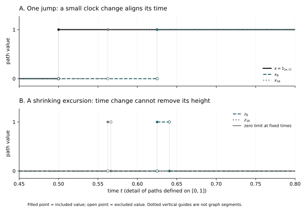

# Chapter 24: How Does an Entire Random Path Converge?—Portmanteau, Prokhorov and Path-Space Topologies

A spike of height one moves toward zero while becoming narrower. At any time chosen in advance it eventually disappears, and observing finitely many fixed times together gives the same result. Yet the whole curve never approaches the zero curve: searching along time always finds height one. The last example in Chapter 23 left more than a small computational gap. It exposed a difference between two ways of observing.

If random walks are eventually to become Brownian motion, getting every collection of photographs right is not enough. We must prevent curves from hiding such peaks between photographs. We need to know which observations of whole paths should be stable, which sets of curves can hold most of the probability, and how common restrictions ensure that a path limit actually exists.

## 24.1 What finite-dimensional readings leave out

Continue to use uniform distance on C([0,1]) and take the deterministic curves f_n from Chapter 23. Viewed as random elements, their laws are the point masses δ_fₙ. Every fixed finite-dimensional law approaches the corresponding law of the zero process, but a bounded continuous whole-path reading F refuses to converge:

\[
f_n(t)=\max\{1-n^2|t-1/n|,0\},\qquad F(f)=\min\{1,\|f\|_\infty\},\qquad F(f_n)=1,\quad F(0)=0.
\]

F is not an artificial pathological function chosen to embarrass finite-dimensional laws. It asks whether the record ever departs from zero by a given scale, a natural question about motion. Failure of finite-dimensional observations reveals missing common control over motion in the gaps between times.

Even the bound that all curves stay below one does not repair the problem. In an infinite-dimensional function space, a bounded set need not admit finitely many approximations at every accuracy. The spikes along n=2ᵏ eventually have disjoint supports and mutual uniform distance one. They have no uniformly Cauchy subsequence. Probability has not escaped toward larger heights, but has escaped sets of paths admitting common approximation.

## 24.2 Which observations weak convergence preserves

In a metric space S, write μ_n and μ for the laws of random elements. The idea from Chapter 7 still applies: the mean reading of every bounded continuous observation f should converge. Continuity depends on the chosen topology, so before defining weak convergence we must specify what closeness of outcomes means.

\[
\mu_n\Rightarrow\mu\quad\Longleftrightarrow\quad
 \int_S f\,d\mu_n\longrightarrow\int_S f\,d\mu
 \quad\text{for every }f\in C_b(S).
\]

Why not require convergence of every bounded measurable reading? The laws δ_1/n and δ₀ on the line give the boundary: the positions approach each other, but probabilities of {0} remain zero and one. Requiring stability of every measurable indicator would exclude even this elementary small positional error. Testing only a few coordinates, however, misses spikes. All bounded continuous functions place the requirement on the topology without demanding uncontrolled higher moments.

For the general measure results in this chapter, take S to be a nonempty Polish space: its topology admits a complete metric and it has a countable dense subset. Fix such a metric d, replacing it by min(1,d) if useful. The spaces C([0,T]) and C_loc of Chapter 23 satisfy these conditions. Separability supplies countable records; completeness ensures that increasingly accurate compatible records find their limit inside the space. The two conditions will play distinct roles in the construction.

## 24.3 How continuous readings approach sharp events

Weak convergence does not promise convergence of every event probability, but it is not silent about events. For closed F, points close to F allow its indicator to be approximated from outside. Put h_m(x)=max(1−m d(x,F),0). These bounded continuous functions decrease to 1_F; the empty-set case is immediate. Thus:

\[
\limsup_{n\to\infty}\mu_n(F)\le\int h_m\,d\mu
 \ \downarrow\ \mu(F),\qquad
 \liminf_{n\to\infty}\mu_n(G)\ge\mu(G)\quad(G\text{ open}).
\]

The second inequality follows by complements. Mass can enter the boundary of a closed set in the limit, explaining the directions of the inequalities. If a Borel set A has μ(∂A)=0, its interior and closure have the same μ-mass, and squeezing gives μ_n(A)→μ(A). It is the limiting measure’s boundary mass that matters, not whether each μ_n assigns zero to the boundary.

Conversely, the lower bound on every open set recovers all continuous readings. For continuous 0≤f≤1, the sets {f>t} are open. Nonnegative Fubini and Fatou give the following inequality; applying it to 1−f gives the reverse upper bound. Rescaling handles any bounded continuous function.

\[
\liminf_n\int f\,d\mu_n
 =\liminf_n\int_0^1\mu_n(f>t)\,dt
 \ge\int_0^1\mu(f>t)\,dt=\int f\,d\mu.
\]

Convergence of probabilities for all Borel sets with μ-null boundary is also sufficient. For continuous f, the boundary of {f>t} lies in {f=t}, and only countably many levels can have positive μ-mass. Layer probabilities therefore converge for almost every t, and bounded convergence recovers the integral. This proves four equivalent Portmanteau formulations: bounded continuous tests, closed-set upper bounds, open-set lower bounds, and convergence on limiting continuity sets.

The argument gives a little more. If bounded Borel f is discontinuous only within a μ-null Borel set, the boundary of {f>t} lies in that null set together with {f=t}. Limits can still be taken level by level for almost every t, proving convergence of these integrals as well. This version will handle operations unstable only on exceptional paths.

## 24.4 Where continuity matters when transforming outcomes

Let T:S→E be a Borel map into another metric space. If T is continuous at μ-almost every point, then for every g∈C_b(E), g∘T is bounded measurable and continuous on the same full-probability set. The preceding extension proves the continuous mapping theorem:

\[
\mu_n\Rightarrow\mu,\quad \mu(D_T)=0
 \quad\Longrightarrow\quad \mu_n\circ T^{-1}\Rightarrow\mu\circ T^{-1}.
\]

A Borel null set containing all discontinuity points may be used for D_T. The qualification cannot be omitted. The map T(x)=1_{x=0} sends the approaching positions 1/n to zero but sends their limit to one. Conversely, if a limiting law assigns no mass to a threshold a, the corresponding threshold event can pass correctly to the limit despite its discontinuous indicator.

We shall also need stability when comparing step records with interpolated ones. If X_n and Y_n are paired on common spaces, X_n⇒μ and d(X_n,Y_n)→0 in probability, then Y_n⇒μ. For closed F and ε>0, {Y_n∈F} is contained in {X_n∈F^ε} together with {d(X_n,Y_n)>ε}, where F^ε={x:d(x,F)≤ε} is closed. Take the upper limit in n, then decrease ε to zero. Closedness of F and continuity from above of the measure give the Portmanteau bound.

This does not require X_n and a limiting X to inhabit the same probability space in advance. The paired distance compares two records at each n; the limit remains a distributional limit. Different levels of joint realization should not be conflated.

## 24.5 Individual tightness is not a common home

Chapter 8 established tightness of an individual Borel probability on a Polish space. Finite approximations explain it as well: at each scale, countably many small balls cover the space, so a finite initial segment holds most of that measure’s mass. Make omitted probabilities summable and intersect the finite unions of closed balls across scales. The result has high probability and is closed and totally bounded; completeness makes it compact. Closed balls themselves have not been assumed compact.

The metric fact is concrete: total boundedness means finitely many balls suffice at every positive accuracy. Successively selecting subsequences from those covers gives a Cauchy subsequence; if the set is closed and the ambient space complete, its limit stays in the set. Conversely, compactness supplies finite covers at every accuracy. This is what is missing between boundedness and compactness in infinite-dimensional spaces.

Finding a limit of a sequence of laws requires the same compact set to hold most of every law. A family 𝓜 is uniformly tight when:

\[
\forall\eta>0\ \exists K_\eta\subset S\text{ compact},
 \qquad\inf_{\nu\in\mathcal M}\nu(K_\eta)\ge1-\eta.
\]

Each member of the family δ_n is tight, but the family escapes to infinity. The family δ_fₙ is subtler: all heights have a common bound, yet no compact set contains every spike. For point masses, η<1 forces every f_n into K_η. The earlier counterexample therefore lacks common tightness, not merely a successful weak-convergence test.

Tightness differs from uniform integrability. It controls the probability of bad regions, not their contributions weighted by numerical size. The random-variable spikes of height n and width 1/n in Chapter 7 have uniformly tight real laws but are not uniformly integrable. The present question is how to keep probability within jointly approximable sets in the chosen outcome space.

## 24.6 Making room to construct an actual limit

How does uniform tightness produce a limiting probability? Taking limits of set probabilities separately is insufficient: countable additivity may be lost in infinite sums. We need compatible finite approximations across accuracies and control preventing mass from escaping to later and later cells within a level.

Fix countably many dense centers. At level k, cover S by open balls around these centers, with radii between 2⁻ᵏ⁻³ and 2⁻ᵏ⁻². Subtract what earlier balls have already covered to obtain a countable disjoint partition. Refine jointly with the previous levels and delete empty cells, obtaining 𝒫_k. Every cell A has diameter at most 2⁻ᵏ, and each level-k+1 cell has a unique parent.

The partition has a crucial additional property: any compact K meets only finitely many cells at a fixed level. At each original level, a finite initial segment of balls covers K, leaving only finitely many possible ball addresses on K. Refining finitely many levels gives finitely many combinations of addresses. An arbitrary countable small-diameter partition need not have this property.

We can additionally make cell boundaries null for a given measure μ. Spheres of distinct radii about a fixed center are disjoint, so at most countably many radii carry positive μ-mass. Avoid those radii when choosing each ball within the stated range. Each cell is formed by finitely many intersections and differences of balls; its boundary lies in a finite union of null spheres.

## 24.7 Prokhorov: how tightness preserves the limiting mass

We now prove that any uniformly tight sequence of probabilities on a Polish space has a weakly convergent subsequence. Diagonal extraction over all cells at all levels makes μ_nⱼ(A) converge to p(A). These numbers are nonnegative, but before treating them as probabilities we must prove that every level still has total mass one and every parent retains the sum of its children’s masses.

For η>0 choose a common compact K leaving at most η mass outside. At a fixed level, a finite family F of cells covers K, so Σ_F p(A)≥1−η; the limiting total of any finite set of cells is at most one. Let η decrease to zero to obtain total mass one. For a parent, take finitely many next-level cells covering K and keep only its children. The parent mass under μ_nⱼ minus these child masses lies between zero and η. Pass to the subsequence limit and then decrease η to zero, giving genuine countable consistency:

\[
\sum_{A\in\mathcal P_k}p(A)=1,\qquad
 p(A)=\sum_{\substack{B\in\mathcal P_{k+1}\\B\subset A}}p(B).
\]

Construct an outcome rather than merely name one. Recursively divide (0,1) by the parent and child masses: the root has length one, children are arranged in a fixed countable order and have lengths equal to their masses. A uniform U, excluding all countably many endpoints, selects nested cells. Fix a representative in each nonempty cell and call the selected representative Z_k. All later representatives lie in the same level-k cell, within distance 2⁻ᵏ, so they form a Cauchy sequence. Completeness gives a limit Y inside S.

Each Z_k is measurable because it selects from countably many intervals; use one fixed point on the exceptional endpoints. For closed F, d(Y,F)=lim d(Z_k,F), proving measurability of Y. Notice that Y is guaranteed only to belong to closures of selected cells. We cannot simply assert P(Y∈A)=p(A): boundary membership can change. Identifying the limit through continuous readings avoids that risk.

Let Q_k(x) be the representative of the cell containing x. At fixed k, pointwise convergence of cell masses, with total mass one on both sides, implies ℓ¹ convergence. Choose a finite collection leaving a small p-tail; pass to the limit on that collection, which also makes the μ_nⱼ-tail small. Hence for bounded f the readings at a fixed quantization level satisfy:

\[
\int f(Q_k(x))\,\mu_{n_j}(dx)
 =\sum_{A\in\mathcal P_k}f(a_A)\mu_{n_j}(A)
 \longrightarrow\sum_{A\in\mathcal P_k}f(a_A)p(A)=\mathbb E f(Z_k).
\]

For bounded continuous f, quantization errors vanish uniformly near a common compact K. Precisely, the supremum of |f(x)−f(y)| over x∈K and d(x,y)≤δ tends to zero with δ. A finite collection of continuity neighborhoods covering K proves this without global uniform continuity. Outside K the error is at most 2‖f‖∞η. Fix k and let j tend to infinity, then let k grow, using Z_k→Y and bounded convergence, and finally decrease η to zero. We obtain μ_nⱼf→Ef(Y). The law of Y is the constructed weak limit.

## 24.8 Why the possibility of limits forces tightness

Common tightness has produced subsequential limits. The converse also holds: if every sequence from a family 𝓜 has a weakly convergent subsequence, the family is uniformly tight. This connects absence of escape with the ability always to find a limit.

Fix r,η>0, and let G_m be the union of the first m radius-r balls centered at dense points. If no G_m captures more than 1−η of every law, choose ν_m∈𝓜 with ν_m(G_m)≤1−η. Extract ν_mⱼ⇒ν. Since the G_m increase to S, some M has ν(G_M)>1−η/2. For m_j≥M, however, ν_mⱼ(G_M)≤1−η, contradicting the open-set Portmanteau bound.

Each scale therefore has a common high-probability finite ball cover. Choose such covers for r_k↓0 and η_k=ε2⁻ᵏ, put F_k equal to the corresponding finite union of closed balls and K=∩_kF_k. This set is closed and totally bounded, hence compact by completeness. The union bound gives ν(K)≥1−Ση_k≥1−ε simultaneously for all ν in the family. This proves both directions of Prokhorov’s theorem: uniform tightness is equivalent to every sequence admitting a weakly convergent subsequence whose limit remains a probability on S.

Calling this relative compactness in the weak topology additionally calls for a metric description of that topology, rather than an unstated assumption about sequences. With d≤1, define the bounded Lipschitz distance:

\[
b(\nu,\mu)=\sup_{\substack{\|f\|_\infty\le1\\ \operatorname{Lip}_d(f)\le1}}
 \left|\int f\,d\nu-\int f\,d\mu\right|.
\]

The triangle inequality is immediate. If b=0, scale the closed-set distance ramps into the testing class; the same approximation used in Portmanteau identifies the measures. If b(μ_n,μ)→0, pass to the limit for each fixed ramp and then sharpen the ramp, obtaining weak convergence.

Conversely, a weakly convergent sequence together with its limit is uniformly tight: any sequence from this family has either a constant subsequence or a subsequence whose original indices tend to infinity, so the converse just proved applies. On a common compact K, the unit Lipschitz class has a finite uniform approximation: choose a finite δ-net and divide the function values in [-1,1] at the net points into finitely many bins. Functions in the same bins differ by at most 3δ on K. Select one actual function per nonempty bin class. Convergence of finitely many representative integrals, together with the tail bound outside K, makes the entire supremum tend to zero.

There is no topological gap either. Fix μ and choose a high-probability compact K and its δ-neighborhood U. The same finite function net works on U with at most another 2δ error. Add a continuous cutoff h equal to one on K and zero outside U. Closeness of another law’s integrals for h and the finite representatives ensures both high ν(U) and small b(ν,μ). Thus each b-ball contains a weak neighborhood. Conversely, each C_b integral is continuous in the b-metric by the established sequential result, since sequential continuity is continuity in a metric space. The two topologies coincide, and the sequential conclusion is genuinely relative weak compactness.

## 24.9 Can distributional limits be rearranged into pointwise approach?

Weak convergence has not made outcomes for different n close to one another; it compares average readings. The partitions of §24.6 suggest another possibility: when probabilities of finite-accuracy cells approach each other, can one random number choose the same cell for all laws eventually? This would extend the quantile idea of Chapter 7 to a Polish space without a linear order.

Precisely, if μ_n⇒μ, one can construct Y_n∼μ_n and Y∼μ on a common probability space so that d(Y_n,Y)→0 almost surely. This is the Polish Skorokhod representation theorem. Representation here changes the joint realization; it is not the different theory embedding distributions at Brownian stopping times.

Choose the refining partitions of §24.6 with μ-null boundaries for every cell. Portmanteau gives μ_n(A)→μ(A) for each cell. Partition (0,1) separately for μ and every μ_n using the same cell tree and child order, and use the same U for all of them. Each partition conserves its own masses, and the successive representatives are Cauchy, yielding Y and Y_n.

Check marginal laws first, without assuming that a limit stays inside its cell. For any given ν, the representative at level k has law Σ_Aν(A)δ_aA, while Q_k(x)→x for x sampled under ν. Bounded convergence for bounded continuous f on both sides shows that the coded limit has law ν. Uniqueness from continuous readings gives exactly the required marginals for Y_n and Y.

Now fix the same U. The left endpoint for a finite address is its parent’s left endpoint plus the masses of finitely many preceding siblings; the right endpoint adds its own cell mass. Induction along a finite address makes both μ_n endpoints converge to their μ counterparts. A vague lexicographic order with infinitely many predecessors at a whole level cannot be substituted for these finite sums.

Exclude the countably many endpoints from the μ coding and all μ_n codings. At every fixed finite level, U is inside its μ interval. Thus eventually both codings select the same level-k cell. Although Y_n and Y may lie on boundaries, both belong to that cell’s closure, giving:

\[
\forall k\ \exists N_k(U)\ \forall n\ge N_k(U):
 \qquad d(Y_n,Y)\le2^{-k}.
\]

First fix k and let n grow, then increase k. This proves almost sure convergence of the whole sequence, not just another subsequence. Original variables need not behave this way: independent Bernoulli variables with identical laws converge in distribution but change infinitely often almost surely; a new representation can make them all one Bernoulli variable. The marginal laws are retained, not the original dependence across n.

This also completes the real quantile argument precisely. Let F_n,F be distribution functions and Q_n,Q their left quantiles. Take only continuity points u∈(0,1) of Q; at most countably many points are excluded. Given ε>0, choose a continuity point x₋ of F in (Q(u)−ε,Q(u)); then F(x₋)<u. Continuity of Q at u supplies v>u with Q(v)<Q(u)+ε/2. Choose a continuity point x₊ of F in (Q(v),Q(u)+ε), so F(x₊)≥v>u. Convergence of F_n at those two points eventually gives x₋≤Q_n(u)≤x₊, hence Q_n(u)→Q(u). A uniform U avoids the exceptional quantile discontinuities and yields the almost sure representation needed in Chapter 7. Convergence has not been asserted at every u.

## 24.10 Which continuous curves admit common approximation

The general theorem explains why tightness produces limits, but not yet how to check it for curves. Write w(f,δ) for a continuous function’s oscillation at time scale δ. A collection admitting uniformly convergent subsequences must neither escape at its starting point nor retain uncontrolled oscillations at finer common time scales:

\[
w(f,\delta)=\sup_{\substack{s,t\in[0,T]\\|s-t|\le\delta}}|f(t)-f(s)|,\qquad
 \sup_{f\in A}|f(0)|<\infty,\quad
 \lim_{\delta\downarrow0}\sup_{f\in A}w(f,\delta)=0.
\]

These conditions characterize relative compactness of A in C([0,T]). For sufficiency, extract subsequences successively at countably many dense times. The initial bound and common oscillation control, using a finite time partition, bound every coordinate uniformly. A diagonal subsequence converges at dense times. Given ε>0, choose a time mesh with common oscillation below ε, then use convergence at finitely many nearby dense points to control the entire curve. The subsequence is uniformly Cauchy, and completeness of C gives a continuous limit.

Necessity reveals the same mechanism. A compact closure admits a finite cover by small uniform balls. Their centers are continuous, so choose one δ making all center oscillations small. Oscillation inside a ball is at most that of its center plus twice the radius. Decreasing the radius gives common continuity, and the initial bound follows from boundedness of continuous evaluation on a compact set. This proves the Arzelà–Ascoli criterion needed here.

For C([0,T])-valued random elements X_n, the deterministic conditions become two probabilistic conditions, necessary and sufficient for uniform tightness of their laws:

\[
\lim_{M\to\infty}\sup_nP(|X_n(0)|>M)=0,\qquad
 \forall\varepsilon>0:\ \lim_{\delta\downarrow0}\sup_nP(w(X_n,\delta)>\varepsilon)=0.
\]

For sufficiency, fix a total error η, control the initial value, and choose ε_k↓0 and δ_k↓0 so that failure of the kth oscillation bound has probability at most η2⁻ᵏ⁻¹. The functions satisfying all restrictions have compact closure by the deterministic criterion, and the union bound gives probability at least 1−η uniformly. Necessity applies the deterministic criterion on a common high-probability compact set. The function w is Borel because its change is bounded by 2‖f−g‖∞ in uniform distance.

Estimates with limsup_n in place of sup_n also suffice. Each fixed continuous random path has w(X_n,δ)↓0; bounded convergence controls finitely many initial indices separately. Combine this with the bound for sufficiently late indices to recover the full-family condition. Harmless finite prefixes do not justify ignoring spikes continually created as n changes.

## 24.11 One moment estimate controlling a whole family

The grid proof of Chapter 23 now has another use. When its moment bound uses the same constants for every n, it does more than supply separate continuous modifications: it excludes increasingly narrow spikes across the family. For simplicity take T=1, suppose X_n are already C-valued random elements, and assume common α,β,C>0 with:

\[
\mathbb E|X_n(t)-X_n(s)|^\alpha\le C|t-s|^{1+\beta}\qquad(n\ge1,\ s,t\in[0,1]).
\]

Choose 0<γ<β/α, and let H_n be the supremum of all adjacent dyadic increments multiplied by 2ᵏᵞ at level k. Markov’s inequality and a union bound over levels give the following uniform tail bound. We sum over all levels directly, rather than mistake a separate Borel–Cantelli conclusion for each n for a uniform one.

\[
\sup_nP(H_n>A)\le C A^{-\alpha}
 \sum_{k\ge0}2^{-k(\beta-\alpha\gamma)}.
\]

Because paths are continuous, the same chaining argument extends grid estimates back to the original paths, giving w(X_n,δ)≤c_γH_nδᵞ. Probabilities of bad oscillations therefore vanish uniformly with δ. Add uniform tightness of the initial laws X_n(0) to obtain uniform tightness of the C-valued laws. A linear time rescaling handles any finite T.

Neither condition may be replaced silently. Each f_n is individually continuous, but lacks common oscillation control over the family. The processes X_n(t)=n have identically zero increments but non-tight starting points. Existence of one continuous path and control of a sequence of continuous paths genuinely require different orders of quantifiers.

## 24.12 Finite-dimensional laws can now identify a path limit

Let X_n and X be C([0,T])-valued random elements. If the laws of X_n are uniformly tight and all finite-dimensional laws on a countable dense time set containing the endpoints converge to those of X, then X_n⇒X in C([0,T]). Finite-dimensional readings now suffice because tightness has supplied common path control.

Separate finding a limit from finding the correct limit. From any subsequence, Prokhorov gives a weakly convergent further subsequence with limit ν. Finite evaluation maps on continuous paths are continuous, so ν and Law(X) have identical finite-dimensional laws at the dense times. Borel generation and pi–lambda uniqueness from Chapter 23 give ν=Law(X). If the full sequence failed for a C_b reading, choose a subsequence staying away from the correct value. Its further subsequence has just been shown to have the correct limit, a contradiction.

In C_loc, tightness is equivalent to tightness of the restricted laws on every integer interval [0,M]. One direction follows from continuous restriction. Conversely choose a compact K_M for each M with omitted probability at most η2⁻ᴹ. The global functions satisfying all restrictions form a closed set, compact in local uniform distance by a diagonal subsequence and compatible limits on the intervals. The same identification argument then applies on the whole half-line.

This leaves a precise task for future random-walk limits: identify finite-dimensional laws and prove common starting-value and oscillation estimates. We have not asserted that a particular random walk already satisfies these conditions. We have established the path-space tools that can make such an argument valid.

## 24.13 A slightly late jump can stay distance one away

Common oscillation control for continuous motion cannot be imposed unchanged on every process. The arrivals and jump chains of Chapters 21–22 have genuine jumps. A small delay in a jump should often count as a small change of record, yet uniform distance sees the full jump height between the two jump times.

Take 0<a<1 and, for sufficiently large n, let x_n=1_[a+1/n,1] and x=1_[a,1]. Their uniform distance is always one. An increasing continuous clock mapping a to a+1/n while fixing zero and one aligns the steps exactly. Values have not been changed; a small timing error has been allowed.

<figure class="publication-math-figure" id="visual-jump-alignment"><figcaption>Figure 24.1. A small timing error can align one jump but cannot delete an excursion. Here a=1/2, showing n=8,16 and the limit. Decreasing area below does not mean J₁ proximity to zero: every time homeomorphism must still pass through height one. Open and filled endpoints distinguish values before and after jumps. Deterministic illustration, not simulation. <a href="../assets/visuals/path-topologies/jump-alignment.pdf">Vector PDF</a>.</figcaption></figure>

The natural outcome space is D=D([0,1]), the real-valued functions that are right-continuous and have left limits. Right-continuity records the state at an event time after the event, while left limits give meaning to the state just before it. Every such path is bounded and admits uniform approximation by finite step functions. That finite-description property will be essential in compactness proofs, rather than merely a notation convention.

Let Λ consist of increasing continuous time homeomorphisms fixing both endpoints. J₁ convergence means that there are λ_n∈Λ for which both clock error and aligned value error vanish:

\[
\|\lambda_n-\mathrm{id}\|_\infty\longrightarrow0,\qquad
 \|x_n\circ\lambda_n-x\|_\infty\longrightarrow0.
\]

For the single jump, interpolate λ_n linearly between zero, a and one with λ_n(a)=a+1/n, verifying convergence. Conversely, for z_n=1_[a+1/n,a+1/n+1/n²), every fixed finite collection of coordinates tends to zero. But every time homeomorphism is onto, so ‖z_n∘λ‖∞ remains one. Two opposite jumps squeezing together do not become nothing in J₁.

## 24.14 Compactness in J₁ still comes from finite descriptions

Uniform clock error gives a metric for J₁, but not a complete one. The functions 1_[1/n,1] are Cauchy for that metric, yet cannot converge to a D-path: the value at zero would be zero and values at positive continuity times would be one, violating right-continuity. The Polish conclusion requires a genuinely complete equivalent metric.

Instead control logarithms of the clock’s interval-length ratios. In the following display restrict to clocks with finite log norm, denoted Λ₀. This prevents excessive compression while producing the same J₁ topology:

\[
\|\lambda\|_{\log}=\sup_{0\le s<t\le1}
 \left|\log\frac{\lambda(t)-\lambda(s)}{t-s}\right|,\qquad
 d_0(x,y)=1\wedge\inf_{\lambda\in\Lambda_0}
 \bigl(\|\lambda\|_{\log}\vee\|x-y\circ\lambda\|_\infty\bigr).
\]

The full proof is in [T-J1: clocks, measurability and compactness](../foundations/t-j1.md#t-j1-polish). First choose a finite small-oscillation partition of a càdlàg path and replace an ordinary aligning clock by a polygonal one through the partition endpoints, with slopes tending to one. Then accumulate clocks along a Cauchy subsequence with summable errors. Aligned paths converge uniformly and the limiting clock remains bi-Lipschitz. This proves both equivalent topology and completeness. Finite steps with rational times and values give separability.

Jump paths cannot satisfy C’s common continuity modulus. Instead require that, after using genuine jumps as dividing points, each intervening piece has small oscillation at the required accuracy, and distinct boundaries do not squeeze together indefinitely. The precise quantity w′ allows a different partition for each path:

\[
w'_\delta(x)=
 \inf_{\substack{0=t_0<\cdots<t_m=1\\ \min_i(t_i-t_{i-1})>\delta}}
 \max_i\ \sup_{s,t\in[t_{i-1},t_i)}|x(t)-x(s)|.
\]

Cells exclude their right endpoints, including one for the last cell; the uniform norm controls x(1) separately. Thus a jump exactly at the endpoint is legitimate, without silently merging unfinished jumps approaching it. The exact criterion for A⊂D is uniform boundedness of ‖x‖∞ together with sup_Aw′_δ→0, equivalent to relative compactness.

Sufficiency has a concrete finite-description mechanism: replace each path on a good partition by a step function with small error. A minimum spacing δ bounds the number of levels, separates jump times and, together with bounded heights, gives a compact parameter family. The original family then has finite covers at every accuracy, and completeness gives compact closure. Necessity transports finite partitions through small clocks and uses a finite cover of the compact set. The [companion proof](../foundations/t-j1.md#t-j1-compact) supplies the details and proves that w′_δ is Borel.

Consequently, laws on D are uniformly tight exactly when their norms do not escape and, for each ε>0, lim_δ↓0 sup_n P(w′_δ(X_n)>ε)=0. As for C, summable bad-event probabilities and the deterministic criterion prove this; the sets satisfying w′ bounds need not themselves be closed, since their compact closure suffices. The narrow pulses have w′_δ≥1 once their widths are below δ and are correctly excluded.

## 24.15 Topology also changes which readings are stable

The Borel sigma-algebra of D is still generated by coordinate evaluations, and by any countable dense time set containing one. This is not because evaluations are everywhere continuous: an interior e_t is continuous at paths continuous at t, while e₀ and e₁ are always continuous. Right-side short averages prove Borel measurability of evaluations; dyadic sampled steps P_kx→x in J₁ prove the reverse generation. See [T-J1’s measurable structure](../foundations/t-j1.md#t-j1-borel) for the full argument.

The moving single jump makes the distinction unavoidable: the D-valued point masses x_n⇒x converge, but at t=a, x_n(a)=0 while x(a)=1, so that marginal does not converge. Weak convergence has not failed; the continuous mapping theorem has been used at a discontinuous evaluation.

For a given D-valued candidate limit X, let T_X contain zero, one and all interior times with P(X is continuous at t)=1. If X_n is tight in D and its finite-dimensional laws on T_X converge to those of X, then X_n⇒X. Every D-valued probability has at most countably many fixed times carrying positive jump probability; [T-J1](../foundations/t-j1.md#t-j1-fixed-times) proves this. For any subsequential weak limit ν, choose a countable dense set in the complement of the bad times of both ν and X, and add the endpoints. Continuous mapping identifies those finite-dimensional laws, coordinate Borel uniqueness identifies ν, and the bad-subsequence argument recovers the full sequence.

One cannot merely remove bad times from the rationals and declare the remainder dense: a càdlàg law may have a fixed small jump at every rational time. The correct step is to choose dense times anew in the complement of the countable bad set. If convergence is known at every finite collection of times, it of course includes T_X.

When the J₁ limit path is continuous, matters simplify. Uniform error is bounded by aligning error plus the limiting path’s continuity modulus, so J₁ convergence is equivalent to uniform convergence. Continuous functions also form a J₁-closed set, since uniformly convergent aligned continuous functions have a continuous limit. The topologies meet at continuous limits but preserve different information at jumps.

## 24.16 Detecting rapid excursions through stopping times

Because w′ allows path-dependent jump boundaries, directly finding good partitions may be difficult. Stopping times from Chapter 16 suggest another observation: wait until the path has just departed by a given scale, then check whether another departure follows immediately. A partition can then be generated by the path rather than guessed in advance.

We establish an explicit sufficient Aldous-type version. Let X_n be real càdlàg processes adapted to right-continuous filtrations and assume compact containment of their uniform norms. For all bounded stopping times S,U of the same filtration, use the following short stopping-pair condition. It is stronger than versions testing certain deterministic delays; we do not interchange versions without proof.

\[
a_n(\delta,\varepsilon)=
 \sup_{\substack{S\le U\le(S+\delta)\wedge1\\S,U\text{ stopping times}}}
 P(|X_n(U)-X_n(S)|>\varepsilon),\qquad
 \lim_{\delta\downarrow0}\limsup_n a_n(\delta,\varepsilon)=0
 \quad(\varepsilon>0).
\]

The conclusion is uniform tightness of the D-valued laws. The mechanism does not forbid jumps in every short interval; it prevents too many significant changes from squeezing into too little time. At exit scale ε, put τ₀=0 and let τ_k₊₁ be the first departure by more than ε from X_n(τ_k), capped at one. Let N_ε count genuine exits before one. It is finite for each càdlàg path. If N_ε≥K, at least half the first K waiting gaps are at most 2/K, so the stopping-pair condition gives:

\[
P(N_\varepsilon\ge K)\le2a_n(2/K,\varepsilon/2).
\]

First bound the number of exits, then the probability that any of finitely many exit gaps is too short. Separately control oscillation in the last 2δ before the endpoint. Retaining exits before 1−δ and appending one produces a partition with gaps greater than δ and oscillation at most 4ε per cell. The w′ criterion completes tightness. The [full proof in T-J1](../foundations/t-j1.md#t-j1-aldous) also independently establishes the adaptedness of stopped continuous-time processes and validity of open exits used here. It invokes no future optional sampling, debut theorem or continuous-martingale regularization.

This is sufficient, not a necessary description of every tight family. The point mass at a deterministic path with one fixed jump is tight, yet deterministic stopping times immediately before and after its known jump give increments of one even as their gap vanishes. It fails the condition here. Different tests suit different models; a convenient test is not the definition of tightness.

## 24.17 Growing observation windows require endpoint care

Finite-interval proofs rescale linearly to every [0,T]. On the half-line, however, ordinary local J₁ cannot copy C_loc by mechanically requiring convergence at every integer restriction.

For example, move a jump from 1+1/n to one. On a window extending beyond one, small time changes align the paths. But restricting exactly at one leaves endpoint value zero for the approximations and one for the limit, and finite-interval J₁ fixes endpoints rather than hiding this discrepancy outside the window. The correct local description tests restrictions at endpoints where the limiting path is continuous. Specifying observation windows and endpoint conventions is part of the topology.

[T-J1’s half-line construction](../foundations/t-j1.md#t-j1-local) integrates bounded complete distances over a continuum of window lengths and actually proves local J₁ completeness, separability and coordinate Borel structure. Gluing window limits requires agreement first on common interiors, then at continuous endpoints. Other jump topologies such as M₁ are outside this scope. For continuous Brownian limits, C_loc remains the most direct home; merging jumps requires a fresh decision about which path information a limit should preserve.

## 24.18 Preserving the motion between the photographs

The narrowing spike deceived no observation at a fixed time. The mistake was to treat separately correct observations as common control over the whole motion. Tightness adds no further finite-dimensional probability formula. It constrains most paths to admit finite descriptions at the same accuracy.

For continuous paths this common description takes the form of starting values and oscillations. For jump paths it must also distinguish time alignment, neighboring jumps and window endpoints. Continuous observations express weak convergence; Portmanteau explains the effects of event boundaries; Prokhorov turns common control into an existing limit; finite-dimensional laws identify which limit has been found. Separating these roles prevents “the distributions approach” from promising more than it says.

Brownian motion acquired a continuous home in Chapter 23. We now know the threshold discrete records must cross to reach it: not only must the Gaussian snapshots be right, but oscillations between observations must obey uniform control. Whether random walks achieve this, and why a finite second moment suffices, is finally a question ready for a complete proof rather than a guess from a scaling picture.

## 24.19 References and proof scope

Prokhorov’s [Convergence of Random Processes and Limit Theorems in Probability Theory](https://www.mathnet.ru/eng/tvp4997) appeared in 1956; its English translation is in Theory of Probability and Its Applications 1, 157–214. Skorokhod’s [Limit Theorems for Stochastic Processes](https://www.mathnet.ru/eng/tvp5003) appeared the same year, translated in the same volume at 261–290. These original publication details were checked. The partition coding and proof organization here are modern reconstructions, not claimed reproductions of the original arguments.

Aldous’s Stopping Times and Tightness appeared in Annals of Probability 6 (1978), 335–340, verified through the [institutional bibliography](https://www.stat.berkeley.edu/users/pitman/aldbib/bydate.html). We prove the explicitly stated strong stopping-pair sufficient version, not equivalence of all weaker forms. For J₁ topology and endpoint qualifications compare Julian Kern’s [open article](https://link.springer.com/article/10.1007/s00591-023-00353-2). That article expressly supplies no proofs; the proofs needed here are supplied in the completed T-J1 companion.
