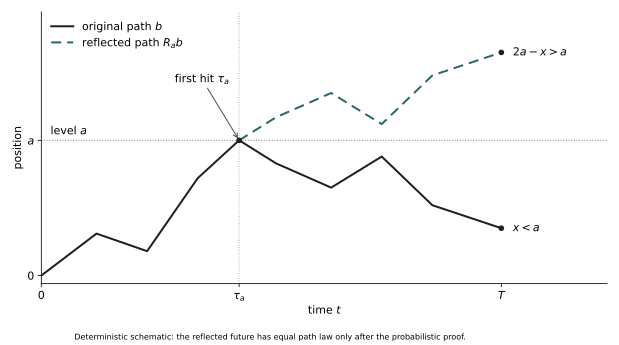

# Chapter 26: Why Is a Continuous Path So Rough?

Magnifying the polygon of a random walk does not remove its corners: finer scales keep revealing new ones. Chapter 25 proved convergence of path laws to Brownian motion, not convergence of microscopic slopes. The continuous limit now exists. We can ask whether the curve ever becomes smooth.

There is also a more direct observation. After the particle first touches a horizontal line, does its motion really start afresh? First contact and last contact differ by a single word, yet require different mathematical arguments. Before studying a rough path, we must learn when it may legitimately be cut.

## 26.1 What Gaussian increments have not yet told us

Throughout, B is real standard Brownian motion starting at zero, with variance parameter one and continuous paths. For fixed t and h>0, \((B_{t+h}-B_t)/h\) has law \(N(0,1/h)\). These laws spread out. A finite right derivative would bound all sufficiently small difference quotients by some integer M, but for each M the probability of such an eventual bound is at most \(\liminf_{n\to\infty}P\!\left(\left|\frac{B_{t+1/n}-B_t}{1/n}\right|\le M\right)=0\). Thus a finite right derivative at this fixed t has probability zero.

That does not yet say “nowhere differentiable.” A null exceptional set for each deterministic t need not remain null after an uncountable union. Chapter 23 already exposed that danger. What we must exclude is a finite slope at a time selected by the path itself. This change of quantifier is a genuine proof difficulty.

Likewise, independent increments after deterministic times do not automatically justify restarting at a first hit. The hitting time is selected by the past. We must turn that selection into countable, verifiable steps.

## 26.2 What information lets us recognize an arrival

Use the natural filtration \(\mathcal F_t=\sigma(B_s:0\le s\le t)\), optionally completed by the null sets of the original probability space. No right-continuous augmentation or later general regularization theorem is presumed. A stopping time T may equal infinity and satisfies {T≤t}∈\(\mathcal F_t\) for every t. Chapter 16’s stopped σ-algebra applies unchanged:

\[
\mathcal F_T=\{A\in\mathcal F:
A\cap\{T\le t\}\in\mathcal F_t\ \text{for every }t\ge0\}.
\]

\(\mathcal F_T\) records events recognizable by T. Joint measurability of a continuous adapted process on [0,t] follows by left-mesh approximation, so \(B_{T\wedge t}\) is \(\mathcal F_t\)-measurable. For Borel C, express {\(B_T\)∈C}∩{T≤t} through T∧t and {T≤t}; \(B_T\) is thus \(\mathcal F_T\)-measurable on {T<∞}. Rational stopped-path coordinates \(B_{q\wedge T}\) are measurable too: on {T≤t}, use \(B_{q\wedge T\wedge t}\). The coordinate Borel structure of \(C_{\mathrm{loc}}\) then gives measurability of the stopped path.

This depends on the chosen filtration. Revealing B₁ at time zero destroys independence of future increments from \(\mathcal F_0\). Restarting is a property of both the process and its information structure, not merely the curve’s appearance.

## 26.3 Move the random time to the next mesh point

First suppose T is bounded and put \(T_n=2^{-n}\lceil2^nT\rceil\). This is a finite-grid stopping time, with \(T_n\downarrow T\). For A∈\(\mathcal F_T\), the event \(A\cap\{T_n=k2^{-n}\}\) belongs to \(\mathcal F_{k2^{-n}}\): for k≥1 write it as \(A\cap\{(k-1)2^{-n}<T\le k2^{-n}\}\); k=0 is immediate. Apply deterministic-time independent increments on each cell.

\[
\begin{aligned}
&E\!\left[\mathbf1_A f(B_{T_n+s_1}-B_{T_n},\ldots,
B_{T_n+s_r}-B_{T_n})\right]\\
&\quad=\sum_kP(A\cap\{T_n=k2^{-n}\})\,
E f(B_{s_1},\ldots,B_{s_r})
=P(A)E f(B_{s_1},\ldots,B_{s_r}).
\end{aligned}
\]

Start with bounded continuous f. Path continuity gives pointwise convergence and bounded domination passes through expectation, proving the identity at T. Bounded continuous tests determine finite-dimensional measures; π–λ extends to Borel cylinders. Rational evaluations generate the Borel sets of \(C_{\mathrm{loc}}\), extending the identity to the entire future path. This proves independence of a path-valued random element, not merely a calculation at a few observation points.

## 26.4 What strong Markov says when the time may be infinite

Do not assume T is almost surely finite. For A∈\(\mathcal F_T\) put \(A_m\)=A∩{T≤m}. This belongs to \(\mathcal F_{T\wedge m}\): use the definition for t<m and A∩{T≤m}∈\(\mathcal F_m\) for t≥m. Apply the bounded result to T∧m and \(A_m\), then increase m to infinity to obtain the needed local form.

\[
E\!\left[\mathbf1_A\mathbf1_{\{T<\infty\}}
H\big((B_{T+s}-B_T)_{s\ge0}\big)\right]
=P(A\cap\{T<\infty\})\,E H(B).
\]

The identity holds for every bounded Borel path functional H. Define the future arbitrarily on {T=∞}; the indicator removes that choice. If T is finite almost surely, post-T increments form standard Brownian motion independent of \(\mathcal F_T\). This proves the dedicated Brownian strong Markov property, not a statement about arbitrary Markov processes and filtrations.

## 26.5 The first contact with a level

Fix a>0 and let \(\tau_a=\inf\{t\ge0:B_t=a\}\), with infimum infinity for an empty set. Continuity gives \(\{\tau_a\le t\}\)=\(\{\max_{s\le t}B_s\ge a\}\). Taking a supremum over rational times together with endpoint t proves measurability, so τ_a is a stopping time. Continuity gives \(B_{\tau_a}\)=a when the hit is finite. We have not yet proved the hit certain; the local strong Markov statement avoids assuming the desired conclusion.

Unlike a first hit, the last zero before T requires knowing that no later return occurs and is generally not a stopping time. Confusing the two lets a plausible path picture conceal a false conditional-independence claim. The distinction will matter in the arcsine laws.

## 26.6 Reflect the future at the first hit

\[
(R_aB)_t=
\begin{cases}B_t,&t\le\tau_a,\\2a-B_t,&t>\tau_a,\end{cases}
\qquad R_aB=B\ \text{if }\tau_a=\infty.
\]

The reflected curve stays continuous, has the same first hit of a, and returns to the original curve on a second reflection. The map is measurable: split coordinates according to \(\{\tau_a\le t\}\), then use the coordinate Borel structure. Geometric invertibility alone is not enough; the issue is preservation of probability.

On \(\{\tau_a<\infty\}\), the stopped past and \(\tau_a\) are \(\mathcal F_{\tau_a}\)-measurable. Strong Markov makes \(Z_s=B_{\tau_a+s}-a\) independent of them, with Z equal in law to −Z. Expectations of products of a bounded function of the stopped past and a bounded function of the future are unchanged by this reversal. Finite sums and the monotone class theorem extend to arbitrary bounded Borel functions of the two pieces. Gluing at \(\tau_a\) proves that \(R_aB\) and B have the same entire path law. On \(\{\tau_a=\infty\}\), the map does nothing.

Figure 26.1. A first hit separates a recognizable past from an independent symmetric future. The polygon illustrates the map: endpoint x<a becomes 2a−x>a. It is not a Brownian sample or a substitute for the strong Markov and measurability proofs. Solid and dashed lines remain distinct in monochrome.

## 26.7 Laws of the maximum and first arrival

Write \(M_t=\max_{s\le t}B_s\). For x<a, reflection maps \(\{M_t\ge a,B_t\le x\}\) bijectively to \(\{B_t\ge2a-x\}\); the latter paths must cross a first. Normal endpoint laws have no atoms. Increase x to a and include the half with \(B_t\)≥a to obtain

\[
\begin{gathered}
P(M_t\ge a,B_t\le x)=P(B_t\ge2a-x)\quad(x<a),\\
P(M_t\ge a)=2(1-\Phi(a/\sqrt t)),\qquad M_t\overset d=|B_t|,\\
P(\tau_a\le t)=2(1-\Phi(a/\sqrt t)),\qquad
P(\tau_a\in dt)=\frac{a}{\sqrt{2\pi}\,t^{3/2}}e^{-a^2/(2t)}\,dt.
\end{gathered}
\]

The distribution function tends to one as t grows, proving only now that \(\tau_a\) is finite almost surely. Differentiation gives the density, with total mass guaranteed by the endpoint limits. Yet the mean waiting time is infinite: \(P(\tau_a>t)=2\Phi(a/\sqrt t)-1\sim\sqrt{2/\pi}\,a/\sqrt t\), whose tail integral diverges. A certain arrival can have infinite mean waiting.

We also obtain \(P(\sup_{s\le t}|B_s|>u)\le4e^{-u^2/(2t)}\). The factor four comes from a union bound over positive and negative maxima, not independence. A one-time Gaussian tail has become whole-segment amplitude control.

## 26.8 A certain gain is not a free profit

For a bounded stopping time S, take right-mesh approximations \(S_n\)↓S. The discrete samples \(B_{k2^{-n}}\) form a martingale; Chapter 16’s bounded discrete sampling gives \(EB_{S_n}=0\). If S≤H, all \(S_n\)≤H+1, and reflection makes \(\sup_{u\le H+1}|B_u|\) integrable. Continuity and DCT give \(EB_S=0\), without borrowing an unproved general continuous-time sampling theorem.

\[
EB_{\tau_a\wedge t}=0\quad(t<\infty),\qquad
B_{\tau_a\wedge t}\longrightarrow a\ \text{almost surely},\qquad EB_{\tau_a}=a.
\]

Were the stopped family UI, Chapter 7’s Vitali criterion would pass expectations to the limit, contradicting the display. It is not UI. Fairness is not broken at the hit: increasingly rare, deeply negative terminal paths still carry expectation and cannot be discarded. First-passage tails give concrete meaning to conditions for unbounded sampling.

## 26.9 How strong can continuity be?

Gaussian moments give \(E|B_t-B_s|^p=c_p|t-s|^{p/2}\). Chapter 23’s grid proof gives almost sure γ-Hölder continuity on finite windows for every γ<1/2. Choose p so that γ<1/2−1/p. The original continuous version agrees with that modification at rational times, hence is indistinguishable from it. Intersect over integer windows and countable γ approaching one half.

The path does not fluctuate without constraint: local displacements are bounded by a random constant times \(|t-s|^\gamma\). Can the constant stay finite at γ=1/2? A square-root variance describes a typical increment, not the largest one selected among many locations. First we prove that a finite slope occurs nowhere.

## 26.10 Trap all possible tangent points in a mesh

Fix integers H,M≥1. A finite right derivative at t∈[0,H] would imply \(|B_{t+u}-B_t|\le Mu\) for some δ>0 and all 0<u<δ. Put h=2⁻ⁿ and j=⌊t/h⌋. Once 4h<δ, the four mesh points (j+1)h,…,(j+4)h lie in this right neighborhood. Each of the three adjacent increments between them has absolute value at most 8Mh.

For fixed j the three increments are independent N(0,h). The normal density bound gives P(|N(0,h)|≤8Mh)≤CM√h, so all three are small with probability at most \(CM^3h^{3/2}\). There are at most H/h+1 candidate j. Thus

\[
P\!\left(\exists j\le H/h:\quad
\bigcap_{i=1}^{3}\{|B_{(j+i+1)h}-B_{(j+i)h}|\le8Mh\}\right)
\le C_HM^3h^{1/2}.
\]

The bound is summable along h=2⁻ⁿ. First Borel–Cantelli allows such triples at only finitely many scales. A finite right derivative would require them at every sufficiently fine scale. A countable union over H,M excludes finite right derivatives at every t≥0 on one probability-one event, hence ordinary finite derivatives too. We enclosed all candidate points in countable mesh events instead of unioning uncountably many null sets.

Why three increments? One small increment has probability of order √h but there are order 1/h locations, so that union bound fails. Three independent constraints leave \(h^{1/2}\), summable on geometric scales. This is the mechanism.

## 26.11 Infinite total variation, but a definite quadratic scale

Divide a fixed [a,b] into 2ⁿ equal cells and put \(Q_n=\sum_i(B_{t_i}-B_{t_{i-1}})^2\). Independent Gaussian increments give the following mean and variance. Chebyshev and Borel–Cantelli yield \(Q_n\to b-a\) almost surely.

\[
EQ_n=b-a,\qquad\operatorname{Var}(Q_n)=2(b-a)^2\,2^{-n},\qquad Q_n\longrightarrow b-a.
\]

Sum the absolute displacements along a finite partition, then take the supremum over all partitions: this is total variation, the total travel detectable by arbitrarily fine segmented measurements. A continuous path of finite total variation would satisfy \(Q_n\le\max_i|\Delta B_i|\sum_i|\Delta B_i|\to0\) by uniform continuity, a contradiction. Intersect over rational endpoint intervals; every nondegenerate interval contains one, proving infinite total variation on every such interval.

This proves squared-increment limits along deterministic dyadic partitions. General quadratic variation on random partitions, brackets and Itô integration remain for later chapters. This is not the whole stochastic integration theory. It already shows that failure of first-order length control does not destroy a second-order law.

## 26.12 The extra growth beyond the square root

At each fixed time \(B_t/\sqrt t\) is standard normal. Repeatedly observing one path over longer periods nevertheless finds occasional fluctuations larger than the usual scale. The correction is not another power, but a slowly growing iterated logarithm. First we prove the scalar large-time law, writing \(b(t)=\sqrt{2t\log\log t}\), \(t\ge e^e\).

Fix ε>0 and choose \(1<q<(1+\varepsilon)^2\). If \(B_t>(1+\varepsilon)b(t)\) for some t∈[qⁿ⁻¹,qⁿ], the maximum up to qⁿ exceeds (1+ε)b(qⁿ⁻¹). Reflection and Gaussian tails bound the event by \(2\exp(-c\log\log q^{n-1})\), where \(c=(1+\varepsilon)^2/q>1\). This is summable in n since \(\log\log q^{n-1}=\log((n-1)\log q)\).

Apply Borel–Cantelli and repeat for −B: eventually \(|B_t|\le(1+\varepsilon)b(t)\). A countable intersection over ε↓0 gives limsup≤1 and liminf≥−1. The maximum over a whole block matters; checking B(qⁿ) alone would not exclude crossings between observation times.

## 26.13 Why the lower bound needs separate fresh fluctuations

Now take a large integer q. Increments \(D_n\) on [qⁿ⁻¹,qⁿ] are independent with variance \(q^n(1-1/q)\). For \(0<c<\sqrt{1-1/q}\), the normal lower-tail bound \(P(Z>x)\ge c_0x^{-1}e^{-x^2/2}\) gives

\[
\begin{gathered}
D_n=B_{q^n}-B_{q^{n-1}},\\
P(D_n>c\,b(q^n))\ge
C_q(\log n)^{-1/2}n^{-c^2/(1-1/q)}
\quad\text{for all sufficiently large }n.
\end{gathered}
\]

The series diverges, so second Borel–Cantelli gives infinitely many large positive fresh increments. The upper bound controls the old position: \(|B(q^{n-1})|/b(q^n)\le(1+o(1))/\sqrt q\). Thus \(\limsup B_t/b(t)\ge c-1/\sqrt q\). Take countably many integer q increasing to infinity and, for each q, countably many c increasing to √(1−1/q); the lower bound is one. Symmetry handles the negative direction. The normal lower tail follows by integrating the density on [x,x+1/x], not from another limit theorem.

\[
\limsup_{t\to\infty}\frac{B_t}{\sqrt{2t\log\log t}}=1,\qquad
\liminf_{t\to\infty}\frac{B_t}{\sqrt{2t\log\log t}}=-1
\quad\text{almost surely}.
\]

The upper bound uses nearby scales to cover all times; the lower bound uses widely separated scales to reduce the old position. The two choices of q serve different purposes. Conflating them into a parameter varying with n loses the summability and independence arguments.

## 26.14 Turn distant times into a neighborhood of the origin

Time inversion gives a short bridge, but continuity at zero needs verification. Without LIL, Gaussian tails give \(\sum_nP(|B_n|>\varepsilon n)<\infty\) and reflection gives \(\sum_nP(\sup_{u\le1}|B_{n+u}-B_n|>\varepsilon n)<\infty\). Borel–Cantelli and countably many ε↓0 yield \(B_t/t\to0\). Set \(\widehat B_0=0\) and \(\widehat B_t=tB_{1/t}\). It is continuous everywhere, centered Gaussian in finite dimensions, with \(\operatorname{Cov}(\widehat B_s,\widehat B_t)=\min(s,t)\). Chapter 23’s uniqueness on continuous path space makes it standard Brownian. Apply its large-time LIL to obtain

\[
\limsup_{h\downarrow0}
\frac{B_h}{\sqrt{2h\log\log(1/h)}}=1,\qquad
\liminf_{h\downarrow0}
\frac{B_h}{\sqrt{2h\log\log(1/h)}}=-1
\quad\text{almost surely}.
\]

This is the LIL at the fixed origin zero. For each specified deterministic r, \(B_{r+h}-B_r\) is Brownian and obeys the same law; strong Markov also permits any specified almost surely finite stopping time. Do not union exceptional sets over all possible random times. Countably many rational r already prove failure of a one-half-Hölder bound on every nondegenerate interval, because the local iterated-logarithm factor is unbounded.

## 26.15 Search all locations for the largest short increment

A fixed origin and a search for the most violent location are different observations. For T>0 set \(w(B,\delta)=\sup_{\substack{s,t\in[0,T]\\|t-s|\le\delta}}|B_t-B_s|\). Roughly 1/δ candidate locations produce larger extremes than a fixed origin. The exact result is

\[
\lim_{\delta\downarrow0}
\frac{w(B,\delta)}{\sqrt{2\delta\log(1/\delta)}}=1
\quad\text{almost surely}.
\]

A union bound on a coarse grid misses times between mesh points. [T-LIL, Section 2](../foundations/t-lil.md#t-lil-uniform-modulus) uses a δ/m mesh, Gaussian tails for pairs at distance about δ, and reflection for both endpoint errors. Fix m large, then sum over geometric δ. The lower bound uses normal lower tails for about T/δ independent short increments; adjacent scales complete all δ.

The log(1/δ) here does not contradict the log log(1/δ) at a fixed origin. One permits a new favorable location at each scale; the other keeps the same origin. The rules for selecting observations matter as much as one increment’s law.

## 26.16 Can the iterated-logarithm law record an entire shape?

The scalar LIL sees only \(B_T\) and can miss the preceding motion. Compress [0,T] onto [0,1] with the same normalization to obtain continuous functions \(Y_T\). They cannot converge to one curve, as their positive and negative endpoint limits show. We seek all shapes they can repeatedly approach.

\[
\begin{gathered}
Y_T(u)=\frac{B_{Tu}}{\sqrt{2T\log\log T}},\quad0\le u\le1,\quad T\ge e^e,\\
K=\left\{g:g(t)=\int_0^t v(u)\,du,\quad
v\in L^2([0,1]),\quad\int_0^1|v(u)|^2\,du\le1\right\}.
\end{gathered}
\]

The Brownian functional LIL says that almost surely \(\{Y_T:T\ge e^e\}\) is relatively compact in uniform norm and its cluster set as T→∞ is exactly K. Every cluster point must lie in K, and every shape in K must actually occur. Evaluation at one maps K onto [−1,1], with endpoints realized by ±u, so the scalar law is included but genuine path information is added.

Strassen’s 1964 “An Invariance Principle for the Law of the Iterated Logarithm” appeared in Zeitschrift für Wahrscheinlichkeitstheorie und Verwandte Gebiete 3, 211–226, as verified by his publication list. We give a modern independent reconstruction for real Brownian motion, not a proof of the paper’s general invariance principle for independent sums.

## 26.17 Why quadratic energy constrains the shape

Forcing Brownian increments near prescribed Δg on a partition multiplies Gaussian densities and produces \(\sum(\Delta g)^2/\Delta u\). Refinement leaves the squared integral \(\int_0^1|v(u)|^2\,du\) of a velocity in \(g(t)=\int_0^t v(u)\,du\), rather than length. Energy comes directly from the density exponent. Bounded partition energies, a bounded linear functional on steps and L² completeness prove existence and uniqueness of this L² velocity. Absolute continuity of the integral makes g absolutely continuous; no extra singular change is possible. Energy is established directly from increments, without presuming a differentiation theorem for pointwise derivatives.

The full proof is in [T-LIL, Sections 1 and 3–7](../foundations/t-lil.md#t-lil-energy). At \(T_n=q^n\), χ² exponential moments for grid increments and reflection remainders make deviations from K summable; stability under \(g(a\,\cdot)/\sqrt a\) fills all real T. For the lower bound, target rational polygons of energy<1 in disjoint large blocks. Gaussian increment boxes give probabilities roughly \(n^{-I(g)}\), and continuous bridges control the remaining errors. Exponents below one allow second Borel–Cantelli. The old block is controlled to \(O(q^{-1/2})\) before q is increased, not discarded.

Neither Chapter 29’s Schilder theorem nor an unproved path transformation formula is invoked. Smoothness of curves in K does not contradict Brownian roughness: these are macroscopic cluster shapes after expanding the window and compressing fluctuations, not microscopic derivatives of the original curve.

## 26.18 Does symmetry leave half the time above zero?

At every deterministic s>0, P(\(B_s\)>0)=1/2, so positive occupation time \(A_T\) has mean T/2. Mistaking this for an independent coin frequency suggests \(A_T/T\) approaches one half for large T. Neighboring times share a continuous history, however: one long positive excursion occupies many neighboring observations.

\[
A_T=\int_0^T\mathbf1_{\{B_s>0\}}\,ds,\qquad
G_T=\max\{s\le T:B_s=0\},\qquad
\rho_T=\min\{s\le T:B_s=M_T\}.
\]

The other two times record the last return and earliest global maximum. For fixed deterministic T, the three fractions have the same law:

\[
\begin{gathered}
P(U\le x)=\frac2\pi\arcsin\sqrt x,\quad
f_U(x)=\frac1{\pi\sqrt{x(1-x)}}\quad(0<x<1),\\
\frac{A_T}{T}\overset d=\frac{G_T}{T}\overset d=\frac{\rho_T}{T}.
\end{gathered}
\]

The density grows near the endpoints, but zero and one have no atoms. The three times are not equal on individual paths, nor are they thereby independent. Each law needs its own path argument; proving one and labeling the others the same way establishes no additional theorem.

## 26.19 Comparing two half-normal quantities

Split at deterministic s. Given \(B_s\)=x≠0, reflection gives probability 2Φ(|x|/√(T−s))−1 of avoiding zero until T. Thus \(G_T\)≤s becomes a comparison of absolute values of two independent standard normals:

\[
P(G_T\le s)=P\!\left(\sqrt{T-s}|Z_2|\le\sqrt{s}|Z_1|\right)
=\frac2\pi\arctan\sqrt{\frac{s}{T-s}}
=\frac2\pi\arcsin\sqrt{\frac{s}{T}}.
\]

The two-dimensional Gaussian angle is uniform, so probability is the angular width of four symmetric sectors. For the maximum time, time reversal and symmetry give past drawdown \(D_s=M_s-B_s\) law \(\sqrt s\,|Z_1|\). The independent future maximum increment has law \(\sqrt{T-s}\,|Z_2|\). The event \(\rho_T\)≤s asks the latter not to exceed the former, producing the same angle.

Distinct maximizers must still be excluded. [T-ARCSINE, Section 3](../foundations/t-arcsine.md#t-arcsine-argmax) inserts rational r between hypothetical maximizers. A future maximum has a continuous law independent of the past and zero probability of tying its maximum exactly. Countably many r give uniqueness for fixed T. The companion treats measurability and the non-stopping nature of \(G_T\) too. Strong Markov is never applied at a last zero or maximizer.

## 26.20 Occupation time requires counting whole excursions

Occupation cannot be reduced to two endpoints. Let R start at zero with independent equiprobable ±1 steps. Count a whole edge as positive when its open interior lies above zero: both 0 to 1 and 1 to 0 count once, while neither 0 to −1 nor −1 to 0 counts. A unit step cannot cross zero without ending there, so this is equivalent to a positive midpoint. Let \(H_{2m}\) count positive edges among the first 2m, and let \(L_{2m}\) be the linear interpolation with time scale 1/(2m) and space scale 1/√(2m). Positive occupation then equals the positive-edge fraction exactly; zero endpoints contribute no time. Cutting at zeros yields completed excursions, each keeping its sign until return, and one unfinished terminal segment. Independent return decompositions and sign symmetry give the exact formula

\[
\begin{gathered}
H_{2m}=\sum_{i=1}^{2m}\mathbf1_{\{R_{i-1}+R_i>0\}},\qquad
L_{2m}\!\left(\frac{i}{2m}\right)=\frac{R_i}{\sqrt{2m}},\\
\int_0^1\mathbf1_{\{L_{2m}(t)>0\}}\,dt=\frac{H_{2m}}{2m},\\
P(H_{2m}=2k)=u_{2k}u_{2m-2k},\qquad
u_{2j}=\frac{\binom{2j}{j}}{4^j},\quad0\le k\le m.
\end{gathered}
\]

Why a product rather than binomial probabilities? The return generating function is \(U(z)=(1-z)^{-1/2}\), with first-return function \(F=1-1/U\). The unfinished segment’s tail generating function is again U. In the bivariate generating function, z counts half the total number of steps m and w counts half the positive-edge count k. A positive excursion of 2j edges contributes \((zw)^j\), while a negative one contributes \(z^j\). \(H_{2m}\) is even because completed excursions and the even-length terminal segment have even lengths. Weighting positive excursions with this convention simplifies the total generating function to U(zw)U(z), giving the formula by coefficients. [T-ARCSINE, Section 4](../foundations/t-arcsine.md#t-arcsine-excursions) proves the decomposition, including the zero-length terminal segment.

Chapter 13’s span-two local CLT gives \(u_{2j}\sim(\pi j)^{-1/2}\), turning interior sums into Riemann sums for the arcsine density. Endpoint mass is bounded by C√ε and cannot be ignored. The polygon’s positive fraction is exactly \(H_{2m}/(2m)\), and Donsker sends the polygon to Brownian motion. Occupation is continuous at paths whose zero set has length zero; Tonelli gives this almost surely for Brownian motion. The continuous mapping theorem genuinely transfers the lattice formula to the Brownian law.

## 26.21 Balanced means and one path’s allocation of time

\[
EU=\frac12,\qquad\operatorname{Var}(U)=\frac18,\qquad
P\!\left(U\notin[1/4,3/4]\right)=\frac23.
\]

Substitute x=sin²θ to compute the values. More importantly, the law of \(A_T/T\) does not change with T, so it cannot converge in probability to one half. The law of large numbers has not failed: independent-sample assumptions never applied to these sign observations. One long excursion can push occupation toward an endpoint; symmetry balances means across paths.

Lévy’s original “Sur certains processus stochastiques homogènes” is in Numdam’s journal archive, catalogued as Compositio Mathematica 7 (1940), 283–339. It is an original-source entry into this path literature. Our grid arguments, excursion generating functions and modern path-space proofs are reconstructions, not claims that this exposition or every intermediate result appeared in one historical source in this form.

## 26.22 Roughness is not absence of structure

The curve that kept revealing corners now has a precise character. It has no finite tangent anywhere and infinite total variation on every interval. Yet its largest short fluctuations have an exact scale, its extremes an iterated-logarithm boundary, and its compressed long-time shapes a quadratic energy constraint. Continuity has not made motion smooth; roughness has not made it mathematically structureless.

A first hit permits restarting; a last return requires future information. Equal positive and negative probabilities at each time do not make one path divide its time equally. None of these distinctions is readable from one Gaussian marginal. Path space, measurable events, stopped information and whole-segment estimates reveal how a distribution unfolds in time.

Brownian motion has a sharp restriction: it does not jump. Rare events produced Poisson laws, and heavy-tailed sums produced stable limits. If increments remain independent and stationary but paths may jump, how can continuous small fluctuations and rare large jumps coexist? Adding vertical lines to a Brownian curve will not answer that. We must understand how one motion splits into independent parts.

**Proofs and original sources.** [T-LIL](../foundations/t-lil.md); [T-ARCSINE](../foundations/t-arcsine.md); [Strassen’s publication list](https://www.math.uni-konstanz.de/~strassen/publ.html) and [the 1964 DOI](https://doi.org/10.1007/BF00534910); [Lévy’s original journal archive](https://numdam.org/item/CM_1940__7__283_0/).
