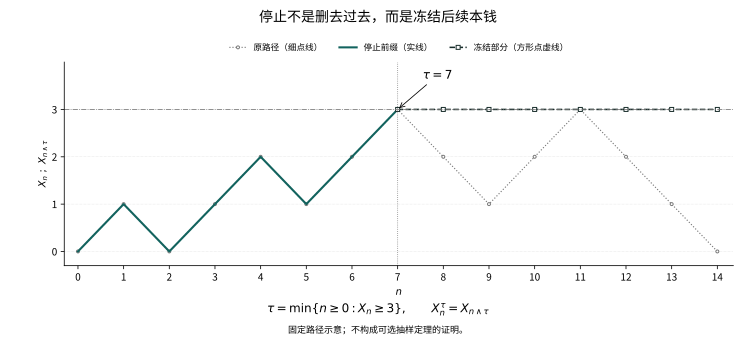

# 第十六章：如果玩家自己决定何时停止？

玩家在开始前写下一条规则：只要赢到一元钱，就离开牌桌。

他没有要求硬币改变概率，也没有预知下一步。他只改变了记账的时刻。若游戏可以永远继续，第一次赢钱似乎迟早会到来；到那时再清点本钱，结局便不再像一个平均收益为零的实验。

第十五章中，每一步的公平已经能够约束路径的振荡。但玩家选择的终点，是由这条路径自己决定的。固定时刻的条件平均，能否穿过这样的选择，需要重新证明。

## 16.1 一条规则必须在当时就能执行

本章先固定离散时间滤过 \((\mathcal F_n)_{n\ge0}\)。取值于 \(\mathbb N_0\cup\{\infty\}\) 的随机变量 \(T\) 称为停止时刻，如果

\[
\{T\le n\}\in\mathcal F_n\qquad(n\ge0).
\]

这说的不是玩家在时刻零就知道什么时候离开，而是在时刻 \(n\) 能够知道自己是否已经离开。等价地，\(\{T=n\}\in\mathcal F_n\)：一个方向取相邻差，另一个方向取有限并。于是 \(\{T\ge k\}\in\mathcal F_{k-1}\)。这最后一个事件会成为合法下注的指标。

设 \(S_n\) 是简单对称随机游走。第一次到达1的时间是停止时刻，因为“截至现在是否到过1”只使用已经出现的步子。相反，在固定期限 \(N\) 内最后一次到达0的时刻一般不是停止时刻：刚在0的位置离开以后，必须看见未来才能知道这是不是最后一次。具体地取 \(N=2\)，最后一个零点 \(L\) 满足 \(\{L=0\}=\{S_2\ne0\}\)，它不是平凡的 \(\mathcal F_0\) 中的事件。

随机时间与停止时刻的区别，因而是信息上的区别，而不是时间是否随机的区别。

## 16.2 停止以后，究竟知道了什么

在可能无穷的停止时刻处，定义

\[
\mathcal F_T=\{A\in\mathcal F:\ A\cap\{T\le n\}\in\mathcal F_n\text{ for every }n\}.
\]

这里原概率空间的 \(\mathcal F\) 必须保留：规则没有约束 \(\{T=\infty\}\) 上的信息。有限时间片上的等价条件是 \(A\cap\{T=n\}\in\mathcal F_n\)。通过取补集和可数并，立即验证这确实是σ-代数；\(T\) 对它可测。

特别地，对任何 \(B\in\mathcal F\)，都有

\[
B\cap\{T=\infty\}\in\mathcal F_T,
\]

因为它与每个 \(\{T\le n\}\) 的交集都为空。这是本定义在无穷时间片上的约定，不表示某个有限时刻已经看见全部环境信息。即使 \(\{T=\infty\}\) 本身属于 \(\mathcal F_\infty\)，它与隐藏事件的交集也未必属于这份由有限记录生成的σ-代数。后面必须区分原始闭合变量与过程真正拥有的终值，原因就在这里。

若 \(S\le T\)，则 \(\mathcal F_S\subseteq\mathcal F_T\)。事实上

\[
A\cap\{T\le n\}=(A\cap\{S\le n\})\cap\{T\le n\}\in\mathcal F_n.
\]

若 \(X_n\) 适应，且先约定在 \(T=\infty\) 上取一个确定值0，那么 \(X_T\) 对 \(\mathcal F_T\) 可测：在 \(\{T\le n\}\) 上，它是有限个 \(X_k\mathbf1_{\{T=k\}}\) 的拼接。这个约定并不声称0是过程在无穷远的极限。以后只有在已经证明终值存在时，才另行使用那个终值。

停止时刻的最小值、最大值仍是停止时刻。若 \(S\le T\)，还可验证 \(A\in\mathcal F_S\) 蕴含 \(A\cap\{S<k\le T\}\in\mathcal F_{k-1}\)。这正是从 \(S\) 开始、到 \(T\) 结束的一段账本所需的信息。

## 16.3 冻结一条路径，不会偷偷看见未来

令 \(X^T_n=X_{n\wedge T}\)。它适应，因为可按 \(T=0,\ldots,n-1\) 与 \(T\ge n\) 分片。对可积过程，有限拼接仍可积。更重要的是逐条路径恒等式

\[
X^T_n=X_0+\sum_{k=1}^n\mathbf1_{\{T\ge k\}}(X_k-X_{k-1}).
\]

第 \(k\) 次增量是否记入，在它发生前已经确定。因此若 \(X\) 是鞅，条件平均给出 \(X^T\) 仍是鞅；次鞅、上鞅分别保留自己的不等号。这里没有关于随机时间的定理作前提，只有有限求和。

同一计算也适用于任意有界的、\(\mathcal F_{k-1}\)-可测的下注额 \(H_k\)。鞅增量乘以这种预先决定的因子，有限和仍为鞅。对于次鞅和上鞅，保留不等号还要求 \(H_k\ge0\)。无限次下注的可积性却不能由这个有限事实自动获得。

<figure class="publication-math-figure" id="visual-stopping-prefix">

<figcaption>

首次到达只使用已经发生的记录。固定近邻路径在第7步首次达到高度3；实线保留停止前缀，方形点虚线在此后冻结为3，细点线显示未停止的原路径。这里没有随机抽样，有限路径示意不是可选抽样定理的证明，也不保证任意停止规则保持期望。

</figcaption>

[SVG 静态图](../assets/visuals/batch16-20/stopping-prefix.zh.svg) · [矢量 PDF](../assets/visuals/batch16-20/stopping-prefix.zh.pdf)

</figure>

## 16.4 有界终点为什么仍然公平

设 \(M\) 是鞅，\(S\le T\le N\) 为停止时刻。我们要证明的不是只有总期望相等，而是

\[
\mathbb E[M_T\mid\mathcal F_S]=M_S.
\]

对 \(A\in\mathcal F_S\)，写出

\[
\mathbb E[(M_T-M_S)\mathbf1_A]
=\sum_{k=1}^N\mathbb E[\mathbf1_{A\cap\{S<k\le T\}}(M_k-M_{k-1})]=0.
\]

每个指标均对 \(\mathcal F_{k-1}\) 可测；每个乘积可积。上节的可测性说明 \(M_S\) 属于 \(\mathcal F_S\)，因此这正是条件期望的定义。对次鞅同一求和给出 ≥0，对上鞅给出 ≤0。

这便是有界停止时刻的可选抽样。它没有要求 \(S,T\) 与过程独立，反而容许玩家充分使用过去。真正起作用的，是不许使用尚未发生的增量，以及总共只清算有限笔可积的账。

## 16.5 两道边界之间，游戏一定会结束吗

从整数 \(x\in\{1,\ldots,a-1\}\) 出发，每步以概率 \(p\in(0,1)\) 向右、以 \(q=1-p\) 向左，记首次到达0或 \(a\) 的时间为 \(T\)。不能先写 \(S_T\) 再默认它存在。

任意尚未吸收的位置，接下来 \(a\) 步若全向右便会吸收，其条件概率至少 \(p^a\)。分块迭代得到

\[
P_x(T>ka)\le(1-p^a)^k.
\]

因此 \(T<\infty\) 几乎必然，而且 \(E_xT<\infty\)。在公平情形 \(p=q=1/2\)，对 \(T\wedge n\) 使用有界抽样，\(E_xS_{T\wedge n}=x\)。停止后的路径被0与 \(a\) 控制，DCT给出

\[
P_x(S_T=a)=x/a.
\]

期限随机，但清算前后的本钱都有同一个确定上界，这才使极限安全地通过期望。

## 16.6 等待的代价也可以算出来

公平游走满足 \(S_n^2-n\) 为鞅：展开平方，条件交叉项为0、增量平方为1。对有界时刻应用刚才已经证明的抽样，得到

\[
E_x(T\wedge n)=E_xS_{T\wedge n}^2-x^2.
\]

左边单调趋于 \(E_xT\)，右边由有界收敛趋于 \(a^2(x/a)-x^2\)。所以

\[
E_xT=x(a-x).
\]

对于 \(p\ne q\)，取 \(r=q/p\)。因为 \(pr+q/r=1\)，\(r^{S_n}\) 是鞅。停止在有限区间内仍被确定常数控制，故

\[
P_x(S_T=a)=\frac{1-r^x}{1-r^a}.
\]

它在 \(p\to1/2\) 时趋于 \(x/a\)。漂移改变的是调和读数：公平时位置本身足够，偏向一侧时指数函数才消掉平均漂移。

## 16.7 只设一道边界，平均就可能出问题

从0出发的公平游走，令 \(T\) 为首次到达1的时间。在区间 \([-a,1]\) 使用上节的有限区间公式，先到1的概率为 \(a/(a+1)\)，所以 \(P(T<\infty)=1\)。可是

\[
E S_{T\wedge n}=0,\qquad S_{T\wedge n}\longrightarrow S_T=1\quad\text{a.s.}
\]

这不是停止时刻不合法，而是有限清算的极限不满足一致可积性。

还可证明 \(ET=\infty\)。如果 \(ET<\infty\)，由于步长绝对值为1，

\[
|S_T-S_{T\wedge n}|\le(T-n)^+,
\]

右边期望趋0，于是左边在 \(L^1\) 中趋0，迫使 \(ES_T=0\)，与 \(S_T=1\) 矛盾。因此“几乎必然能等到”与“等待有有限平均代价”是不同命题。

## 16.8 翻倍下注把风险藏在哪里

另一个玩家第一次押1，输了押2，再输押4，直到第一次赢。令 \(\varepsilon_k\) 为独立的 ±1 公平结果，\(T\) 为首次正面，净收益为

\[
G_n=\sum_{k=1}^{n}2^{k-1}\mathbf1_{\{T\ge k\}}\varepsilon_k.
\]

每个有限期限它都是可积鞅，\(EG_n=0\)。第一次赢以前累计损失为 \(-(2^n-1)\)，一旦赢则净赚1。因此 \(T<\infty\) 几乎必然，\(G_T=1\)，但 \(G_{T\wedge n}=G_n\) 不一致可积。

尾部失控可以直接算出，而不只用一个术语命名。未赢的概率为 \(P(T>n)=2^{-n}\)，在这件事上损失绝对值为 \(2^n-1\)。对任意固定 \(K>1\)，只要 \(2^n-1>K\)，就有

\[
E[|G_n|\mathbf1_{\{|G_n|>K\}}]
=(2^n-1)2^{-n}=1-2^{-n}.
\]

阈值再高，仍可选择更晚期限，使尾部承载的平均损失接近1。同时

\[
E|G_n|=2(1-2^{-n})\le2.
\]

所以连绝对期望统一有界也不足以保障清算。问题不是这些有限账本不可积，而是可积质量集中到越来越少见、越来越昂贵的失败记录上。

这里 \(ET=2\) 甚至有限。故单独要求停止时间可积仍不够：刚才一步绝对值≤1的控制，这里已经失效。有限期限公平、可积的等待时间、几乎必然赢钱，三件事可以同时发生；代价是没有统一控制的损失与下注额。

## 16.9 一份可积终值，能够支持无界清算

第十五章证明，一致可积鞅恰好可写成 \(M_n=E[Z\mid\mathcal F_n]\)，其中 \(Z\in L^1\)。令 \(\mathcal F_\infty=\sigma(\bigcup_n\mathcal F_n)\)，取已证明存在的 \(M_\infty=E[Z\mid\mathcal F_\infty]\)。在 \(T=\infty\) 上使用这个终值。

对任意停止时刻 \(T\)，将 \(A\in\mathcal F_T\) 按 \(T=k\) 分片，并用条件期望定义，得到

\[
E[M_T\mathbf1_{A\cap\{T<\infty\}}]
=E[Z\mathbf1_{A\cap\{T<\infty\}}].
\]

绝对可积性也不能省略：逐片先用 \(E[|M_k|\mathbf1_{A\cap\{T=k\}}]\le E[|Z|\mathbf1_{A\cap\{T=k\}}]\)，再求和。在无穷时间片，若原 \(\mathcal F\) 比 \(\mathcal F_\infty\) 更大，不能自动得到同样等式。

不过，抽样定理本身不需要缩小原来的 \(\mathcal F\)。改用规范终值 \(M_\infty\)：第十五章已给出 \(M_k=E[M_\infty\mid\mathcal F_k]\)。对有限时间片作同一求和，在 \(T=\infty\) 片上则两边的被积变量本来就都是 \(M_\infty\)，不要求该片中的事件属于 \(\mathcal F_\infty\)。有限片的绝对积分和不超过 \(E|M_\infty|\)，无穷片也可积，因此确有 \(M_T=E[M_\infty\mid\mathcal F_T]\)。若在下面第一式中取 \(Z=M_\infty\)，再用 \(\mathcal F_S\subseteq\mathcal F_T\) 的塔式法则，便得到

\[
M_T=E[Z\mid\mathcal F_T],\qquad
E[M_T\mid\mathcal F_S]=M_S\quad(S\le T).
\]

这允许 \(S\le T\) 都取∞，终值始终按 \(M_\infty\) 约定。若仍保留最初任意的闭合变量 \(Z\)，则第一式还需要无穷片上的额外条件；例如 \(\mathcal F=\mathcal F_\infty\) 足够，而几乎必然有限的 \(T\) 也不受这个问题影响。差别不是形式上的：取所有 \(\mathcal F_n\) 平凡、\(Z\) 为等概率的±1隐变量、\(T\equiv\infty\)，便有 \(M_T=M_\infty=0\)，而原环境中的 \(\mathcal F_T=\mathcal F\) 使 \(E[Z\mid\mathcal F_T]=Z\)。失效的是任意闭合变量的公式，不是规范终值下的抽样结论。

这份终值表示还解释了为什么无界抽样没有另外消耗一份尾部预算。对任意子σ-代数 \(\mathcal G\)，令 \(V=E[M_\infty\mid\mathcal G]\)。取正数 \(a,K\)，事件 \(\{|V|>K\}\) 对 \(\mathcal G\) 可测；条件三角不等式、截断与Markov界给出

\[
\begin{aligned}
E[|V|\mathbf1_{\{|V|>K\}}]
&\le E[|M_\infty|\mathbf1_{\{|V|>K\}}]\\
&\le E[|M_\infty|\mathbf1_{\{|M_\infty|>a\}}]
+\frac{aE|M_\infty|}{K}.
\end{aligned}
\]

先让 \(a\) 足够大以控制第一项，再让 \(K\) 足够大控制第二项，界与 \(\mathcal G\) 无关。因此对同一可积终值的所有条件平均构成一致可积族。取 \(\mathcal G=\mathcal F_T\)，就同时控制全部停止时刻的 \(M_T\)，包括具有无穷时间片的规则，而不必为每一条规则寻找一个新的支配随机变量。

## 16.10 不要求整个鞅一致可积，也能停止吗

可以。对一个几乎必然有限的 \(T\)，若停止族 \(\{M_{n\wedge T}:n\ge0\}\) 一致可积，第十五章说明它在 \(L^1\) 中趋于 \(M_T\)。于是 \(EM_T=EM_0\)。更一般，\(S\le T\) 时，停止鞅已闭合，由上节得到 \(E[M_T\mid\mathcal F_S]=M_S\)。这是对实际采用规则的局部条件，不必控制停止以后的全部游戏。

停止族条件也允许 \(T=\infty\)。令 \(N_n=M_{n\wedge T}\)，其一致可积性给出可积终值 \(Y\) 及 \(N_n=E[Y\mid\mathcal F_n]\)。在 \(T<\infty\) 上，路径最终固定，故 \(Y=M_T\)；在无穷片上用 \(Y\) 定义清算值。对 \(S\le T\)，将16.9用于这个停止过程，便得 \(E[Y\mid\mathcal F_S]=M_S\)，其中 \(S=\infty\) 时也取 \(Y\)。这不要求原过程在整个空间上已有一个无穷远终值。

这里的 \(Y\) 应选择为停止过程实际的几乎必然且 \(L^1\) 极限

\[
Y=\lim_{n\to\infty}N_n,\qquad Y\in L^1(\mathcal F_\infty),
\]

而不是再任取一份具有相同有限时刻条件平均的环境变量。若 \(S\) 有限且 \(S\le T\)，停止过程在该时刻的值就是 \(N_S=M_S\)；若 \(S=\infty\)，则必有 \(T=\infty\)，两边都按这个 \(Y\) 清算。这样，停止族的一致可积性闭合的是实际冻结后的账本；在 \(T<\infty\) 的记录上，原过程若继续运行，仍然可以没有极限。

一种易检查的充分条件是 \(ET<\infty\)，并且 \(|M_k-M_{k-1}|\le C\) 几乎必然。此时

\[
|M_{n\wedge T}|\le|M_0|+CT\in L^1,
\]

故停止族一致可积。有限区间赌博则由停止位置有界获得同一条件。两种控制并不相同，却都明确限制了极限可能藏匿的尾部。

对于非负上鞅与几乎必然有限的 \(T\)，有界抽样及Fatou只给出 \(EM_T\le EM_0\)，一般不能把不等号升成等号。若整个上鞅已一致可积，或相应停止族一致可积，可按相同极限程序保留适当的条件不等式。

## 16.11 首次到达为何天然适合这种语言

对适应的离散过程及可测状态集合 \(B\)，定义 \(T_B=\inf\{n\ge0:X_n\in B\}\)，约定空集的下确界为∞。因为

\[
\{T_B\le n\}=\bigcup_{k=0}^n\{X_k\in B\},
\]

它总是停止时刻；从时刻1开始的首次返回也一样。若从停止时刻 \(S\) 以后再寻找一次命中，事件按 \(S=k\le n\) 分片、再取有限并，仍然只使用截至 \(n\) 的信息。

这解释了为什么返回可以反复使用，却没有假定“每次回来以后都独立重来”。停止时刻只保证规则合法，重新开始的分布是否仅由当前位置决定，是下一种额外结构的问题。

## 16.12 连续路径能告诉我们多少，不能告诉我们多少

第四章的粒子并不只在整数时刻出现。本章的离散定理不能直接代替连续时间抽样，但可以先清楚建立一个可测性事实。

设 \(X_t\) 是度量空间中的连续适应过程，\(C\) 为闭集。对固定 \(t\)，连续性与区间紧性给出

\[
\{T_C\le t\}=\left\{\inf_{s\in([0,t]\cap\mathbb Q)\cup\{t\}}d(X_s,C)=0\right\}\in\mathcal F_t.
\]

所以首次命中闭集合法。若仅有右连续路径，对开集 \(O\) 则先有 \(\{T_O<t\}=\bigcup_{r\in\mathbb Q,\,0\le r<t}\{X_r\in O\}\)。在右连续滤过下，\(\{T_O\le t\}=\bigcap_m\{T_O<t+1/m\}\in\mathcal F_t\)。这些证明只处理所列路径类别与集合类别。

右连续路径碰闭集不能照抄第一个证明：路径可能在1以前趋近0，却在1跳到1，其距离下确界为0而没有碰到0。一般début定理还涉及更深的可测投影；本章没有把它当成显然，也没有假定任意鞅已经有右连续版本。连续时间抽样、通常条件与正则化仍须在采用相应路径理论时另证。

## 第十六章结语：规则合法，仍需能够清算

等到赢钱再走，不一定违反每一步的公平。真正危险的，是把有限期限的账本直接带到一个没有控制的终点：有时等待的平均长度无限，有时下注额把罕见损失放大，有时停止后的本钱缺少共同的可积控制。

停止时刻把“当时能不能决定”说清楚；一致可积性把“能不能在最后结账”说清楚。它们解决的是两个不同的问题。

而一次合法的返回，还留下了另一件没有保证的事。玩家重新回到同一个位置时，未来会不会仍记着此前怎样走到这里？若当前位置足以概括整段过去，一次停止便有可能成为一次真正的新开始。

## 史料与证明边界

本章的两种翻倍游戏、有限增量账本与反例是现代教学重建，不声称为某位历史作者原书中的同一表述。关于公平赌博进入现代鞅理论的背景，可参看第十五章已经列出的 [Doob本人访谈](https://chance.dartmouth.edu/Doob/conversation.html)。本章完整主证限于离散时间抽样；连续时间一节仅证明明示的首次命中可测性，没有预用Doob–Meyer或一般正则化。
