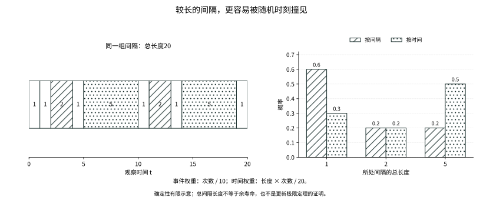

# 第十九章：等待下一次开始

一个人每次回到原点，都重新开始等待。若返回以后拥有同样的未来，那么一条漫长的记录可以不再按单步阅读，而按两次返回之间的周期阅读。

可是，在街边随意找一个时刻观察，看到的周期并不是随意抽取的一个周期。短周期很快就过去，长周期会占住更多的时间。一个完全没有预测能力的观察者，反而更容易落进较长的等待。

这两种阅读时间的方法——沿着到达次数数周期，沿着时间寻找自己所在的周期——将把同一份随机等待引向不同的概率。

## 19.1 用等待间隔重新搭起时钟

设 \(X_1,X_2,\ldots\) 为独立同分布的严格正实随机变量，分布为 \(F\)。令

\[
S_0=0,\qquad S_n=X_1+\cdots+X_n,\qquad
N(t)=\max\{n:S_n\le t\}.
\]

称 \(S_n\) 为更新时刻，\(N(t)\) 为截至 \(t\) 的更新次数，不计初始时刻。严格正性避免同一时刻堆积无限多个零周期。即使均值无穷，仍有 \(S_n\to\infty\) 几乎必然：选 \(\delta>0\) 使 \(p=P(X_1\ge\delta)>0\)，独立Bernoulli强律保证这样的间隔无穷多次出现。因此每个有限 \(t\) 的计数有限。

这里用独立周期作模型；Markov链对一个常返状态的逐次返回，在首次返回之后正好提供这样的周期。暂留状态的缺失返回概率则必须先处理，不能把缺失质量当作一个有限等待间隔。

## 19.2 有限时间内的计数，也要有平均预算

定义更新测度

\[
U(B)=\sum_{n\ge0}P(S_n\in B),\qquad U([0,t])=1+EN(t).
\]

选上节的 \(\delta,p\)。如果 \(S_n\le h\)，前 \(n\) 次中，长度至少 \(\delta\) 的成功次数不超过 \(\lfloor h/\delta\rfloor\)。达到下一次成功所需的试验次数，是有限多个均值 \(1/p\) 的几何等待之和。因此

\[
U([0,h])\le\frac{\lfloor h/\delta\rfloor+1}{p}<\infty.
\]

更重要的是，对所有 \(t\ge0\)，\(U([t,t+h])\le U([0,h])\)。取首次进入 \([t,\infty)\) 的更新时刻：若它已经越过右端，区间计数为0；否则，余下区间的访问数不超过一个从头开始、长度为 \(h\) 的新更新过程所含的点数。按首次进入的下标分片，后续独立性证明这个期望上界。我们记统一界为 \(C_h\)。它将负责后面所有不能只靠逐点极限完成的尾部控制。

## 19.3 大数律首先告诉我们平均节奏

令 \(\mu=EX_1\in(0,\infty]\)。有限均值时，强律与 \(S_{N(t)}\le t<S_{N(t)+1}\) 给出 \(N(t)/t\to1/\mu\) 几乎必然。无限均值时，对每个截断 \(X_k\wedge a\) 使用强律，再令 \(a\to\infty\)，得到 \(S_n/n\to\infty\)，故同一结论成立，约定 \(1/\infty=0\)。

平均次数的结论还需另证。记 \(\mu_a=E(X_1\wedge a)\)。逐项利用 \(\{N(t)+1\ge k\}=\{S_{k-1}\le t\}\) 与下一间隔的独立性，Tonelli给出

\[
\mu_a E[N(t)+1]
=E\sum_{k=1}^{N(t)+1}(X_k\wedge a)\le t+a.
\]

19.2保证左边有限，且最后一个越界间隔截断后不超过 \(a\)。因此 \(\limsup EN(t)/t\le1/\mu_a\)。再令 \(a\to\infty\)，并用Fatou给出反向下界，便证明初等更新定理

\[
\frac{EN(t)}t\longrightarrow\frac1\mu.
\]

这比形式地把随机下标代入期望更谨慎。我们先证明路径速率，再用一个有界越界预算证明平均速率。

## 19.4 更新方程记录最后一次重新开始

更新测度满足 \(U=\delta_0+F*U\)。对一个给定的函数 \(g\)，记 \((U*g)(t)=\int_{[0,t]}g(t-s)U(ds)\)。若相应绝对卷积有限，则它满足

\[
z(t)=g(t)+\int_{(0,t]}z(t-x)F(dx).
\]

这是更新方程。逐次代入产生 \(g+F*g+F^{*2}*g+\cdots\)。对有界时间区间内有界的 \(g\)，19.2使它绝对收敛；同一类别中解唯一，因为迭代后的余项被 \(P(S_n\le t)\) 乘以一个局部上界控制，而这个概率趋0。

但初等更新定理只估计一个越来越长区间中的平均点数，并不直接告诉我们最近一个短窗口里有多少点。要计算年龄、余寿命和延迟效应，需要真正的局部更新极限。

这不是从一个大数律再取一次差就能解决的事情。若只知道某个递增函数 \(V(t)=t/\mu+o(t)\)，误差 \(o(t)\) 仍可能在短窗口内发生显著变化。最简单的提醒来自确定间隔 \(X_1=1\)：此时 \(U([0,t])=1+\lfloor t\rfloor\)，长期平均完全正确，但长度小于1的窗口会随相位交替看见0个或1个点。

因此，局部定理需要排除的不是平均速率错误，而是时间轴上残留的振荡。我们将保留19.2的局部预算，把观察窗口移到越来越远处，先研究任何可能留下的局部形状，再问更新方程允许它具有怎样的形状。

## 19.5 时钟能否锁在一张格网上

若存在最大的 \(d>0\) 使 \(P(X_1\in d\mathbb Z)=1\)，称更新间隔为算术型，跨度为 \(d\)；否则称非算术型。这里是经过0的加法群，不是第十三章固定样本量的仿射格点跨度。支撑 \(\{1,3\}\) 的更新跨度是1，虽然固定次数求和仍有奇偶限制；支撑 \(\{1,\sqrt2\}\) 的离散等待分布却是非算术型。

这个区别不会被无限次相加自动磨平。若每次间隔恰为1，观察时刻的相位将永远保留。非算术型的证明必须说明为什么不存在另一种隐蔽的周期，而不能把“没有密度”与“有周期”混为一谈。

## 19.6 为何需要一个关于置换的零一引理

一次更新只依赖已经累计的间隔之和。交换有限多个间隔，会改变早期的到达顺序，却不会改变足够晚的部分和。这个很具体的对称性，比“远处的变量与过去独立”更适合当前问题：我们要研究的极限仍会使用所有间隔，未必是显然的尾事件。

所需的零一律正是把这种有限重排变成确定性。它并不说所有对称统计量都是常数；有限样本的和当然可以随机。关键是一个无限记录的读数，对任意有限次交换都不变。

先建立所需的专用工具。对于iid序列，若事件 \(A\) 在任意有限坐标置换下都不变，则 \(P(A)\) 为0或1。证明如下。第十五章的条件期望向上收敛，使 \(\mathbf1_A\) 可在 \(L^1\) 中由有限前缀条件平均逼近；在1/2处截断，得到前 \(m\) 个坐标中的事件 \(B\)，满足 \(P(A\triangle B)<\varepsilon\)。

把有限逼近也写清楚。令 \(\mathcal H_m=\sigma(X_1,\ldots,X_m)\)、\(D_m=E[\mathbf1_A\mid\mathcal H_m]\)。向上收敛给出 \(E|D_m-\mathbf1_A|\to0\)。取 \(B=\{D_m>1/2\}\)，则

\[
P(A\triangle B)\le 2E|D_m-\mathbf1_A|.
\]

这是因为在判断错误的每一点，条件平均与真实指标至少差一半。因此前缀逼近不是假设整个事件只依赖有限坐标，而是把判断错误的概率压到任意小。

给定任意有限前缀事件 \(C\)，用一个有限置换把 \(B\) 所用的坐标全移到 \(C\) 之后。得到 \(B'\) 与 \(C\) 独立，且由iid对称性与 \(A\) 不变性，仍有 \(P(A\triangle B')<\varepsilon\)。因此

\[
|P(A\cap C)-P(A)P(C)|\le2\varepsilon.
\]

令ε趋0，再以π–λ把 \(C\) 推广到整个序列σ-代数，\(A\) 便与自身独立。对有界、有限置换不变的随机变量，把这一结论应用于全部有理水平集，便知它几乎必然为常数。这是本章实际需要的Hewitt–Savage型引理的完整证明，不借后文交换性或遍历理论。

## 19.7 一份有界调和读数为什么不能保留非算术振荡

设有界连续函数 \(h\) 满足 \(h(t)=\int h(t-x)F(dx)\)。对固定 \(t\)，\(h(t-S_n)\) 是有界鞅，故有几乎必然及 \(L^1\) 极限。任何有限置换最终不再改变部分和，因而不改变这个极限。上节说明极限是常数，其平均必为 \(h(t)\)。闭鞅恒等式再推出 \(h(t-X_1)=h(t)\) 几乎必然。

这里最有力的一步，是把随机极限重新送回有限时间。定义 \(H_t=\limsup_n h(t-S_n)\)，使它在所有记录上都有定义；有限重排最终不改变部分和，所以这个变量确实满足上一节的不变性。鞅收敛说明它又是实际极限。因而 \(H_t=h(t)\) 几乎必然，而且有界性给出

\[
h(t-S_n)=E[H_t\mid\mathcal H_n]=h(t).
\]

特别取 \(n=1\)，就得到对一个随机步长的精确不变性。我们并没有从“平均不变”直接猜出“每个步长不变”；零一律和闭鞅恒等式正是补上这段距离的工具。

连续性把这个等式推广到支撑中的每个步长，并且对每个 \(t\) 成立。于是 \(h\) 对支撑生成的整个加法群不变。实线的加法子群若不是离散的 \(d\mathbb Z\)，就有任意小正元素，用整数倍逼近任意实数，故稠密。非算术时连续性迫使 \(h\) 为常数。

从概率为1的步长推广到支撑，也有一个确定性的理由。对固定 \(t\)，满足 \(h(t-x)=h(t)\) 的 \(x\) 构成闭集，且其 \(F\)-概率为1，因此它包含 \(F\) 的支撑。这对每个 \(t\) 分别成立，便得到对所有平移位置都有效的函数恒等式。把 \(t\) 换成 \(t+x\)，又得到反向平移不变性。

为何只剩格网或稠密两种可能？设支撑生成的群为 \(G\)。若正元素的下确界 \(d\) 大于0，趋近这个下确界的群元素之差最终小于 \(d\)，只能为0，故 \(d\in G\)；对任意群元素除以 \(d\) 作带余除法，余数也只能为0，所以 \(G=d\mathbb Z\)。若下确界为0，任意小的正群元素的整数倍都能逼近任意实数。于是非算术性真正排除的，是可供一个非恒定连续调和函数保留的周期。

在整数上，对有界函数与正整数步长，完全相同的鞅证明适用；若支撑的最大公约数为1，生成的群就是整个整数群，所以函数也是常数。这个调和机制是局部更新极限能够消除周期的真正原因。

## 19.8 先在格点上把常数找出来

将算术跨度缩放成1，记 \(u_n=U(\{n\})\)，负下标取0。严格正整数间隔使同一条路径在一个点至多更新一次，所以 \(0\le u_n\le1\)。更新递推为 \(u_n=\mathbf1_{\{n=0\}}+\sum_{k\ge1}p_ku_{n-k}\)。

从任意趋∞的整数序列，对所有固定整数偏移同时抽取子列，使 \(u_{n_j+\ell}\to v(\ell)\)。以界1控制求和，递推极限给出 \(v(\ell)=\sum_kp_kv(\ell-k)\)。19.7的整数调和引理使 \(v\equiv c\)。

每个时刻恰在一个更新周期内，因此有精确身份

\[
1=\sum_{k=0}^nP(X_1>k)u_{n-k}.
\]

有限均值时，尾权重之和为 \(\mu\)，界1允许先截断再控制剩余，得到 \(1=c\mu\)。任何子列都只能有这个极限，故 \(u_n\to1/\mu\)。恢复跨度，极限为 \(d/\mu\)。这里不仅知道周期平均速率，还真正识别了每个允许更新格点上的局部质量。

## 19.9 没有格网时，先选出局部极限

把窗口移到远处，并不是把一份概率重新归一化。更新测度在整条实线上通常具有无限总质量，因此这里不能直接套用“概率质量不逃逸”的紧性说法。我们只要求每个固定长度的窗口拥有共同预算；这允许局部测度子列收敛，却暂时允许候选极限为零。

所用的选择结论恰是T-STIELTJES已经证明的实线版本：对每个紧区间有统一质量界，就能选出同一条子列，对所有连续紧支撑测试函数同时收敛。不能为每个测试函数各选一条互不相干的子列，否则下一步的更新方程没有共同的极限测度。

本节到19.11的非算术结论，均假设严格正iid间隔、非算术分布及 \(0<\mu<\infty\)；算术情形另保留固定相位。将 \(U\) 在负半轴延拓为零，对任意 \(t_j\to\infty\)，平移测度记为 \(U_t(B)=U(t+B)\)。19.2的统一局部界使这列平移测度有一个子列，在连续紧支撑测试函数上收敛到局部有限测度 \(\lambda\)。[T-STIELTJES](../foundations/t-stieltjes.md#t-stieltjes-selection)通过有理点对角抽取、单调函数与层轴推前，完整证明这一步。

记 \(U_t(g)=\int g(y)U_t(dy)\)。更新方程的平移形式是 \(U_t(g)=g(-t)+\int U_t(g(\,\cdot+x))F(dx)\)，因此卷积中的平移方向也已确定。若 \(g\) 的支撑位于长度 \(H\) 的区间内，则所有 \(x,t\) 的内层绝对积分均不超过 \(\|g\|_\infty C_H\)。对每个固定 \(x\)，平移后的测试函数仍连续且紧支撑；先沿子列取极限，再对概率 \(F\) 使用这个共同支配量，且 \(g(-t_j)\to0\)，便得 \(\lambda=F*\lambda\)。更具体地，对任意连续紧支撑 \(g\)，函数

\[
h(t)=\int g(t-y)\lambda(dy)
\]

有界连续，且满足19.7的调和方程。其有界性来自统一区间质量界，连续性来自 \(g\) 的一致连续性与稍大支撑区间的质量界。故 \(h\) 为常数。

极限测度也继承一个稍放大的统一窗口预算。取连续折线函数盖住任意长度 \(H\) 的区间，支撑只比它宽2，沿子列积分便得该区间的 \(\lambda\)-质量不超过 \(C_{H+2}\)。因此平滑读数的连续性可以定量地写成：当 \(|r|\le1\) 时，

\[
|h(t+r)-h(t)|\le C_{H+4}\,\omega_g(|r|),
\]

其中 \(\omega_g\) 是把 \(g\) 在实线上延拓后的一致连续模。右端不依赖 \(t\)，且随 \(r\to0\) 趋0。对卷积换序同样先用这个窗口预算控制绝对值，再用Fubini，得到 \(h(t)=\int h(t-x)F(dx)\)。所以调和引理适用的每一个条件，都来自局部质量控制，而不是来自尚未证明的密度。

这迫使 \(\lambda\) 平移不变。因为对每个测试函数的任意平移积分都相同；用连续折线从内外逼近区间，便得平移区间有相同质量。每个单点质量为0，否则一个有界区间中任意多个不同平移单点会使局部质量无界。区间质量于是只依赖长度，且具有可加性与长度上的单调性：先在有理长度上得到线性，再用有理夹逼推广到实数。因此 \(\lambda=c\,dx\)。

## 19.10 局部极限的总预算，不能靠猜测

还需确定 \(c\)。每条路径的更新区间恰好覆盖时间轴，所以对 \(t\ge0\)，

\[
1=\int_{[0,t]}\overline F(t-s)U(ds),\qquad \overline F(x)=P(X_1>x).
\]

沿所选 \(t_j\) 平移，在固定窗口 \([-A,0]\) 上，积分函数有界且单调，至多可数个跳跃；极限测度 \(c\,dx\) 没有这些点的质量，Riemann阶梯逼近便允许取极限。

这个恒等式看的是一个“尚未结束的周期”：在 \(s\) 更新以后，到 \(t\) 仍未有下一次更新的概率是 \(\overline F(t-s)\)。不同更新下标对应互斥的最后更新事件，全部相加恰为1。这与平均更新次数的极限不同，它是一条在每个时刻都成立的精确预算。

固定 \(A\)，并令所选 \(t_j>A\)。坐标换成 \(y=s-t_j\) 后，窗口内的被积函数为 \(\mathbf1_{[-A,0]}(y)\overline F(-y)\)。它有界、Riemann可积，T-STIELTJES的端点处理允许在候选极限 \(c\,dy\) 下取极限。剩下的任务是证明，窗口外没有被这个操作漏掉的一笔平均质量。

窗口以外不能只写DCT。固定一个网格 \(h>0\)，统一局部界给出尾项上界

\[
C_h\sum_{k\ge\lfloor A/h\rfloor-1}\overline F(kh).
\]

具体地，取 \(A\ge3h\) 并令 \(K=\lfloor A/h\rfloor-1\)。尾函数递减，所以

\[
\sum_{k\ge K}\overline F(kh)\le\frac1h\int_{(K-1)h}^{\infty}\overline F(u)\,du\longrightarrow0
\quad(A\to\infty).
\]

这里先固定 \(h\)，再扩大 \(A\)，从未让一个未受控制的 \(C_h/h\) 随网格一起变化。先在固定窗口中令 \(j\to\infty\)，预算1与 \(c\int_0^A\overline F\) 的差便被这个共同尾界控制；最后才令 \(A\to\infty\)。这解释了有限均值出现的位置：它不是抽取局部极限所需的条件，而是把无限长的周期预算带过极限所需的条件。

有限均值使单调尾函数可积，故这个固定网格尾和趋0。于是 \(1=c\int_0^\infty\overline F(x)dx=c\mu\)。所有子列候选相同，得到完整的局部更新极限

\[
U((t,t+h])\longrightarrow h/\mu\qquad(h>0).
\]

子列的唯一候选还要变成全体时间的收敛。若某个连续紧支撑测试函数的积分没有趋于所识别的值，就能找到一列趋无穷的时刻，始终偏离它至少一个固定正数。局部选择再从这列时刻抽取子列，而刚才的论证又迫使其极限为同一个 \(dx/\mu\)，矛盾。对窗口指标，T-STIELTJES的Riemann夹逼与端点原子消失再给出上面的区间极限。

这一步说明为什么我们先研究任意局部候选，而不从初等更新定理猜测一个密度：局部形状的唯一性和整体归一化，分别解决了振荡与常数两个困难。

这包括任意非算术严格正等待分布，不要求密度、二阶矩或spread-out条件。它也没有引用尚未建立的遍历定理。

## 19.11 关键更新定理究竟要求怎样的可积性

以下取Borel可测实函数 \(g\)，使对可能奇异的更新测度所作积分也确实有定义。直接Riemann可积性需要控制函数的实际点值，不能只把它看成Lebesgue几乎处处等价类。

函数 \(g\) 在负半轴置0。称其直接Riemann可积，若其正负部的网格上下和在网格趋0时趋于相同有限值，并且某个足够细固定网格上的绝对值上和有限。这个条件既控制紧区间内的振荡，也控制远处尖峰；只有Lebesgue可积不足以承担更新测度对特定时间点的采样。

对非负函数，令 \(I_k(h)=[kh,(k+1)h)\)，记 \(a_k(h)=\sup_{I_k(h)}g\)、\(b_k(h)=\inf_{I_k(h)}g\)。所说的网格和就是

\[
\overline R_h(g)=h\sum_{k\ge0}a_k(h),\qquad
\underline R_h(g)=h\sum_{k\ge0}b_k(h).
\]

它们要在 \(h\downarrow0\) 时趋于同一个有限值。对有符号函数分别处理正负部，并保留一个固定网格的绝对上和有限。这个定义比积分有限多要求了一项可见的预算：每一个小格子内可能被更新测度击中的最高值，都必须被计入。

例如，有限起始值的非负递减可积函数满足这个条件：上下和之差至多 \(h g(0)\)，上和至多 \(h g(0)+\int_0^\infty g\)。有限次跳跃不会破坏结论。这正好包括稍后年龄和余寿命所产生的截断尾函数，并不是为一个抽象定理任意挑出的函数类别。

把尾部估计完整写出更能看清其作用。固定一个绝对上和有限的 \(h\)，令 \(a_k^{*}(h)=\sup_{I_k(h)}|g|\)。对所有观察时刻都有

\[
\int_{\substack{0\le s\le t\\t-s\ge A}}|g(t-s)|\,U(ds)
\le C_h\sum_{k\ge\lfloor A/h\rfloor}a_k^{*}(h)\longrightarrow0
\quad(A\to\infty).
\]

每一项只用到一个长度为 \(h\) 的反射窗口；窗口落到负半轴的部分没有更新质量。右端是一个已经可求和的固定序列的尾和，完全不依赖 \(t\)。在有限窗口上，DRI又保证通常的Riemann可积性，所以局部极限可用；两部分拼接以后，才得到全卷积的极限。

紧支撑Riemann可积函数先由19.10的区间极限与阶梯夹逼得到卷积极限。对一般 \(g\)，固定网格上的远尾卷积由 \(C_h\) 乘以相应上包络尾和控制；它随截断界 \(A\to\infty\) 而趋0，且对观察时刻 \(t\ge0\) 一致。先截断、取长时间极限，再放大截断范围，证明非算术关键更新定理

\[
\int_{[0,t]}g(t-s)U(ds)\longrightarrow\frac1\mu\int_0^\infty g(s)ds.
\]

算术跨度为 \(d\) 时，不能把求和换成积分。对固定相位 \(r\in[0,d)\)，若采样列绝对可和，则由19.8与界 \(u_n\le1\) 得到

\[
(U*g)(nd+r)\longrightarrow\frac d\mu\sum_{k\ge0}g(kd+r).
\]

算术公式也可以直接复核。沿 \(t=nd+r\) 展开卷积，得到 \(\sum_{k=0}^n u_{n-k}g(kd+r)\)，这里 \(u_j=U(\{jd\})\)。对每个固定 \(k\)，系数趋于 \(d/\mu\)，且始终不超过1；绝对可和的采样列就是换极限所需的共同支配量。DRI能保证这种可和性：取网格 \(h<d/2\)，不同采样点落在不同小格子中，采样绝对值之和不超过固定网格的上包络和。

直接Riemann可积保证这里的绝对可和。固定长度1的周期与窄窗口函数已经足以说明，不保留相位就可能没有一个统一极限。 另一个反例直接针对可积性：取 \(g=\mathbf1_{\mathbb N_0}\)，其Lebesgue积分为0，但在每个整数时刻，初始更新点就使卷积至少为1。这个函数不直接Riemann可积，说明即使等待分布非算术，普通Lebesgue可积仍不能代替上述条件。

## 19.12 周期中取得的报酬怎样累积

允许每个周期带一项报酬，使 \((X_k,R_k)\) 为iid对，\(E|R_1|<\infty\)、\(\mu<\infty\)。两者在同一周期内可以相关。完成周期的总报酬满足

\[
\frac1t\sum_{k=1}^{N(t)}R_k
=\frac{N(t)}t\frac1{N(t)}\sum_{k=1}^{N(t)}R_k
\longrightarrow\frac{ER_1}{\mu}\quad\text{a.s.}
\]

这是强律沿已经趋∞的随机子列取值，不要求 \(N(t)\) 独立于报酬。若一个尚未完成周期中的累计报酬绝对值被该周期的 \(V_k\) 控制，且 \((X_k,R_k,V_k)\) iid、\(EV_1<\infty\)，则尾积分比较与Borel–Cantelli给出 \(V_k/k\to0\) 几乎必然，故 \(V_{N(t)+1}/t\to0\)。连续计入周期内报酬也有同一极限。

这项更新报酬定理是路径平均结论。若要额外声称期望也收敛，还需一致可积等相应控制，不能因为路径强律已经成立就省略它。

## 19.13 随意观察时，自己落在哪一段等待里

定义年龄 \(A_t=t-S_{N(t)}\)，余寿命 \(R_t=S_{N(t)+1}-t\)。对 \(a,b\ge0\)，按最后一次更新分片，事件 \(A_t>a,R_t>b\) 的概率是对 \(s<t-a\) 积分 \(\overline F(t+b-s)\)。相应强迫函数 \(g(u)=\mathbf1_{\{u>a\}}\overline F(u+b)\) 单调分段且可积，因而直接Riemann可积。

最后一次更新不能当作一个独立选出的下标。正确做法是逐个固定 \(n\)，先看 \(S_n\)，再用下一间隔与前缀的独立性。非负求和允许Tonelli，从而严格得到

\[
P(A_t>a,R_t>b)
=\int_{[0,t]}\mathbf1_{\{t-s>a\}}\overline F(t+b-s)\,U(ds).
\]

指标中的严格不等号也保存了恰在更新时刻观察的边界约定。强迫函数只在 \(a\) 处增加一次跳跃，其后递减；有限均值控制其尾积分，因此19.11的条件已经逐项得到，而不是因为它看起来像一个密度就直接应用极限定理。

非算术、有限均值下，关键更新定理于是给出

\[
P(A_t>a,R_t>b)\longrightarrow
\frac1\mu\int_{a+b}^\infty\overline F(u)du
=\frac{E(X_1-a-b)^+}{\mu}.
\]

这个结论来自最后周期的精确分片，不是把独立样本随便塞到随机时刻。算术情形沿固定相位使用19.11的求和版本；若周期恰为1，年龄就是观察时刻的小数部分，余寿命由同一相位决定。

## 19.14 较长的间隔为什么更容易被看见

上式的联合极限可以这样构造：先取长度偏置的 \(L\)，使 \(P(L\in dx)=xF(dx)/\mu\)，再取独立 \(V\sim\mathrm{Unif}(0,1)\)，令年龄为 \(VL\)，余寿命为 \((1-V)L\)。给定长度后，满足两个不等式的可用位置长度为 \((L-a-b)^+\)；对长度偏置分布积分便恢复19.13。

这份长度偏置并非只由公式识别，也能沿一条实际记录看见。对任意有界Borel函数 \(\psi\)，在长度为 \(X_k\) 的完整周期内，观察者累计获得的读数是 \(X_k\psi(X_k)\)。19.12的报酬定理及未完成周期控制给出

\[
\frac1T\int_0^T\psi\bigl(X_{N(s)+1}\bigr)\,ds
\longrightarrow\frac{E[X_1\psi(X_1)]}{\mu}\quad\text{a.s.}
\]

因此，在越来越长的记录上均匀抽一个观察时刻，所见长度趋于长度偏置分布。这个时间平均结论甚至不要求非算术性；它与固定晚时刻的分布极限不同，均匀观察已经把格网相位一起平均掉了。

给定被看见的长度为 \(\ell\)，年龄和余寿命同时超过 \(a,b\) 的可用位置比例是 \((\ell-a-b)^+/\ell\)。与 \(\ell F(d\ell)/\mu\) 相乘以后，分母消去，恰好得到前一节的尾积分。由更新定理得到的晚时刻分布，与由周期报酬得到的时间权重，在这里成为同一个几何机制。

这就是inspection paradox的机制：不是观察者知道了什么，而是长区间占据更多时间。图中的确定样本只显示这种加权，不替代无限更新的证明。

若二阶矩有限，所见完整间隔的平均长度为 \(EX_1^2/\mu\)，年龄和余寿命平均各为 \(EX_1^2/(2\mu)\)；二阶矩无穷时这些等式按非负扩展积分理解。不能据此一概说余寿命比普通完整间隔平均更长：固定间隔的平均余寿命只有其一半；真正必然偏大的，是被看见的完整间隔的长度偏置。

<figure class="publication-math-figure" id="visual-inspection-length-bias">

<figcaption>

同一组10个间隔，按事件均匀选取与按时间均匀观察，得到不同的长度分布。长度1、2、5各出现6、2、2次；事件权重为0.6、0.2、0.2，时间权重为0.3、0.2、0.5。较长间隔占用更多时间，含观察时刻的间隔平均长度由2变为3.2。本图是总长度20上的确定性有限示意，不是平稳更新构造或更新极限定理的证明；含时刻的总间隔长度也不等于余寿命。

</figcaption>

[SVG 静态图](../assets/visuals/batch16-20/inspection-length-bias.zh.svg) · [矢量 PDF](../assets/visuals/batch16-20/inspection-length-bias.zh.pdf)

</figure>

## 19.15 让整条更新记录真正平稳

取双向iid间隔，在0放一个更新点，得到两侧局部有限的点配置 \(\Phi\)。只使用有界区间内计数生成的σ-代数，不预用一般点过程或Palm理论。记 \(\theta_s\) 为将观察原点移到 \(s\)。通过长度偏置中央间隔与内部均匀位置，再向两侧接独立普通间隔，构造概率 \(Q\)。对任意有界可测配置函数 \(H\)，它满足

\[
QH=\frac1\mu E\int_0^{X_1}H(\theta_s\Phi)ds.
\]

可以把这个构造的概率和可测性都展开，而不预用一般点过程理论。对点根记录，取双向iid间隔 \((X_k)_{k\in\mathbb Z}\)，正方向沿用19.1；负方向定义 \(S_{-n}=-\sum_{j=0}^{n-1}X_{-j}\)（\(n\ge1\)）。取独立的长度偏置中央间隔 \(L\) 与均匀变量 \(V\)，把中央两端放在 \(-VL\) 和 \((1-V)L\)，再接两侧的普通iid间隔。两侧部分和都趋向无穷，所以每个有界窗口中只有有限多个点。给定中央长度以后，均匀位置的因子 \(1/L\) 与长度偏置的因子 \(L/\mu\) 抵消，便得到上面的周期积分公式；取 \(H=1\) 又验证总质量确为1。

对于有界Borel区间 \(B\)，平移后计数写作 \(\sum_{k\in\mathbb Z}\mathbf1_{\{S_k-s\in B\}}\)，它对间隔序列和 \(s\) 联合可测。计数生成配置σ-代数，再用函数单调类，便知公式中的一般有界可测 \(H(\theta_s\Phi)\) 也联合可测。随机移动观察原点因而是已经构造出的可测实验，不是一个形式符号。

这不仅给出一对年龄、余寿命，还给出整个配置的平稳性。对 \(t>0\)，积分区间的平移差精确等于

\[
\mu\{Q(H\circ\theta_t)-QH\}
=E\int_{X_1}^{X_1+t}H(\theta_u\Phi)du
-E\int_0^tH(\theta_u\Phi)du=0.
\]

平稳性证明的关键是换根以后仍有同一份双向iid记录，而不是假设中央长度与换根后的整条记录独立。令 \(u=X_1+v\)，前一个期望积分变为 \(E\int_0^tH(\theta_v(\theta_{X_1}\Phi))\,dv\)。换根只把间隔下标整体移动一位，因此 \(\theta_{X_1}\Phi\) 与原来的点根配置同分布。固定长度 \(t\) 和有界性允许Fubini，于是两项精确抵消。我们从“按到达点扎根”的规律，构造出了“按时间观察”的平稳规律；二者不应混为同一初始分布。

因为把点根从0移到下一更新点 \(X_1\)，仅重标双向iid间隔，下标平移不改变它们的联合分布。最后两个积分长度固定为 \(t\)，有界性保证可积。负平移由反向组合得到。这是实际的平稳构造证明，不是只猜一个平稳余寿命密度。算术间隔若要求实时间平移平稳，内部均匀位置也随机化了格点相位；固定格点观察则保留自己的离散相位版本。

## 19.16 无限均值使哪个愿望失效

若 \(P(X_1>x)=(1+x)^{-\alpha}\)，\(0<\alpha<1\)，每个间隔仍有限，更新仍会无穷次发生，但 \(EN(t)/t\to0\)，而 \(N(t)/t\to0\) 几乎必然。不存在把 \(xF(dx)\) 除以有限 \(\mu\) 得到的概率；年龄、余寿命也不能使用19.13的有限均值平衡公式。

局部极限与平衡概率在这里必须分开。事实上，上面的局部选择和调和识别不需要有限均值；即使 \(\mu=\infty\)，候选仍为 \(c\,dx\)。只在固定窗口中使用周期预算的不等式，便有 \(1\ge c\int_0^A\overline F(u)\,du\) 对每个 \(A\) 成立。这迫使 \(c=0\)，因此非算术情形的固定长度窗口质量趋于0。算术情形对19.8的尾和恒等式先保留有限项，也同样迫使每个子列常数为0。

这不产生一份年龄、余寿命的零概率分布。有限窗口中的质量可以消失到越来越长的周期里；此时年龄问题所需的尾函数已没有有限积分，不满足关键更新定理的DRI条件，也不能把 \(xF(dx)\) 正常归一化。无限均值下仍有可证明的局部零极限，却失去了有限均值时把典型观察周期变成概率的那份预算。

时间轴仍被周期填满，但有限平均周期这份归一化预算已经不存在。我们没有因此宣告所有无限均值极限都不存在，只指出本章平稳长度偏置与有限均值极限所需的条件确实不能删掉。

## 第十九章结语：一次到达与一个时刻，有不同的权重

沿到达点抽一个周期，每个周期只算一次；沿时间抽一个位置，每个周期按长度获得机会。相同的随机记录，因此能够产生两种不同的典型性。

强律给出平均节奏，局部更新极限说明短窗口怎样安定，长度偏置则解释等待为何在观察者眼中变长。它们都来自周期可以重新开始，却分别需要自己的尾部、周期与可积性条件。

到这里，重新开始仍是一条线：一个周期结束，下一个周期接上。若一次结束带来多个新的个体，每个个体又各自开始一次同样的实验，这条时间线便会分叉成一个家族。

## 史料与范围

Blackwell的1948年论文 [A renewal theorem](https://doi.org/10.1215/S0012-7094-48-01517-8)及1953年 [Extension of a renewal theorem](https://msp.org/pjm/1953/3-2/pjm-v3-n2-p03-p.pdf)是局部更新理论的重要原始来源。Smith的1958年综述 [Renewal Theory and its Ramifications](https://doi.org/10.1111/j.2517-6161.1958.tb00294.x)讨论了更新与再生应用。本章的调和、置换与周期积分证明为现代重建；它处理严格正iid周期，不声称已经证明允许负增量的一般更新理论、遍历定理或Palm对偶。
