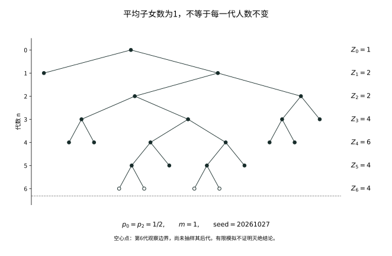

# 第二十章：一个祖先怎样变成一个随机家族？

把一个家族每一代的人数记下来，最容易计算的是平均值。如果每个个体独立地、平均留下 \(m\) 个后代，那么一个祖先在第 \(n\) 代的平均后代数就是 \(m^n\)。当 \(m>1\)，这是一条向上弯曲的指数曲线。

一棵已经灭绝的树当然不会沿着这条曲线生长。但即使只看那些一直存活的家族，平均曲线也未必给出了正确尺度。家族可以不断延续，人口却在除以 \(m^n\) 以后趋于零。这里需要解释的，已经不只是“为什么有人灭绝”，而是平均值为什么可能夸大几乎每一棵生存之树的增长。

要看清这个差别，不能只把平均人口算得更精确。我们需要知道：组成这份平均的，是许多通常规模的家族，还是越来越罕见、却越来越庞大的家族。把一棵树改为按其后代人数观察，会让后一种贡献从难以遇见的例外，变成新概率下可直接研究的现象。

## 20.1 先让一棵家族树真正长出来

先明确我们所谓的家族。后代数 \(L\) 取非负整数值，\(p_k=P(L=k)\)，每个已经出生的个体都独立使用同一份生育规则。后代数总是有限，均值可以另行讨论；它不是预先固定的人口增长倍数。

用有限正整数词标记潜在个体：空词是祖先，\(uj\) 是个体 \(u\) 的第 \(j\) 个孩子。所有这种词组成一个可数集合。先给每个词安放独立的 \(L_u\)，再递归地保留祖先以及满足 \(j\le L_u\) 的孩子。没有出生的词上虽然也安排过实验，那些结果不会进入实际家族的观察。第八章的可数乘积空间就足以支持这个构造。

把实际树上的第 \(n\) 代人数记为 \(Z_n\)。每代有限，因为从一个祖先出发，有限个个体各自只有有限个孩子。若按代内顺序列出生育实验，就有

\[
Z_0=1,\qquad Z_{n+1}=\sum_{j=1}^{Z_n}L_{n,j}.
\]

这就是单类型Galton–Watson过程。令 \(\mathcal F_n\) 揭示实际树直到第 \(n\) 代：它知道这一代有哪些人，但尚未知道这些人各自将有几个孩子。因此，给定 \(\mathcal F_n\) 后，右边的生育实验仍然相互独立，并且具有原来的后代分布。若把该代自己的生育结果也提前放进信息，后面的条件平均就会改变。

十九世纪的姓氏消失问题提供了这个模型的一条历史入口。Watson与Galton于1875年刊出的论文研究一条父系姓氏经过若干代后还剩多少代表，并明确采用不重叠世代等简化。我们保留这一真实问题，但以下个体是抽象的生育单位；模型的独立性、同分布和世代假设都需要明说，不能当成人口史的事实，更不能把后来的鞅证明倒写成早期作者的思想。

## 20.2 灭绝为什么要求选择最小的根

一代中若有许多独立家族，直接枚举下一代的全部组合会很快变得笨重。后代母函数把这些组合集中到一个读数中：

\[
f(s)=E[s^L]=\sum_{k=0}^{\infty}p_ks^k,\qquad 0\le s\le1,\qquad 0^0=1.
\]

给定当前树，各人的孩子数独立，故 \(E[s^{Z_{n+1}}\mid\mathcal F_n]=f(s)^{Z_n}\)。若 \(f_n(s)=E[s^{Z_n}]\)，便有 \(f_{n+1}=f_n\circ f\)，且 \(f_0(s)=s\)，所以 \(f_n=f^{\circ n}\)。对同一代不同家族要相乘，对连续世代则要复合。这两种运算记录了两种不同的独立结构。

取 \(s=0\)，记 \(q_n=P(Z_n=0)=f^{\circ n}(0)\)。零人口一旦出现就不会恢复，因此这些灭绝事件递增，\(q_n\uparrow q\)，其中 \(q\) 是最终灭绝的概率。由有界收敛，\(f\) 在 \([0,1]\) 连续，故 \(q=f(q)\)。但只写下这个方程还不够，因为1总是它的根。

若 \(a\in[0,1]\) 满足 \(f(a)=a\)，从 \(0\le a\) 出发反复应用单调的 \(f\)，得到 \(q_n\le a\) 对所有 \(n\) 成立。于是

\[
q=\min\{s\in[0,1]:f(s)=s\}.
\]

最小性来自有限代事件的递增极限，不是解完方程后的任意选择。从 \(r\) 个祖先出发时，独立子树给出人口母函数 \((f^{\circ n}(s))^r\)，灭绝概率为 \(q^r\)。我们已经能处理任意有限的初始家族，而不需要重新枚举整个亲缘网络。

## 20.3 平均数决定哪一类未来，却没有决定每一棵树

以下取有限均值 \(m=EL\)。若 \(m=0\)，后代数几乎必然为0，下一代立即灭绝。否则，由非负级数的单调收敛，\(f'(1-)=m\)。母函数的凸性于是把平均数与不动点的形状联系起来。

当 \(m<1\)，对 \(0<s<1\)，有 \(f'(s)\le m<1\)。因此 \(f(s)-s\) 严格递减，到1时才降到0，区间内没有别的根。当 \(m=1\) 且 \(L\not\equiv1\)，均值条件迫使 \(p_0>0\) 且某个 \(p_k>0\) 对 \(k\ge2\) 成立；严格凸性使图像在1处切线 \(s\mapsto s\) 的上方，故 \(f(s)>s\) 对 \(s<1\) 成立。这两种家族都几乎必然灭绝。

若 \(L\equiv1\)，每代只有一个人，永不灭绝；这是临界情形必须单列的例外。当 \(m>1\)，左导数说明 \(f(s)-s<0\) 对足够接近1的 \(s<1\) 成立，而在0处非负。连续性给出一个根 \(q<1\)，严格凸性保证只有 \(q,1\) 两个根。若 \(p_0=0\)，这个较小的根就是0；若 \(p_0>0\)，则 \(0<q<1\)。

例如 \(p_0=1/4,p_2=3/4\) 时，\(m=3/2\)，不动点方程的较小根为 \(q=1/3\)。平均人口增加，仍有三分之一的家族消失。若 \(p_0=p_2=1/2\)，平均数恰为1，却几乎必然灭绝。这些计算说明平均与生存不同，但还没有回答：在不灭绝的记录上，平均增长尺度是否合适。

## 20.4 除去平均增长以后，还剩多少人口

条件于已经长出的树，下一代的平均人数是 \(mZ_n\)，因而 \(EZ_n=m^n\)。对 \(m>0\)，把这份可预测的增长除掉，令

\[
W_n=\frac{Z_n}{m^n},\qquad
E[W_{n+1}\mid\mathcal F_n]=W_n,\qquad EW_n=1.
\]

这是一份非负鞅，不是独立变量序列：同一位祖先的子孙会共同影响后续许多代。第十五章的收敛定理给出 \(W_n\to W<\infty\) 几乎必然，而Fatou只给出 \(EW\le1\)。灭绝时 \(W=0\)；反方向则尚未建立。

若生存事件上 \(W>0\)，那么 \(Z_n\) 最终确实与 \(m^n\) 成一个正的随机比例。若生存时仍有 \(W=0\)，便说明这份尺度过大，不能把零极限解释成人口最终为零。最初的疑问因此分成两步：极限保留了多少期望，以及零极限是否只来自灭绝。先把这两步混为一谈，会漏掉本章最重要的现象。

期望等于1是对许多可能的树取平均，不是对每棵树作担保。由于 \(W_n\) 非负，它在有限阈值以内的部分容易通过极限；真正难以控制的是极少数很大的 \(W_n\)。一致可积性准确问的是这些上尾贡献能否统一趋零。要找到最合适的后代条件，应当直接研究这种一阶贡献，而不是只看生存概率。

## 20.5 平方矩提供了一条路，但不是最后的边界

现在限定 \(1<m<\infty\)，并暂时假设 \(\sigma^2=\operatorname{Var}L<\infty\)。给定第 \(n\) 代树，下一代的条件方差是 \(\sigma^2Z_n\)。全方差公式得到

\[
\operatorname{Var}Z_{n+1}
=m^2\operatorname{Var}Z_n+\sigma^2m^n.
\]

除以 \(m^{2n+2}\)，相邻归一化方差之差就是 \(\sigma^2m^{-n-2}\)。从 \(Z_0=1\) 开始求几何和，得

\[
\operatorname{Var}(W_n)
=\frac{\sigma^2}{m(m-1)}(1-m^{-n}).
\]

于是 \((W_n)\) 在 \(L^2\) 中有界，鞅的 \(L^2\) 收敛进一步给出 \(L^1\) 收敛和 \(EW=1\)。这是一份完整的充分条件证明。但这里控制的是平方偏差；我们想保住的只是人口的一阶平均。二阶矩发散时，这个计算停止工作，并不能推出一阶平均一定丢失。

直接估计每一个罕见巨大家族的贡献仍然困难。另一个办法，是让这些贡献本身决定观察机会：对平均人口贡献越大的树，在新的实验里越容易被选到。这种改换概率的出发点，不是技巧上的偏好，而是我们要研究的量本来就带着人口权重。

## 20.6 先在有限代中选一位后代

固定一代 \(n\)，把截至这一代的有限有序树记为 \(t\)，其原始概率为 \(P_n(t)\)。这个截断记录了深度小于 \(n\) 的生育数，以及第 \(n\) 代实际出生的人，不记录这一代自己的生育数。所有这样的有限树构成可数集合。

在“有限树加一位第 \(n\) 代标记个体”的集合上，定义一份新概率

\[
Q_n^*(t,v)=\frac{P_n(t)}{m^n},
\qquad v\in t,\quad |v|=n.
\]

对树 \(t\) 的每位后代给相同权重，再把全部树与标记相加，总质量为 \(E_PZ_n/m^n=1\)，所以它确实是一份概率。忘掉标记以后，得到

\[
Q_n(t)=\frac{Z_n(t)}{m^n}P_n(t),\qquad
Q_n^*(v\mid t)=\frac1{Z_n(t)}\quad(Q_n(t)>0).
\]

“终点均匀”与“树被人口加权”在同一个式子中出现。前者是给定已经选中的树以后怎样选人；后者是这棵树一开始怎样被选中。先按原始律选一棵非空树，再从它里面均匀选人，会让每个个体得到与家族人数成反比的权重，并不是现在的实验。

这与长度偏置有完全相同的数学结构：观察单位若是时间点，含有更多时间点的区间权重更大；观察单位若是某代个体，含有更多这些个体的家族权重更大。改变的是抽样单位，不是关于长区间或大家族的一种模糊偏爱。

但 \(Q_n^*\) 仍然只描述固定一代。若对越来越晚的世代分别选人，这些有限实验能否属于同一棵无限树，还不能靠写下一个密度猜出来。我们需要一种逐代长树的方法，真正实现这些概率。

## 20.7 一条脊柱怎样实现人口加权

对任意 \(n\ge1\)，新实验下根的后代数分布为

\[
Q_n(L=k)=\frac{k\,p_k\,m^{n-1}}{m^n}
=\frac{kp_k}{m},\qquad k\ge1.
\]

分子中的 \(k\) 棵普通子树各自平均留下 \(m^{n-1}\) 个第 \(n\) 代后代。这就自然产生大小偏置后代数 \(\widehat L\)。其总质量为1，且不会取0；它的均值却可能无穷。

从根开始标记一条亲缘线。每个标记个体先按 \(\widehat L\) 生育，再在其孩子中均匀选一个继续标记；其他孩子以及所有未标记个体都独立按原始 \(L\) 生育。标记线称为脊柱。对标记个体的孩子数 \(k\) 与续接孩子 \(j\)，这一步的联合规则就是

\[
Q^*(\widehat L=k,\ J=j)=\frac{kp_k}{m}\frac1k
=\frac{p_k}{m},\qquad 1\le j\le k.
\]

概率空间也可以明确指定。实际树是有限词集合的一个子集：含根、包含每位个体的祖先，且每个个体的孩子是一个有限的初始序列。用每个词是否出生的指标表示它，便得到一个可数坐标空间中的可测子集；上述约束都是可数次集合运算。树的σ-代数由这些出生指标生成，也就是 \(\mathcal F_\infty=\sigma(\bigcup_n\mathcal F_n)\)。带标记空间再增加每代的标记词，并要求标记沿亲缘相接。

在每个有限合法状态，下一代只有有限个出生个体，生育与续接规则给出一个可数状态概率核。第十七章与[T-SEQUENTIAL](../foundations/t-sequential.md#t-sequential-extension)的顺序构造于是给出整棵带标记树的律 \(Q^*\)。忘掉标记得到 \(Q\)；原始独立生育实验推前到同一实际树空间得到 \(P\)。因此两律比较的是同一份树信息，不包含未出生个体的隐藏实验，也没有先假定某个无穷密度存在。

现在验证这个无限构造实现了20.6的有限实验。记 \(\tau_n\) 为截至第 \(n\) 代的截断树，\(V_n\) 为该代的标记词。固定 \(\tau_n=t\) 和其第 \(n\) 代个体 \(v\)，通往 \(v\) 的祖先链上，每一步的原生育因子 \(p_k\) 被 \(p_k/m\) 替换，链外所有因子不变。因此

\[
Q^*(\tau_n=t,V_n=v)=\frac{P(\tau_n=t)}{m^n},\qquad
Q(A)=E_P[W_n\mathbf1_A]\quad(A\in\mathcal F_n).
\]

第一式重新给出条件于截断树的均匀终点；第二式先对可数个有限树事件求和，再对它们生成的全部 \(\mathcal F_n\) 事件成立。它也说明 \((Q_n)\) 相容，因为 \(E_P[W_{n+1}\mid\mathcal F_n]=W_n\)。但真正的无限律已经由生长构造给出，不需要用尚待证明的一致可积性来保证其存在。

脊柱不会终止，所以 \(Q\) 下的树必然生存；这不使 \(Q\) 等于“原树条件在生存上”的律。例如当 \(p_0=0\) 时，原树本来就必然生存，但只要生育数不是常数，脊柱根的后代分布仍由 \(p_k\) 改为了 \(kp_k/m\)。人口加权与条件生存是不同的概率操作。

## 20.8 有限代的密度，怎样留下或失去无限代的质量

取有限层事件 \(A=\{W_n>K\}\)，上节恒等式变成

\[
Q(W_n>K)=E_P[W_n\mathbf1_{\{W_n>K\}}].
\]

右边正是原实验中大人口对平均值的贡献，左边则是偏置实验的一项普通事件概率。因此 \((W_n)\) 在 \(P\) 下一致可积，当且仅当它在 \(Q\) 下的分布具有统一消失的上尾。我们把一个难以直接估计的期望问题，转成了另一种生育规则下的人口问题。

不能从有限层关系直接写 \(dQ=W\,dP\)。若这个等式已经成立，积分便会给出 \(EW=1\)，相当于提前排除了我们正在研究的期望流失。为避免循环，同时支配两律，令

\[
\mu=\frac{P+Q}{2},\qquad
\alpha=\frac{dP}{d\mu},\quad\beta=\frac{dQ}{d\mu},\qquad
\alpha+\beta=2\quad\mu\text{-a.e.}
\]

这时 \(\alpha,\beta\) 都是有界可积变量。有限层上 \(d\mu=(1+W_n)dP/2\)，因此对任意 \(A\in\mathcal F_n\)，

\[
\int_A\frac2{1+W_n}\,d\mu
=\int_A\frac2{1+W_n}\frac{1+W_n}{2}\,dP=P(A).
\]

这正是条件期望的测试事件定义；第二式可由两项之和为2得到：

\[
E_\mu[\alpha\mid\mathcal F_n]=\frac2{1+W_n},\qquad
E_\mu[\beta\mid\mathcal F_n]=\frac{2W_n}{1+W_n}.
\]

由于有限层信息生成全部树信息，第十五章的向上收敛使两项分别趋于 \(\alpha,\beta\)，在同一个 \(\mu\)-零集外成立。注意，收敛是在共同支配测度下取得的：只在 \(P\) 下知道的几乎必然结论，并不能控制另一份律看到的树。

记 \(D=\{\alpha>0\}\)。在这里，可取两个条件平均的比值，得到 \(W_n\to\beta/\alpha<\infty\)；在 \(D^c\) 上，第一项趋于0，所以 \(W_n\to\infty\)。又有 \(P(D^c)=\int_{D^c}\alpha\,d\mu=0\)，因此前一个极限在 \(P\) 下就是已经建立的 \(W\)。

对任意树事件 \(A\in\mathcal F_\infty\)，于是有

\[
\begin{aligned}
Q_{\mathrm a}(A)&=Q(A\cap D)=\int_{A\cap D}\beta\,d\mu=\int_A W\,dP,\\
Q_{\mathrm s}(A)&=Q(A\cap D^c),\qquad
Q=Q_{\mathrm a}+Q_{\mathrm s},\quad Q_{\mathrm s}\perp P.
\end{aligned}
\]

最后的奇异性表示第二份测度集中在 \(P\)-零集 \(D^c\) 上。这就实际给出了Lebesgue分解，而不只是给极限密度起一个名字。特别地，

\[
E_PW=Q(D)=Q(\limsup_n W_n<\infty),\qquad
1-E_PW=Q(D^c).
\]

丢失的期望成为偏置律在奇异部分的质量。它不是灭绝概率：原律下 \(D^c\) 的概率为零，仍可承载偏置律的全部质量。每一代都极罕见的大树，在按人口重新加权以后，可能成为无限记录中最典型的树。

这份计算还给出了所需的两种判别。若 \(Q\) 下 \(\limsup W_n<\infty\) 几乎必然，则 \(EW=1\)，非负鞅在 \(L^1\) 中收敛且一致可积。若 \(Q\) 下 \(\limsup W_n=\infty\) 几乎必然，则 \(EW=0\)，非负的 \(W\) 在原律下几乎必然为0。后者比“不是一致可积”强得多。我们没有假设 \(W_n\) 在 \(Q\) 下是鞅；它在该律下的有限或无穷极限，是刚才的有界条件平均揭示出来的。

## 20.9 生育的尾部，为什么要取对数

沿脊柱向下看，每一代都有一个继续标记的孩子，其余孩子开始普通的独立家族。令 \(Y_k=\widehat L_k-1\)，表示第 \(k-1\) 代脊柱个体产生、在第 \(k\) 代进入这些普通家族的孩子数。在 \(Q^*\) 下，这些移民数相互独立且同分布。

一个第 \(k\) 代加入的普通家族，到第 \(n\) 代平均有 \(m^{n-k}\) 人。用全树的尺度 \(m^n\) 归一化后，它的平均贡献为 \(m^{-k}\)。因此值得比较的是 \(Y_k\) 与 \(m^k\)，而不是 \(Y_k\) 的未折扣平均。指数尺度把尾部条件指向了对数。

先证明这里需要的尾部事实，不把它藏在“次指数增长”几个字里。若 \(V\ge0\)，记 \(\overline F(t)=P(V>t)\)。尾积分公式及其单调性给出，对任意 \(c>0\)，

\[
c\sum_{n\ge1}\overline F(cn)
\le EV
\le c+c\sum_{n\ge1}\overline F(cn).
\]

右边的常数来自区间 \([0,c]\)；其他区间逐段比较即可。因此 \(EV<\infty\) 当且仅当这份尾和有限。若 \(V_k\) iid且 \(EV_1<\infty\)，对每个正有理 \(c\) 应用第一Borel–Cantelli，再取可数交，得到 \(V_k/k\to0\)。若 \(EV_1=\infty\)，对每个正整数 \(c\) 的尾和都发散，独立性允许使用第二Borel–Cantelli，得到

\[
\limsup_{k\to\infty}\frac{V_k}{k}=\infty
\qquad(EV_1=\infty).
\]

应用于 \(V_k=\log^+Y_k\)，其中 \(\log^+0=0\)，大小偏置给出

\[
E_{Q^*}\log^+Y_1
=\frac1m\sum_{j\ge1}jp_j\log^+(j-1).
\]

这个写法也避免了在 \(L=0\) 时对负数取对数；若记为 \(m^{-1}E[L\log^+(L-1)]\)，整个乘积在0处约定为0。对 \(j\ge2\)，有 \(0\le\log j-\log(j-1)\le\log2\)。由于 \(EL<\infty\)，两种对数矩同时有限或同时无穷：

\[
E_{Q^*}\log^+Y_1<\infty
\quad\Longleftrightarrow\quad E_P[L\log^+L]<\infty.
\]

现在可以看清两个因子的来处：按后代选树，把 \(p_j\) 乘上 \(j\)；比较移民与指数生长，把后代数变成 \(\log j\)。所以条件是 \(L\log L\)。若直接要求偏置移民有有限均值，便会要求 \(E\widehat L=E L^2/m<\infty\)，又回到那条过强的二阶矩道路。

## 20.10 有限对数矩：先固定脊柱旁的移民

假设 \(E[L\log^+L]<\infty\)。上节说明 \(\log^+Y_k/k\to0\) 几乎必然。选定 \(0<\varepsilon<\log m\)，最终有 \(Y_k\le e^{\varepsilon k}\)，故

\[
\sum_{k\ge1}\frac{Y_k}{m^k}<\infty
\qquad Q^*\text{-a.s.}
\]

还不能就此把所有移民家族的极限相加。每个家族有自己的鞅极限，但家族数随观察世代增加，交换无穷求和与极限可能再次丢失质量。证明应当控制全部当代人口，而不是假设每棵子树的极限已经给出了全部人口。

先固定任意一条确定的非负整数序列 \(y_1,y_2,\ldots\)，使 \(\sum_k y_k/m^k<\infty\)。每项都是有限整数，但不要求只有有限项非零。给每位移民附上一棵独立的原始家族树，记第 \(n\) 代非脊柱总人口为 \(A_n\)，则

\[
A_0=0,\qquad A_{n+1}=\sum_{j=1}^{A_n}L_{n,j}+y_{n+1}.
\]

固定移民以后只让普通家族的生育保持随机。以这些生育结果的逐代信息为滤过，条件平均给出

\[
E\!\left[\frac{A_{n+1}}{m^{n+1}}\ \middle|\ \mathcal H_n\right]
=\frac{A_n}{m^n}+\frac{y_{n+1}}{m^{n+1}},\qquad
E\frac{A_n}{m^n}=\sum_{k=1}^n\frac{y_k}{m^k}.
\]

因此 \(A_n/m^n\) 是非负次鞅，正部期望统一有界。每个有限时刻的可积性由同一个递推保证，第十五章的次鞅收敛定理于是给出一个有限的几乎必然极限。这一步不要求生育有二阶矩。

也可把这个归一化看成每批移民家族的贡献之和。若 \(W_r^{(k,j)}\) 是第 \(k\) 代第 \(j\) 位移民经过 \(r\) 代后的原始归一化人口，则在每个固定时刻，精确有

\[
\frac{A_n}{m^n}
=\sum_{k=1}^n m^{-k}\sum_{j=1}^{y_k}W_{n-k}^{(k,j)}.
\]

这是有限和，合法地解释了折扣 \(m^{-k}\)；我们并没有把右边直接改成无穷多个家族极限之和。次鞅定理已经一次处理了全部家族在同一世代的总量，所以不需要那次危险的交换。

回到随机移民序列时，可先把全部 \(Y_k\) 和可数多个候选移民的普通子树安放在乘积空间上。前者独立于后者；实际人口是这些坐标的可测函数，因为有限世代只需有限次、按可数情形分片的生育计算。对每条满足折扣和有限的移民序列，失败集合在普通子树的乘积律下概率为零。Tonelli对这份失败指标积分，再利用允许序列的 \(Q^*\)-概率为1，便得到整体几乎必然结论。

全树还包含每代恰好一个脊柱个体，所以 \(Z_n=1+A_n\)，而 \(W_n=m^{-n}+A_n/m^n\) 在 \(Q\) 下收敛到有限值。20.8的测度分解现在给出

\[
EW=1,\qquad W_n\longrightarrow W\text{ in }L^1(P),
\qquad (W_n)\text{ is uniformly integrable under }P.
\]

必须先固定移民再取平均，正因为 \(E_{Q^*}Y_1\) 可能无穷；若先要求这项均值有限，证明便无故缩回有限方差情形。也不能把固定移民后的整个 \(W_n\) 叫次鞅，脊柱自己的 \(m^{-n}\) 在下降；应用收敛定理的对象是非脊柱人口 \(A_n/m^n\)。

## 20.11 无限对数矩：偏置实验暴露出什么

现在假设 \(E[L\log^+L]=\infty\)。这不只是上一方向的某一步无法使用。上面的尾和判别与独立Borel–Cantelli给出了正面的相反结论：\(\limsup \log^+Y_k/k=\infty\)。选整数 \(c>\log m\)，便会无穷多次发生 \(Y_k>e^{ck}\)，沿这些世代

\[
\frac{Z_k}{m^k}\ge\frac{Y_k+1}{m^k}
>e^{(c-\log m)k},\qquad
\limsup_k W_k=\infty\quad Q\text{-a.s.}
\]

这些巨大人口甚至不需要等移民的子树继续繁殖：刚出生的脊柱旁孩子已经足以压过归一化尺度。20.8于是识别出全部偏置质量都在奇异部分，得到

\[
E_PW=0,\qquad W=0\quad P\text{-a.s.}
\]

这是两份律的不同结论：偏置树下归一化人口出现无穷大的上极限，原树下归一化人口却趋于零。它们没有矛盾，因为偏置法正是让原律中稀少而巨大的贡献获得很高权重。只有通过两律的测度分解，才可以从前者推导后者；不能把偏置生育规则误当成原树自己的生育规则。

## 20.12 零极限与灭绝，何时才是同一件事

有限对数矩已经给出 \(EW=1\)，还需回到树的分枝结构，才能确定生存记录上的极限。把第一代第 \(j\) 个孩子的独立子树人口记为 \(Z_r^{(j)}\)，在每条记录上有

\[
\frac{Z_n}{m^n}
=\frac1m\sum_{j=1}^{L}\frac{Z_{n-1}^{(j)}}{m^{n-1}}.
\]

给所有可数潜在子树同时去掉归一化鞅不收敛的零集。每位实际祖先的孩子数有限，所以这个等式通过极限时只经过一个有限和，得到

\[
W=\frac1m\sum_{j=1}^{L}W^{(j)}.
\]

令 \(r=P(W=0)\)。给定 \(L\)，子树极限独立，均有原始 \(W\) 的分布，并独立于根的生育实验。非负性排除了不同子树的抵消，因此右边为零当且仅当每个子树极限都为零；空和也按零理解。故

\[
r=E[r^L]=f(r).
\]

灭绝事件包含在零极限事件中，所以 \(q\le r\)。另一方面，\(EW=1\) 排除 \(r=1\)。超临界母函数只有 \(q,1\) 两个不动点，于是 \(r=q\)。两个事件存在包含关系且概率相同，因此它们模零相等，而不只是碰巧具有相同概率。

至此，单类型、有限均值超临界的结论完整闭合。在 \(1<m<\infty\) 下，

\[
\begin{aligned}
E[L\log^+L]<\infty
&\ \Longleftrightarrow\ EW=1\\
&\ \Longleftrightarrow\ (W_n)\text{ is uniformly integrable}\\
&\ \Longleftrightarrow\ P(W=0)=q.
\end{aligned}
\]

有限对数矩时，生存上 \(W>0\) 几乎必然；无限对数矩时，\(W=0\) 几乎必然，即使条件在具有正概率的生存事件上也如此。反向的等价没有遗漏第三种可能：无限对数矩已经证明 \(EW=0\) 且 \(P(W=0)=1>q\)，而一致可积性必然保留平均1。这个判别通常称为Kesten–Stigum的 \(L\log L\) 判别。这里“非退化”只指不是恒为0；确定生育 \(L\equiv k\ge2\) 时，极限可以恒为1。

## 20.13 同样没有二阶矩，可以有两种增长命运

现在给出一组同时检验条件边界与最初问题的例子。对 \(\gamma>1\)，取 \(c=1/10\)，令

\[
p_2=\frac12,\qquad
p_k=\frac{c}{k^2(\log k)^\gamma}\ (k\ge3),\qquad
p_0=\frac12-\sum_{k\ge3}p_k,\qquad p_1=0.
\]

因为 \(\log k>1\) 对 \(k\ge3\) 成立，尾概率和小于 \(c\sum_{k\ge3}k^{-2}<1/2\)，所以 \(p_0>0\)，这些数确实是概率。其均值为

\[
m=1+c\sum_{k\ge3}\frac1{k(\log k)^\gamma}\in(1,\infty).
\]

积分判别给出有限均值的条件 \(\gamma>1\)。二阶矩却包含 \(\sum_{k\ge3}1/(\log k)^\gamma\)，对每个有限 \(\gamma\) 都发散：例如取 \(r\ge2\)，在 \(2^r\le k<2^{r+1}\) 的一块上，其和至少为 \(2^r/((r+1)\log2)^\gamma\)，这些块的贡献甚至不趋于零。

而对数矩的尾部恰为

\[
c\sum_{k\ge3}\frac1{k(\log k)^{\gamma-1}}.
\]

取 \(\gamma=3\)，这项有限：虽然二阶矩无穷，归一化人口仍在 \(L^1\) 中收敛，并在生存上留下正极限。取 \(\gamma=2\)，这项发散：家族有正概率生存，\(Z_n/m^n\) 却几乎必然趋于零。后一项保留了此前的明确反例，前一项则说明平方矩确实不是准确边界，不仅仅是我们还没有证明它必要。

这里比较的是人口与平均尺度的比例，不是断言它们具有严格不同的指数率。仅以正数列 \(b_n=m^n/n\) 为例，

\[
\frac{b_n}{m^n}=\frac1n\longrightarrow0,\qquad
\frac{\log b_n}{n}=\log m-\frac{\log n}{n}\longrightarrow\log m.
\]

这不是另一个分枝模型，而是提醒我们零比例本身能推出什么、不能推出什么。本章没有从零比例推导出较小的指数增长率，也没有在这里建立另一套适合重尾家族的归一化。

零归一化极限也不表示生存家族的人数长期停在一个小范围。事实上，在这里的超临界模型中，生存上有 \(Z_n\to\infty\)。若 \(p_0>0\)，每次人口落在 \(1,\ldots,K\) 之间，下一代全部没有孩子的条件概率至少为 \(p_0^K>0\)。令 \(\sigma_1\) 为第一次访问这个人口范围的时刻，\(\sigma_{r+1}\) 为不早于 \(\sigma_r+1\) 的下一次访问；它们都是人口链的停止时刻。若发生这次立即灭绝，就不会再有下一次访问。逐次条件平均得到

\[
P(\sigma_r<\infty)\le(1-p_0^K)^{r-1}.
\]

因此无穷多次访问这个范围的概率为零；在生存事件上人口不为0，对可数多个 \(K\) 同时排除反复访问，就得到 \(Z_n\to\infty\)。这里不把“有正的灭绝机会”未经证明地替换成“最终一定灭绝”，而是逐次记录了错过这个机会的概率。

若 \(p_0=0\)，人口非降。超临界保证 \(p_1<1\)；一旦人口为某个有限 \(z\)，连续若干代都保持该人数的概率为 \((p_1^z)^r\)，随 \(r\to\infty\) 趋零。对可能的最终人数与稳定起点取可数并，就排除人口有有限极限的事件。于是，人口趋于无穷与人口相对于平均尺度趋于零，完全可以同时成立。

## 20.14 临界家族的迟到灭绝，怎样留下精确常数

回到 \(m=1\)，排除 \(L\equiv1\)，并假设 \(0<\sigma^2=\operatorname{Var}L<\infty\)。这时家族几乎必然灭绝，人口鞅在每条最终灭绝的记录上归零。超临界时用来折扣移民的指数增长已经消失，即使对数矩有限，也不能照搬前面的非零极限结论。现在有意义的是：它还能存活到第 \(n\) 代的机会有多大。

令 \(a_n=P(Z_n>0)\)。灭绝分类给出 \(a_n\downarrow0\)，而每个有限 \(n\) 的生存概率仍为正。母函数迭代说明

\[
a_{n+1}=1-f(1-a_n).
\]

需要的是母函数在1附近的二阶偏离。不能为了写一个三阶Taylor余项而偷偷加入三阶矩。这里 \(f''(s)=E[L(L-1)s^{L-2};L\ge2]\uparrow\sigma^2\)，积分两次即可得到，对 \(0<a<1\)，

\[
f(1-a)=1-a+a^2\int_0^1(1-v)f''(1-av)\,dv.
\]

被积函数非负且不超过 \((1-v)\sigma^2\)，控制收敛使积分趋于 \(\sigma^2/2\)。于是

\[
a_{n+1}=a_n-\frac{\sigma^2}{2}a_n^2+o(a_n^2),
\qquad \frac{a_{n+1}}{a_n}\longrightarrow1.
\]

直接累加这个非线性递推不方便；改取倒数，二阶小量恰好变成一个常数增量：

\[
\frac1{a_{n+1}}-\frac1{a_n}
=\frac{a_n-a_{n+1}}{a_n^2}\frac{a_n}{a_{n+1}}
\longrightarrow\frac{\sigma^2}{2}.
\]

望远镜求和，再取Cesàro平均，得到 \(a_n^{-1}/n\to\sigma^2/2\)，也就是

\[
nP(Z_n>0)\longrightarrow\frac2{\sigma^2}.
\]

由于临界时 \(EZ_n=1\)，还立即得到 \(E[Z_n\mid Z_n>0]=1/a_n\sim\sigma^2n/2\)。恒定的无条件平均，由越来越少的生存记录承担，而这些记录的条件平均人数越来越大。但这仍只是条件平均，不是给定生存后的分布极限定理；没有由此证明Yaglom指数极限，更没有处理无限方差的临界情形。

## 20.15 人数与亲缘，保存的是不同的信息

同一串人数可以来自不同的亲缘分配。人口过程适合计算灭绝与规模，整棵树还保存每条分支来自谁。脊柱方法之所以有效，正因为它在这个更丰富的空间中改变观察方式，再把标记忘掉，回到人口问题。下面的有限树让这两个层次同时可见。

<figure class="publication-math-figure" id="visual-finite-gw-family">

<figcaption>

一个临界Galton–Watson家族的有限记录。每个已观察生育的个体以相等概率有0或2个孩子，平均子女数为1；固定种子20261027，MT19937生成，先按代、再按从左到右顺序抽样。第0至6代人口为1、2、2、4、6、4、4。第6代只画已出生个体，不抽样其后代；有限图既不证明临界灭绝，也不能据此判断这一家族的无限未来。

</figcaption>

[SVG 静态图](../assets/visuals/batch16-20/finite-gw-family.zh.svg) · [矢量 PDF](../assets/visuals/batch16-20/finite-gw-family.zh.pdf)

</figure>

图中第6代只是一条观察边界，不是已经长完的无限树；一次仍然非空的记录，也不能反驳临界灭绝。研究条件在大规模下的树形、编码与几何极限，还需要后面随机树理论的工具。这里建立的是离散单类型家族与按后代加权的完整关系，没有把有限图升级为CRT构造。

## 第二十章结语：活下来，还不等于沿着平均曲线生长

家族的未来有两个不同的尺度。母函数告诉我们是否还会有人继续生育；归一化人口则问，一棵生存之树能否保留平均增长所预言的比例。它们最终通过同一个不动点联系起来，但必须先确认极限没有丢掉期望，才能把这两个问题的答案重合。

大小偏置没有改变原始家族真正经历的生育规则。它改变了我们看见哪些树的机会，使少见的大型家族按其对平均人口的贡献被看见。脊柱把这种加权实现为一条实际亲缘线；对数条件则说明，沿线出现的巨大生育是否会反复超过指数增长的尺度。

因此，存活、人数趋于无穷、在平均尺度上留下正极限，是需要分别证明的事情。有些家族一直增长，却由比平均曲线小得多的规模延续；另一些即使没有二阶矩，仍能稳定地留下一个正的随机比例。平均值的力量和局限，都在同一棵树上显现出来。

我们让同一代的所有个体同时生育，才获得了这只整齐的世代时钟。若出生与等待各自发生在真实时间中，亲缘结构仍在，描述它的时钟却需要改变。树的分枝与随机时间怎样相接，是这幅图景自然留下的另一部分。

## 史料、现代重建与证明范围

Watson与Galton的[1875年原文](https://math.uchicago.edu/~shmuel/Modeling/Galton%20Watson.pdf)见《Journal of the Anthropological Institute》4卷138–144页；姓氏问题、母函数式的逐代计算与不重叠世代假设可直接查验。本文的独立构造、概率空间语言及鞅论证是现代重建，并不把原文中的人口论述当作现代结论。

Kesten与Stigum的[1966年论文](https://doi.org/10.1214/aoms/1177699266)研究多维Galton–Watson极限定理。Lyons、Pemantle、Peres的[1995年论文及作者公开稿](https://arxiv.org/html/math/0404083v1)以大小偏置树阐明对数矩判别。本章与该文单类型超临界路线核对：有限层人口加权、无限层质量分解、脊柱移民与Borel–Cantelli；具体测度分解采用本书的共同支配测度证明，有限移民方向由固定序列后的次鞅收敛完整实现，文字与组织独立书写。

证明范围严格限定为单类型 \(1<m<\infty\) 的 \(L\log L\) 充要判别，以及明示有限方差的临界生存概率渐近。LPP的[2003年勘误](https://rdlyons.pages.iu.edu/errata/k-s.pdf)指出其无限方差临界条件极限定理的一处证明问题；本章不调用该部分，也不声称已证明多类型、随机环境、无限均值分枝或Yaglom条件极限。
