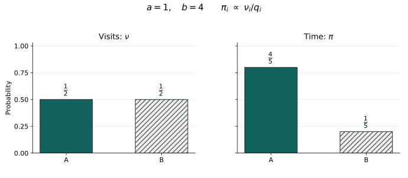

# 第二十二章：随机过程怎样在瞬间发生跳跃？——Continuous-time Markov chains

一台机器坏了，维修人员开始工作。故障前的等待和修复前的等待，没有理由使用同一个速率。机器修好以后，原来的故障时钟又开始运行。若同时有几台机器，下一次响起的时钟还可能改变其余机器的工作条件。每一次变化都很简单，整条时间记录却不能再由一个固定速率的计数过程包办。

更令人不安的情形出现在增长中：个体越多，下一次出生越快。如果系统不断加速，一段段严格正的等待，能否在有限时间里全部用完？在问长期分布以前，我们必须先确定，局部规则究竟给出了一条可以走多久的路径。

## 22.1 先分开“等多久”和“去哪里”

对只有“工作、维修”两个状态的机器，可以在工作时等 Exp(a)，转到维修；在维修时等 Exp(b)，转回工作。若一个状态有多种可能变化，第21章的指数竞争说明：各变化速率先相加，决定总等待，再按各速率的比例选择去向。

因此，状态 i 的一份局部规则包含两件事：离开速度 qᵢ，以及离开以后选择 j 的概率 rᵢⱼ。把它们合在一起写成 qᵢⱼ=qᵢrᵢⱼ，既能描述等待，也能描述方向。但 rᵢᵢ 不应把一次没有改变状态的响声算成真实跳跃；否则同一条可见路径可以因任意添加空响而得到不同的“离开速度”。

\[
q_{ij}\ge0\ (j\ne i),\qquad q_i=\sum_{j\ne i}q_{ij}<\infty,\qquad q_{ii}=-q_i.
\]

本章先以有限或可数集合 E 为状态空间，使用离散 σ-代数。上式定义稳定、保守的速率矩阵 Q：“稳定”指每个 qᵢ 有限，不表示全体速率有共同上界；“保守”指每行代数和为0，不表示过程已经证明不会爆炸。若 qᵢ=0，i 是吸收状态。允许直接杀死的次保守矩阵可通过加入墓地扩展，但这里不把两种假设混写。

## 22.2 把局部规则接成一条记录

按一个固定次序列出 E。对于 qᵢ>0，令 rᵢⱼ=qᵢⱼ/qᵢ（j≠i），rᵢᵢ=0；qᵢ=0 时令 rᵢᵢ=1。用一列独立均匀变量，按这些行分布逐次选择 Y₀,Y₁,…；这就是嵌入链。它只记录跳后状态，把等待从记录中拿掉。可数状态上的逆累积分配是可测的，这一构造只需第八、十章已经建立的可数随机实验，不把一般可测空间的额外困难藏起来。

另取与整条嵌入链独立的 iid Exp(1) 变量 E₀,E₁,…。这里 Eₙ 表示随机变量，E 表示状态集合。把单位时钟按当前速度伸缩：Hₙ=Eₙ/q_{Yₙ}，若速率为0则 Hₙ=∞。令 T₀=0，Tₙ=Σₖ₌₀ⁿ⁻¹Hₖ。一旦出现无限等待，后续 T 都取∞，不进行 ∞−∞ 运算。

\[
\zeta=\lim_{n\to\infty}T_n,\qquad
 X_t=\begin{cases}Y_n,&T_n\le t<T_{n+1},\\
 \Delta,&t\ge\zeta,\end{cases}\qquad t<\infty.
\]

Δ 是 E 之外的吸收墓地。若 ζ 有限，称为爆炸时刻；从 ζ 开始留在 Δ，是最小过程的约定。若遇到吸收状态，T 的后续值为∞，ζ=∞，路径留在原状态而不是进入 Δ。两种“以后不再跳”的原因完全不同。

可测性可以直接核查：{Xₜ=j} 是 {Yₙ=j,Tₙ≤t<Tₙ₊₁} 的可数并，{Xₜ=Δ}={ζ≤t}。连同时间变量也可测，因为每个随机时间区间的指标在乘积 σ-代数上可测。在 t<ζ 的每个紧时间段中只有有限次跳跃，路径右连续并有左极限。爆炸后墓地约定保留右连续性；在爆炸点，离散 E∪{Δ} 中的左极限可能不存在，不能宣称整条爆炸路径都是该离散空间中的 càdlàg 路径。

## 22.3 局部的无记忆怎样给出 Markov 性

固定 t，在尚未爆炸的事件上，把历史按已经完成的跳数 n 分片。若 Yₙ=i，历史已经确定 H₀,…,Hₙ₋₁，以及当前等待满足 Hₙ>t−Tₙ。它尚未看见离开 i 时使用的下一份均匀选择，也尚未看见后来那些独立时钟。给定进入时刻和这些过去数据，指数无记忆把当前余等待恢复为 Exp(qᵢ)，与未用的去向选择独立。

这一步也适用于随机年龄：先对进入时刻与有限历史坐标的简单函数积分，利用独立乘积密度得到条件尾 e^(−qᵢs)，再以单调类推广。对 n 求可数和，未来路径的条件律只由 i 决定；爆炸后则恒为 Δ。设 Fₜ⁰=σ(Xᵤ:0≤u≤t)，于是对有界未来柱函数 G 有：

\[
E_i[G(X_{t+s_1},\ldots,X_{t+s_k})\mid\mathcal F_t^0]
 =E_{X_t}[G(X_{s_1},\ldots,X_{s_k})].
\]

这是从构造证明的 Markov 性，而不是在取出等待以后附加的一句口号。记 pᵢⱼ(t)=Pᵢ(Xₜ=j)，i,j∈E。其行和等于 Pᵢ(ζ>t)，可能小于1；在 E∪{Δ} 上则是完整概率转移。条件平均和非负求和给出 Chapman–Kolmogorov 方程。

\[
p_{ij}(t+s)=\sum_{k\in E}p_{ik}(t)p_{kj}(s),\qquad P(0)=I.
\]

短时速率也应从路径验证。固定初态 i，一次跳到 k 后在 h 内再跳的概率至多 1−e^(−qₖh)。所以两次以上真实跳跃的概率不超过 hΣₖ≠ᵢqᵢₖ(1−e^(−qₖh))=o(h)，因为 Σqᵢₖ=qᵢ<∞，可用控制收敛。一次跳至 j 并保持到 h 的概率为 ∫₀ʰe^(−qᵢs)qᵢⱼe^(−qⱼ(h−s))ds。

\[
p_{ij}(h)=q_{ij}h+o(h)\ (j\ne i),\qquad
 p_{ii}(h)=1-q_i h+o(h).
\]

每个小量是固定 i、j 下的结论，不能未经证明把它对无界状态集合一致求和。“所有行分别有正确导数”与“无限矩阵可以随意微分相乘”，不是同一句话。

## 22.4 观察决定的时刻仍能重新开始吗

对这个已经构造好的跳链，停止重启可以沿第21章的办法独立证明。令 τ 是原始自然滤过的几乎必然有限停止时刻，Fτ 按事件条件定义；在 {τ=∞} 零集上作固定取值约定。令 τₘ=2⁻ᵐ⌈2ᵐτ⌉。对 A∈Fτ，在每个格点 {τₘ=j2⁻ᵐ} 上，A 的相应分片属于该格点的信息。

\[
E_i[\mathbf1_A G(X_{\tau_m+s_1},\ldots,X_{\tau_m+s_k})]
 =E_i[\mathbf1_A\,g(X_{\tau_m})],\qquad
 g(x)=E_xG(X_{s_1},\ldots,X_{s_k}).
\]

有界性控制可数格点求和。右连续与离散状态使有限个 X_{τₘ+s}、X_{τₘ} 最终等于其极限，包含 τ=ζ 时取 Δ 的情形。因此两边都可用控制收敛。这就给出专用强 Markov 性。停止值可测性由 X_{τ∧t} 的向上格点逼近得到：在时刻 t 以内，使用 τₘ∧t 的有限格点分片；其极限是 X_{τ∧t}，故 {τ≤t,Xτ=j}∈Fₜ⁰。

这不是从尚未建立的一般连续时间正则化定理借来的结论。它依赖当前路径的右连续、离散状态和明确的墓地规则。推广到一般状态空间时，“接近的时刻”不再迫使状态最终相等，所需的新工具留给后面的路径与半群理论。

## 22.5 为什么要逐次计算跳跃次数

直接把 Q 写成指数级数，在无界速率下可能连各项是否有意义都不清楚。路径构造提供了更安全的展开：先算一次也没跳，再算恰好跳一次，依次累加。记 p⁽ⁿ⁾ᵢⱼ(t) 为截至 t 恰有 n 次真实跳跃、尚未爆炸且位于 j 的概率。

\[
p^{(0)}_{ij}(t)=\delta_{ij}e^{-q_i t},\qquad
 p^{(n+1)}_{ij}(t)=\int_0^t e^{-q_i s}\sum_{k\ne i}q_{ik}\,p^{(n)}_{kj}(t-s)\,ds,\qquad
 p_{ij}(t)=\sum_{n=0}^\infty p^{(n)}_{ij}(t).
\]

第一次跳跃在 s 发生并去 k 的密度是 e^(−qᵢs)qᵢₖ；余下时间再发生 n 次跳。各项非负，Tonelli 允许积分、状态求和和跳数求和交换。由于每条 t<ζ 的路径只有有限次跳，最后的和既没有遗漏，也不会把爆炸后重新出现的质量算进来。

“最小”还有精确的方程意义。任一非负矩阵函数 R 若满足相同的第一次跳跃积分方程，便先有 R≥p⁽⁰⁾，再代入得到 R≥p⁽⁰⁾+p⁽¹⁾，归纳得 R≥Σₙ≤ₘp⁽ⁿ⁾。单调极限给出 R≥P。若已证明 P 的行和为1，那么任何行和不超过1的这种 R 都只能等于 P。非爆炸由此同时给出这一类解的唯一性。

## 22.6 从第一跳读出后向方程

把展开按第一次跳跃合并，得到不含形式微分的后向积分方程。将变量换成剩余时间 u，就能看见指数积分核如何产生微分方程。

\[
p_{ij}(t)=\delta_{ij}e^{-q_i t}
 +\int_0^t e^{-q_i(t-u)}\sum_{k\ne i}q_{ik}p_{kj}(u)\,du.
\]

内层和以 qᵢ 为界。即使先只知可测性，局部可积有界函数与指数核的这个卷积也是连续的：平移核在有限区间的 L¹ 差趋于0，端点短区间贡献也趋于0。于是所有 pₖⱼ 连续；Σqᵢₖpₖⱼ 再由可求和的固定行 qᵢₖ 控制，成为连续函数。积分因子微分便完全合法。

\[
\frac{d}{dt}p_{ij}(t)=\sum_{k\in E}q_{ik}p_{kj}(t)
 =-q_i p_{ij}(t)+\sum_{k\ne i}q_{ik}p_{kj}(t),\qquad P'(t)=QP(t).
\]

这里固定 i、j，导数在 t>0 存在且连续，在0取右导数。矩阵简记 P′(t)=QP(t) 仅表示以上逐元素等式，不声称无限矩阵在某个算子范数下可微。固定行的绝对和至多2qᵢ。它叫后向方程，因为我们固定最终观察时间，先从初态 i 退回到第一跳来分解；不是让物理时间倒流。

## 22.7 从最后一跳读出前向方程

也可以在到达 j 的最后一次跳跃处分解。恰好 n+1 次跳的路径，先在时刻 s 前完成 n 次跳、位于 k，再以速率 qₖⱼ 跳进 j，随后直到 t 不离开。把有序路径密度按最后一个时间积分，并用 Tonelli 求和，得到另一条完全严格的积分式。

\[
p_{ij}(t)=\delta_{ij}e^{-q_jt}
 +\int_0^t e^{-q_j(t-s)}a_{ij}(s)\,ds,\qquad
 a_{ij}(s)=\sum_{k\ne j}p_{ik}(s)q_{kj}.
\]

这次固定的是一列 qₖⱼ，列和可能无穷。好在等式本身给出了所需积分控制：对固定 T，指数因子至少 e^(−qⱼT)，所以 ∫₀ᵀaᵢⱼ(s)ds≤e^(qⱼT)。因此对每个固定 i、j，pᵢⱼ 局部绝对连续，并在 Lebesgue 几乎每个 t 满足以下逐元素前向方程；下式中的矩阵简记也只在这个意义下使用。

\[
\frac{d}{dt}p_{ij}(t)=\sum_{k\in E}p_{ik}(t)q_{kj}
 =a_{ij}(t)-q_jp_{ij}(t),\qquad P'(t)=P(t)Q\quad\text{a.e.}
\]

本节的一般无界速率结论首先是积分式以及几乎处处的微分式；不借一句“标准微分”悄悄扩大范围。若固定 j 的入速率 supₖ≠ⱼqₖⱼ 有限，则 aᵢⱼ 连续，微分式对每个 t>0 成立。理由是 X 在确定时刻几乎必然没有跳跃或爆炸：第一次等待有连续密度，条件于首跳去向后，对任何后续跳时或寿命再作一次卷积，仍无原子。路径遂在确定 t 两侧几乎必然局部恒定，给出转移行的总变差连续性；有界列可与该极限交换。

尤其当全体离开速率有共同上界时，所有列都满足此条件。前向方程描述流入与流出；后向方程描述从当前初态如何展开。有限矩阵里它们都是熟悉的 ODE；无限状态里，证明需要的求和控制却各不相同。

## 22.8 用一只快时钟容纳许多慢时钟

若 supᵢqᵢ≤c<∞，可以使用速率 c 的 Poisson 时钟。每次响起，根据转移矩阵 R=I+Q/c 选择新状态，允许留在原地。这些留步是为统一时钟而主动加入的虚跳，不能与嵌入链中的真实跳混淆。c=0 时一切吸收，单独处理；以下取 c>0。

\[
P(t)=e^{-ct}\sum_{n=0}^{\infty}\frac{(ct)^n}{n!}R^n,\qquad R=I+\frac Qc.
\]

固定状态 i 时，独立虚跳选择以概率 qᵢ/c 接受真实离开。第21章稀释证明使首次真实等待为 Exp(qᵢ)，接受时去 j 的概率为 qᵢⱼ/qᵢ。几何次失败后的未用选择和时钟未来仍独立，逐次给出第2节同一构造。每个有限时间只有有限次总响声，故不爆炸。

矩阵级数对有界函数一致收敛，因为 R 的上确界范数算子范数为1；导数级数在紧时间区间也一致收敛，受指数级数控制。因此前后向方程此时都逐点成立，且解唯一；它也是有界算子意义的 e^(tQ)。这个表示给出了有限链的实用计算办法，也明确告诉我们：无界速率时缺少的，正是一只共同有限速度的时钟。

## 22.9 无穷多段正等待，怎样挤进有限时间

给定 0<λₙ<∞，纯生链沿 i,i+1,i+2,… 单向行走，在 n 等待 Exp(λₙ)，各等待独立。路径从不回头，嵌入链没有任何不确定性，全部困难集中在时钟上。令 Eₙ 独立且为 Exp(1)，寿命就是 Σₙ≥ᵢEₙ/λₙ。

\[
\sum_{n\ge i}\lambda_n^{-1}<\infty\quad\Longrightarrow\quad
 E_i\zeta=\sum_{n\ge i}\lambda_n^{-1}<\infty\quad\Longrightarrow\quad
 P_i(\zeta<\infty)=1.
\]

反向不能只说“均值无穷，所以变量无穷”。第七、十二章已经提醒过这种推理会失败。这里要利用独立性，计算整个和的 Laplace 读数。对有限部分和相乘，再对 e^(−部分和) 用有界收敛：

\[
E_i e^{-\zeta}=\prod_{n\ge i}\frac{\lambda_n}{1+\lambda_n}
 =\exp\!\left[-\sum_{n\ge i}\log(1+\lambda_n^{-1})\right],\qquad e^{-\infty}=0.
\]

若 Σ1/λₙ=∞，或者无穷多个 1/λₙ≥1，使对数和至少反复增加 log2；或者最终都小于1，用 log(1+x)≥x/2 得对数和发散。于是 E e^(−ζ)=0，非负性迫使 ζ=∞ 几乎必然。纯生链的完整判别因此是：Σ1/λₙ 发散恰好对应非爆炸，收敛恰好对应几乎必然爆炸。

λₙ=λn 只产生调和级数的加速，不会爆炸；λₙ=2ⁿ 则使寿命均值有限。所有单次等待都严格正、所有 qₙ 都有限、所有行都保守，仍然挡不住后一种堆积。局部合法性与全局存在时间的区别，在这个最简单的路径上已经完全显现。

## 22.10 爆炸以后，矩阵没有写下的规则

以 E={0,1,2,…}、qₙ,ₙ₊₁=2ⁿ 为例。最小过程在有限寿命后进入墓地，E 内的转移行便丢失质量。但我们也可以另作规定：每次爆炸以后立即从0重新开始一份独立纯生记录。每个完整周期的寿命独立同分布且严格正，Borel–Cantelli 保证周期寿命之和发散，因此不会再把无穷多个完整周期挤在有限时间里。

再做一个版本，把每次爆炸后的重启状态改成1。两份重启记录在确定时刻都满足 Markov 性：时刻若在某周期内部，过去只告诉当前指数等待已经持续多久，余等待与以后周期仍独立；可按周期编号与周期内跳数作可数分片。两者都保持右连续，但在爆炸时没有离散 E 中的左极限。

它们仍有同一个 Q。固定初态 i，在 h 内完成爆炸至少要先完成两段独立的等待，所以其概率至多 (1−e^(−2ⁱh))(1−e^(−2ⁱ⁺¹h))=O(h²)。重启对固定状态的短时导数没有影响。然而从0出发，重启到1的版本永不返回0，p₀₀(t)=e^(−t)；重启到0的版本还包括“已爆炸、已重启且尚未再离开0”的正概率，故对某些 t 严格更大。

严格正性不需猜测寿命密度：ζ 有限几乎必然，故存在有限 t 使 P(ζ<t)>0；首周期寿命在 t 之前时，再等待至少 t−ζ 的概率为 e^(−(t−ζ))>0。这个反例没有声称两种过程都是非爆炸的 E 值 càdlàg 链。它说明：若允许越过爆炸边界继续，Q 没有指定怎样继续；若要求最小墓地规则，或先证明非爆炸，才会恢复相应的唯一性。

## 22.11 不用逐条追踪路径，也能排除爆炸吗

有界速率太强：λn 的纯生过程明明不爆炸，速率却无界。需要一种能限制路径过快逃向大状态的量。取 V:E→[1,∞)，每个有限水平集 {V<m} 都有限，并假定各行 Σⱼ≠ᵢqᵢⱼV(j) 有限。定义 QV(i)=Σⱼ≠ᵢqᵢⱼ[V(j)−V(i)]。条件 QV≤cV（c≥0）限制的不是每条路径的每次增长，而是当前位置的平均增长速度。

\[
QV(i)\le cV(i)\quad(i\in E)\qquad\Longrightarrow\qquad P_i(\zeta=\infty)=1.
\]

先证明所需的有限停止恒等，不能借用未来的随机积分。对有限 F⊂E，令 τF 为首次离开 F 的时间，取 C_F>maxᵢ∈Fqᵢ 且 C_F>0，把离开 F 以后的各行冻结为0，再用第8节的统一时钟。C_F 是局部响声速率，不是 QV≤cV 中的增长常数 c。每次虚跳以后，V 的条件平均增量等于 QV/C_F；包括最后一次跳到 F 外的实际取值。F 有限且各行 ΣqᵢⱼV(j) 有限，保证任意有限时间内这些增量绝对期望可积：绝对变化率在 F 上有有限最大值。

把时钟分成长度 h 的小格，或者直接对每次 Poisson 响声的有序时间密度求和，就得到“期望增量等于期望速率积分”。后一做法用第21章密度：对一次时间 s 的响声，给定其前状态，平均增量是 QV/C_F，响声平均密度为 C_F ds；Tonelli 先对绝对增量验证交换，再对正负部分相减。于是：

\[
E_i V(X_{t\wedge\tau_F})
 =V(i)+E_i\int_0^{t\wedge\tau_F} QV(X_s)\,ds.
\]

把刚才的求和再展开一次可消除“响声密度”的歧义。用 Jₙ 表示速率 C_F 时钟第 n 次响声，用 Cₙ 表示统一化的离散状态，K 表示首次离开 F 的离散步数。Jₙ₊₁ 的密度为 C_F e^(−C_Fs)(C_Fs)ⁿ/n!，独立于整列 C；第 n+1 次的条件增量为 QV(Cₙ)/C_F。由此期望总增量正是 ∫₀ᵗΣₙ≥₀e^(−C_Fs)(C_Fs)ⁿ/n! E[1_{n<K}QV(Cₙ)]ds，也就是上式的积分项。对绝对增量的同一计算以有限 F 上的最大绝对变化率乘 t 为界，先保证可积，再进行带符号交换。这是当前离散链加独立 Poisson 时钟的专用计算，没有调用一般点过程积分公式。

令 uF(t)=EᵢV(X_{t∧τF})。非负性给出 uF(t)≤V(i)+c∫₀ᵗuF(s)ds。反复代入，前 n 项为 V(i)Σₖ<n(ct)ᵏ/k!，余项至多 supₛ≤ₜuF(s)(ct)ⁿ/n!；有限 F 的上段积分界使此上确界有限。令 n→∞，得到 uF(t)≤e^(ct)V(i)。

\[
P_i(\tau_{\{V<m\}}\le t)\le \frac{e^{ct}V(i)}m,\qquad m>V(i).
\]

最后要说明爆炸确实迫使路径离开每个有限 F。在 F 中反复跳时，取 C≥max(1,maxᵢ∈Fqᵢ)，则 q≤C；给定整条嵌入链，对无穷多个落在 F 的下标，独立单位时钟至少以固定正概率贡献1/C以上的等待，Borel–Cantelli 使总等待发散。对可数有限水平集取共同概率一事件。于是 {ζ≤t} 包含于所有 {τ_{V<m}≤t}，上界随 m→∞ 归零。再对整数 t 取并，定理得证。

## 22.12 判据控制的是什么

对出生死亡链，qₙ,ₙ₊₁=aₙ，qₙ,ₙ₋₁=bₙ，取 V(n)=n+1。有 QV(n)=aₙ−bₙ≤aₙ。若 aₙ≤c(n+1)，不论死亡率多大，只要每个 bₙ 有限，都满足判据而不爆炸。因为死亡把路径推回较小状态；高频向下跳不可能在非负整数中无穷持续，除非同时有足够的向上补充。

这里并未把 QV 的一个上界当成所有爆炸问题的完整分类。若找不到合适 V，结论只是此判据没有回答；不能倒推必然爆炸。相反，第9节的精确纯生判别回答的是一个更窄模型中的充要问题。充分工具和完整刻画应当分清。

## 22.13 平衡方程为什么也要检查无穷求和

一份候选概率 π 若在所有时间都保持不变，定义为 πP(t)=π。把前向方程写成“流入等于流出”诱导 πQ=0，但在无限状态中，这个代数式不应取代概率定义。下面建立一个有明确范围的充分必要结论：假设 π 是概率且 Σᵢπᵢqᵢ<∞，那么 πQ=0 与 πP(t)=π 等价，P 为最小过程。

\[
\sum_i\pi_iq_i<\infty,\quad \pi Q=0
 \quad\Longleftrightarrow\quad \pi P(t)=\pi\quad(t\ge0).
\]

证明充分性，用已经逐点建立的后向方程。对有界 f:E→R，令 Pₜf(i)=Eᵢ[f(Xₜ);t<ζ]。第一次跳跃卷积同样给出 dPₜf(i)/dt=Q(Pₜf)(i)，导数绝对值至多2qᵢ‖f‖∞。π 的有限平均离开率允许微分与 π 求和交换；再以 Σᵢⱼπᵢ|qᵢⱼ|≤2Σπᵢqᵢ 作 Fubini：

\[
\frac d{dt}\sum_i\pi_iP_tf(i)
 =\sum_j\left(\sum_i\pi_iq_{ij}\right)P_tf(j)=0.
\]

初值给出不变性，取 f=1 还说明从 π 出发没有质量进入墓地。反向，若 π 不变，取坐标指标 f=1ⱼ，在0对 πPₜf 微分，同一个可求和导数界给出 πQ=0。证明没有把带符号的无穷和当作形式矩阵乘法。若 Q 不可约且 π 每个状态都为正，从 π 非爆炸又推出每个初态非爆炸。

有限平均速率是本节交换步骤的实际条件，不是说所有不变概率都必须满足它。一般不变概率、边界通量与无穷平均速率的细节留在更一般的过程理论中；不能把此处已证版本抹去条件后继续使用。

## 22.14 按跳数观察和按时间观察，会看见不同的状态

嵌入链每到一个状态便记一次，不管停留多长；时钟观察则给长等待更多机会。这与第十九章长度偏置的机制相同，但现在被加权的是状态停留，不是完整更新周期。设所有 qᵢ>0，嵌入链 R 有不变概率 ν，并且 Z=Σᵢνᵢ/qᵢ 有限。

\[
\pi_i=\frac{\nu_i/q_i}{Z},\qquad
 \sum_i\pi_iq_i=\frac1Z,\qquad
 (\pi Q)_j=\frac1Z\left(\sum_{i\ne j}\nu_ir_{ij}-\nu_j\right)=0.
\]

第13节因而证明 π 确为最小过程的不变概率，而不是只猜出一个权重。反向，若 π 不变且 0<α=Σπᵢqᵢ<∞，令 νᵢ=πᵢqᵢ/α，平衡式给出 νR=ν。吸收状态必须单独对待，不参与除以 qᵢ 的公式。

两状态机器的嵌入链永远交替，因此按跳数各占一半；按时间的比例却是 π工作=b/(a+b)，π维修=a/(a+b)。若维修很慢，记录本里工作与维修仍一一交替，随机时刻却更容易遇见维修。概率规律没有冲突，改变的是抽取记录的位置。

**跳数相等，时间可以不等。** 取工作状态 A、维修状态 B，a=1、b=4。左图的1/2来自嵌入链交替访问；右图的4/5、1/5是已证明的平稳时间权重，来自平均停留1与1/4。它们不是一条有限模拟的经验频率；图本身也不证明长期收敛。纹理与明暗同时区分状态，黑白印刷仍可读。[矢量 PDF](../assets/visuals/jump-clocks/state-time-weight.pdf) 与 SVG 使用相同精确参数。

## 22.15 为什么连续时间能消除有限链的周期障碍

有限不可约 Q 总能取 c>maxqᵢ，使统一时钟矩阵 R=I+Q/c 每个对角元都为正。R 不可约且非周期，第十七章已经完整证明 Rⁿ 向唯一不变概率 π 收敛。此 π 满足 πQ=0，因而也是连续链的不变概率。

\[
\|P_i(t)-\pi\|_{\rm TV}
 \le \sum_{n\ge0}e^{-ct}\frac{(ct)^n}{n!}\,\|R_i^n-\pi\|_{\rm TV}\longrightarrow0.
\]

为核查极限，给定 ε>0，先选 K 使所有 n≥K 的离散距离小于 ε；剩余有限项之和不超过 P(Poisson(ct)<K)，随 t→∞ 归零。连续时间并非使嵌入链突然非周期；它把观察时已走的步数随机化，并通过虚留步获得非周期矩阵。即使真实嵌入链永远交替，机器在确定的大时间仍趋向唯一平衡。一般 Harris 与更强 mixing 理论没有在此被代替。

## 22.16 每个个体各有一只时钟：Yule 过程

取 λ>0，让每个个体独立地以速率 λ 生出一个新个体，父代继续存在。当前有 n 个个体时，指数竞争使下一次出生等待为 Exp(λn)，亲本在 n 个个体中均匀选择。因此人口 Zₜ 是 λₙ=λn 的纯生链。第9节的调和级数判别已经保证它不会在有限时间产生无穷人口。以下 Zₜ 始终表示人口。

从1出发，前向积分式按状态 n 逐级封闭。p₁(t)=e^(−λt)，而 n≥2 满足 pₙ′=λ(n−1)pₙ₋₁−λnpₙ，pₙ(0)=0。每一行只有一个流入状态，没有无穷列交换问题。用积分因子归纳，或将下式代回并用这一逐级唯一性，得到：

\[
P_1(Z_t=n)=a(1-a)^{n-1},\quad n\ge1,\qquad
 a=e^{-\lambda t},\qquad E_1Z_t=a^{-1},\quad E_1Z_t^2=\frac{2-a}{a^2}.
\]

各项相加为1；均值与二阶矩由几何级数微分得到。把 z 个初始个体的后代独立构造再合并，指数竞争给出相同的 λn 规则，故其总人口与初态 z 的纯生链同律。这才建立分枝性，而不是从“人口速率线性”四个字直接宣布所有家族独立。

## 22.17 连续时钟上的人口极限，不借用未来的收敛定理

分枝性和 Markov 性给出 E(Zₜ|Fₛ)=Zₛe^(λ(t−s))，所以 Mₜ=e^(−λt)Zₜ 是鞅，且 EMₜ²=2−e^(−λt)≤2。但第十五章的离散时间收敛定理不能不加论证地覆盖全部实数时间。这个特殊模型可以用第十二章随机级数直接完成。

\[
\lambda A_n=\sum_{k=1}^{n-1}\frac{E_k}{k},\qquad
 \lambda A_n-\log n
 =\sum_{k=1}^{n-1}\frac{E_k-1}{k}
 +\left(\sum_{k=1}^{n-1}\frac1k-\log n\right)\longrightarrow L\in\mathbb R.
\]

这里 Aₙ 是人口首次达到 n 的时刻，A₁=0；用 Aₙ 区分于第2节第 n 次跳的时刻 Tₙ。中心级数各项独立、方差和 Σ1/k² 有限，十二章的完整级数定理保证几乎必然收敛；括号内调和和与对数之差的收敛由积分夹逼及单调性得到。于是 n e^(−λAₙ)→e^(−L)>0。

在 Aₙ≤t<Aₙ₊₁ 时，n e^(−λAₙ₊₁)≤Mₜ≤n e^(−λAₙ)。左右两端同趋 e^(−L)，因为 n/(n+1)→1。这给出同一事件上全部实时间的极限 W>0。二阶矩界使 {Mₜ:t≥0} 一致可积：E[Mₜ;Mₜ>K]≤EMₜ²/K≤2/K。第七章 Vitali 判别对任意 tₘ→∞ 给出 L¹ 收敛，因而 EW=1。

\[
P(M_t>x)=(1-e^{-\lambda t})^{\lfloor xe^{\lambda t}\rfloor}
 \longrightarrow e^{-x}\quad(x\ge0),\qquad W\sim{\rm Exp}(1).
\]

几何分布的精确尾式又识别出极限律。这里存活必然发生，随机比例却仍不确定；平均增长曲线不能指定某个家族最后占它的几成。有限二阶矩和显式时钟使本例没有丢掉平均质量，不能据此抹去第二十章一般家族的 L log L 障碍。

## 22.18 一次生育可以带来多个孩子，也可以带来灭绝

更一般地，取 β>0，让每个个体独立生活 Exp(β) 时间，死亡时由 K 个孩子替代，P(K=k)=pₖ，K 为有限非负整数且 m=EK<∞。每个孩子重复同样规则。当前人口 z 时，所有生育完成事件合计速率为 βz，选择亲本均匀，人口增量是 K−1。K=1 时人口不变，却确有一次生命更替；人口链的真实离开速率因此不是 βz。

\[
q_{z,z-1+k}=\beta z p_k\quad(k\ne1),\qquad
 q_z=\beta z(1-p_1),\qquad q_0=0.
\]

要证明整棵有时间的家族确实存在，不能只删掉看不见的单孩事件。加一个计数 J，记录全部生育完成。在状态 (z,j)，以速率 βzpₖ 跳到 (z−1+k,j+1)；z=0 吸收。取 V(z,j)=z+j+1，有限水平集有限，每次 V 增量为 k，所以 QV=βzm≤βmV。第11节给出所有生育事件的非爆炸，而不仅是可见人口跳跃的非爆炸。

每个事件再用独立均匀选择亲本，并按有限孩子编号接上家谱；有限时间只发生有限个事件，每个事件只有有限孩子，所以得到可数、有明确定义出生死亡时刻的树。指数竞争和无记忆性保证，这与给每个已出生个体独立寿命和后代数的逐个体构造一致。不同初始祖先的树可以在独立乘积空间上分别建立，分枝性因而有实际的概率构造。

独立寿命与“均匀选亲本”的对应可以再核对一次。对 z 个独立 Exp(β) 时钟，指定第 i 个在 s 最先响起，并要求其余残余寿命分别超过 rⱼ，联合概率密度为 βe^(−βzs)∏ⱼ≠ᵢe^(−βrⱼ)ds。除以前两项的边缘密度以后，余下时钟重新成为独立 Exp(β)，与最先时刻和亲本编号无关。新生孩子再接入独立时钟，逐事件归纳即可把两种构造精确对齐；并未假定在任意相关时钟中也能均匀选亲本。

## 22.19 世代的命运与时间的速度，要分别计算

忽略寿命，这棵树就是第二十章的 Galton–Watson 树，灭绝概率仍是 f(s)=EKˢ 的最小不动点。非爆炸使两种灭绝事件一致：若家谱在有限代终止，有限多个个体的有限寿命使人口在有限时间变0；若家谱代代存活，人口不能在某个有限时间先变0再产生后代。这个结论不涉及尚未证明的一般连续状态分枝。

时间尺度上的平均增长需要另算。先由停止的 V 估计和 Fatou 得到 E(Zₜ+Jₜ+1)≤(z+1)e^(βmt)，保证人口均值在紧时间区间有限。从一个祖先出发，令 u(t)=EZₜ。第一次寿命若超过 t，仍有1人；若在 s≤t 结束，平均留下 m 份彼此独立、年龄 t−s 的子家族。非负 Fubini 给出：

\[
u(t)=e^{-\beta t}
 +m\int_0^t\beta e^{-\beta s}u(t-s)\,ds,\qquad
 u(t)=e^{\beta(m-1)t}.
\]

证明最后一步，把等式乘 e^(βt)，得到 v(t)=1+βm∫₀ᵗv(r)dr。局部可积性先给连续、再给可微，解 v′=βmv、v(0)=1。分枝性随后给出 e^(−β(m−1)t)Zₜ 的鞅性质。若 m>1 且 p₀>0，平均人口指数增长仍与正灭绝概率并存；若 p₁=1，世代永不灭绝、人口却恒为1，生命事件时钟继续响。

一般连续时间分枝的归一化极限、L log L 边界和扩散极限，不由这个均值公式自动给出。本章完成的是有限均值离散后代、指数寿命模型的构造、非爆炸、灭绝和均值鞅，以及 Yule 模型的完整显式极限；一般归一化极限、L log L 边界与扩散近似的进一步证明归属尚未确定。第五十八章的主线是多叉 CRT 与质量分裂，不能因此被当成一般连续时间分枝理论的证明位置。

## 22.20 一份矩阵与一条路径之间，还隔着什么

最初那台机器只需要两只时钟。把同样的局部描述放到无穷状态以后，我们发现了此前看不见的边界：一连串完全合法的下一步，可以在有限时间里耗尽所有步数。速率矩阵写下局部改变，最小构造说明它能走到哪里，非爆炸证明才让这份规则覆盖整个未来。

前后向方程也因此不只是矩阵记号的两种摆放。它们分别从第一跳和最后一跳组织路径，对无穷求和提出不同要求。不变概率还迫使我们区分按变化次数与按停留时间观察的世界；Yule 家族则表明，给树加上真实时间以后，随机增长比例仍需要自己的证明。

跳跃之间，路径暂时停住。如果把变化越分越细，使短时间内出现越来越多、越来越小的波动，“每次变化合法”仍不能替代路径存在与路径极限的论证。我们已经学会不把一个局部规则误认成整条未来；下一段探索将把这份谨慎带到连续路径面前。

## 史料、证明来源与范围

Kolmogorov 的1931年论文 [Über die analytischen Methoden in der Wahrscheinlichkeitsrechnung](https://link.springer.com/article/10.1007/BF01457949) 是分析方法研究随机演化的原始文献，刊于 Mathematische Annalen 104，415–458页。本章的可数乘积构造、墓地约定与逐次跳跃展开是现代重建，不把这些表述当成论文当年的原样。

Yule 原文 [A Mathematical Theory of Evolution](https://math.uchicago.edu/~shmuel/Network-course-readings/Yule.pdf) 讨论物种与属的增长，载于通常编目为1925年的 Philosophical Transactions B 第213卷21–87页；扫描首页也保留了1924年的单篇印行日期。本章将线性纯生机制重建为独立指数时钟的人口模型，不把其生物假设当作普遍事实，也不混淆编目卷年与单篇日期。

技术范围可与 Norris 的[作者机构目录](https://www.statslab.cam.ac.uk/~jrn10/Markov/)及其[前后向方程节](https://www.statslab.cam.ac.uk/~jrn10/Markov/s28.pdf) 对照。本章直接给出所承担结果的证明，不复制该书表述。一般无界速率的前向方程以积分形式及几乎处处微分形式建立；列有界时逐点建立。一般状态空间的跳核、无限活动、一般边界分类、Harris理论与连续状态分枝不计为本章完成。

本章的直接前置是[独立随机级数](12-infinite-sums.md)、[离散停止与信息](16-stopping-times.md)、[Markov结构](17-markov-chains.md)、[分枝家族](20-branching.md)及[指数时钟与Poisson过程](21-poisson-process.md)。测度唯一性与单调类工具见[配套完整证明](../foundations/t-mclass.md)。
