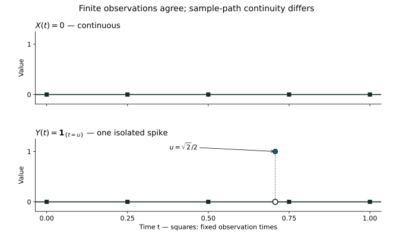

# 第二十三章：Gaussian 快照怎样真正拼成连续路径？——连续修改、Gaussian processes、Wiener measure

一台仪器只记录有限个时刻的位置。把采样频率提高，记录会越来越密，但仪器并没有因此证明两次记录之间发生了什么。对随机运动，缺少的还不只是某些位置的数值：我们需要知道，所有这些读数能不能由同一条连续曲线实现。

第四章给出的 Gaussian 增量与协方差核已经十分具体。现在不再把它们当作一条已经存在的曲线的描述，而把它们当作有待兑现的要求。要兑现它们，必须先分清：给定有限次观察的规律，选择某个过程的版本，以及在连续函数空间上建立概率，分别解决了什么问题。

## 23.1 每张照片都一样，影片却可以不同

先把运动简化到极端：每次观察都应当得到0。恒零过程当然满足这个要求。第八章给过另一个实现：先在(0,1)均匀选择一个U，只在这个随机时刻把值改成1。

\[
X_t=0,\qquad Y_t=\mathbf1_{\{t=U\}},\qquad 0\le t\le1.
\]

对预先固定的有限个时刻，命中U的概率为0。因此两者的全部有限维分布相同。但Y的每条路径都有一个孤立尖点，X的路径却处处连续。这里没有违反第八章的扩张唯一性：它比较的是坐标事件系统上的分布，不是未经确认可测的任意路径性质。

<figure class="publication-math-figure" id="visual-path-version-spike"><figcaption>图23.1　有限观察没有看见的尖点。图中固定u=√2/2只为示意；反例中的U服从均匀分布。虚竖线是定位辅助线，不是函数图像。相同有限维分布不保证给定版本的路径连续。<a href="../assets/visuals/path-versions/path-version-spike.pdf">矢量PDF</a>。</figcaption></figure>

在同一概率空间上，若对每个固定t都有Xₜ=Yₜ几乎必然，称它们互为修改；若存在同一个可测满概率集合，在它上面对所有t同时相等，称它们不可区分。这两个量词的次序不能交换。上例互为修改，但并不可区分。若两个修改均有连续路径，则在可数稠密时刻上取相等事件的可数交，再用连续性延拓，它们就不可区分。

因此，我们不必要求最初由扩张得到的每条坐标记录已经连续。真正需要证明的是：能否在不改变任何有限次观察规律的情况下，选择一个连续修改？这个允许逐个时刻修改零集的要求，既保留了观测概率，又给路径结构留下了空间。

## 23.2 连续性为何不自动成为一个坐标事件

第八章已经证明，原始乘积σ-代数中的一个事件至多依赖可数多个坐标：具有这种性质的集合包含柱集，并对补集和可数并封闭。若连续函数集合也属于这个σ-代数，它就只依赖某个可数时刻集J。把零函数在J以外的一个时刻改成1，不改变J上的任何读数，却破坏连续性，便得到矛盾。这里说的是未经完备化的原始乘积事件系统。

这个障碍不能靠写一句“连续路径的概率为1”消失。我们将实际构造一个取值于连续函数空间的可测映射，再把原概率推到这个空间上。这样，连续性成为值域本身的要求，而不再是对过大坐标空间中一个不可测集合的冒险提问。

[第八章的坐标论证](08-infinite-experiments.md#chapter-8-section-8-14)说明了障碍；下面必须补上的是克服它的实际构造。先从照片之间应当具有的 Gaussian 关系开始。

## 23.3 把所有方向的读数一起指定

只要求每个位置都是正态变量，还不能确定一组位置的联合规律：相同边缘可以有不同依赖。对于向量，真正稳定的 Gaussian 要求是，每个实线性组合都服从一维正态分布，允许方差为0的常量。这一定义让我们能够同时读取各个方向，而不是只读取坐标轴。

设向量Z的均值为m，协方差矩阵为Γ。按定义，uᵀZ的均值与方差分别为uᵀm和uᵀΓu。第十一章从Gaussian积分推导的一维公式 \(\mathbb E e^{irV}=\exp\{ir\,\mathbb EV-r^2\operatorname{Var}(V)/2\}\)，用于V=uᵀZ并取r=1，便给出：

\[
\mathbb E e^{\,i u^\top Z}=\exp\{i u^\top m-\tfrac12 u^\top\Gamma u\},\qquad u\in\mathbb R^d.
\]

这里计算各方向读数用的是一维正态公式，包括方差为0的常量情形；多元唯一性不负责推导这个积分公式。第十四章的唯一性随后保证：这些对所有u的读数至多对应一份联合概率分布。计算特征函数与由特征函数识别分布，是两个不同的步骤。

Γ必须对称非负定，因为任一方向的方差不能为负。反过来，这也是充分条件。为避免把退化情形藏在“取平方根”中，直接用归纳构造Γ=AAᵀ。若Γ₁₁=0，非负二次型在向量xe₁+eⱼ上对所有x非负，迫使Γ₁ⱼ=0，删去首行首列后归纳。若Γ₁₁=a>0，把矩阵分成首坐标与其余坐标，其余块记C，交叉列记b；代入首坐标−bᵀv/a说明C−bbᵀ/a非负定。

\[
\Gamma=\begin{pmatrix}a&b^\top\\b&C\end{pmatrix},\quad DD^\top=C-bb^\top/a,\quad A=\begin{pmatrix}\sqrt a&0\\b/\sqrt a&D\end{pmatrix}.
\]

取独立标准正态ξ₁,…,ξ_d，第八章的乘积构造已经提供它们。Z=m+Aξ的每个线性组合均为正态，这由独立正态特征函数相乘直接得到，协方差恰为Γ。于是任何对称非负定矩阵都对应唯一的Gaussian向量分布。不同块之间协方差全为0时，上式按两块分解成特征函数乘积，再用唯一性，得到两块独立。这里零协方差推出独立，使用了联合Gaussian结构，对一般向量并不成立。

## 23.4 协方差核先创造坐标世界

对于全部时刻，有限矩阵变成一个核K(s,t)。我们所需的条件不是K逐点非负；协方差本身可以为负。要求是K对称，并且任意有限组时刻和系数都满足下面的非负二次型。给定均值函数m后，这个条件恰好保证每一组照片都有合法的Gaussian联合分布。

\[
\sum_{j,k=1}^d c_jc_kK(t_j,t_k)\ge0\qquad(d\ge1,\ c_j\in\mathbb R).
\]

删除坐标或重排坐标后，均值与协方差按同样方式删除或重排，Gaussian唯一性说明这些有限维分布相容。重复的时刻也相容，因为相应两个坐标之差方差为0。[第八章的Kolmogorov扩张](08-infinite-experiments.md#chapter-8-section-8-13)遂给出一个实值过程，具有这些有限维分布。我们称其为Gaussian过程。本步只使用实数这一标准Borel状态空间，没有声称获得连续路径。

第四章的候选核K(s,t)=min(s,t)，s,t≥0，确实满足条件。它把每个时刻看成一段区间的指示函数：

\[
\sum_{j,k}c_jc_k\min(t_j,t_k)=\int_0^\infty\left(\sum_j c_j\mathbf1_{[0,t_j]}(u)\right)^2du\ge0.
\]

非负定性因而不是某个偶然的矩阵技巧，而是平方范数留下的痕迹。稍后我们会让这种内积结构本身成为构造Gaussian随机性的工具。眼下还缺少另一个控制：当两个时刻很近时，究竟能不能同时阻止所有细小时间区间里的大波动？

## 23.5 连续协方差仍然不够

Gaussian过程的均值与协方差决定了全部有限维规律。这容易诱使我们认为，连续的均值和协方差应当自动给出连续修改。它们确实保证均方连续：增量的二次矩由K(s,s)+K(t,t)−2K(s,t)与均值差的平方组成。然而，逐个控制一对时刻，还没有控制一整批时刻。下面的例子把这个差别量化。

在互不相交的区间I_n=(2⁻⁽ⁿ⁺¹⁾,2⁻ⁿ)，n≥2，上画高度1、端点为0、峰顶在中点c_n的三角形函数f_n，并在区间外置0。取独立标准正态Z_n。定义：

\[
a_n=(\log(n+1))^{-1/2},\qquad X_t=\sum_{n\ge2}a_n Z_n f_n(t),\quad X_0=0,\quad 0\le t\le1.
\]

每个t至多有一个非零项，每组有限坐标只涉及有限个Z_n，所以这是中心Gaussian过程。协方差为Σa_n²f_n(s)f_n(t)。远离0是局部有限的连续函数；靠近0时，若两点属于同一个I_n，绝对值至多a_n²→0，否则为0。因此协方差在整个方形上连续。

但峰顶的值不趋0。为看清概率大小，对标准正态Z及u≥1，只在[u,u+1/u]上积分密度，便得到某个绝对常数c>0满足：

\[
P(|Z|>u)\ge c\,u^{-1}e^{-u^2/2},\qquad P(|a_nZ_n|>1)\ge\frac{c}{\sqrt{n+1}\sqrt{\log(n+1)}}.
\]

第一式因为区间长度为1/u，区间内密度至少是(2π)⁻¹ᐟ²exp(−(u+1/u)²/2)，而(u+1/u)²≤u²+3。第二式的级数发散，例如其项最终大于某个正倍数的n⁻³ᐟ⁴。峰顶事件独立，第二Borel–Cantelli引理便说明|X_cₙ|>1无穷多次几乎必然成立。

任何修改都在可数个时刻0,c₂,c₃,…与X同时相等于某个满概率集合上。若它连续，c_n→0应使这些峰顶趋于0，矛盾。因此这个过程没有连续修改。缺少的不是Gaussian有限维信息，而是足以控制大量潜在峰顶的统一增量估计。

## 23.6 矩估计必须支付多少次比较

在长度2⁻ⁿ的网格上，有2ⁿ条相邻边。若某一条边出现大增量的概率很小，仍需把这2ⁿ个可能位置一起计入。连续性判据中的指数，正是从这个计数产生，而不是为了公式美观。

以下给出本章所需的实值、一维时间版本。设Xₜ，0≤t≤1，为同一概率空间上的实随机变量族。若存在α>0、β>0及有限常数C，使所有s,t满足下式，则X存在连续修改；并且可选择同一个修改，使对每个0<γ<β/α，其路径在[0,1]上γ-Hölder连续，随机Hölder常数几乎必然有限。

\[
\mathbb E|X_t-X_s|^\alpha\le C|t-s|^{1+\beta},\qquad |Y_t-Y_s|\le C_\gamma(\omega)|t-s|^\gamma.
\]

这是Kolmogorov连续修改判据在此处的精确范围；并不是连续修改存在的必要条件。α不要求是整数，原过程也不要求预先联合可测。下面的构造会提供一个连续、联合可测的修改。证明只需要第七章的Markov不等式与第一Borel–Cantelli引理，不使用下一章的路径紧性。

## 23.7 先把可数网格上的振动锁住

固定0<γ<β/α。记D_n为j2⁻ⁿ，0≤j≤2ⁿ，组成的网格，A_n为这一层至少有一条相邻边的增量大于2⁻ⁿᵞ的事件。对每条边用Markov不等式，再取有限并界：

\[
P(A_n)\le\sum_{j=1}^{2^n}\frac{\mathbb E|X_{j2^{-n}}-X_{(j-1)2^{-n}}|^\alpha}{2^{-n\alpha\gamma}}\le C\,2^{-n(\beta-\alpha\gamma)},\qquad \sum_{n\ge0}P(A_n)<\infty.
\]

β−αγ>0恰好使级数收敛。第一Borel–Cantelli引理说明，几乎必然只有有限多层失控。那些有限层的边数也有限，而所有坐标实值，所以把它们的增量一并吸收到某个有限随机常数H中，就得到一个可测满概率集合Ω_γ，在它上面对所有n和j同时有：

\[
|X_{j2^{-n}}-X_{(j-1)2^{-n}}|\le H\,2^{-n\gamma}.
\]

仅有相邻边估计还不是任意两点的Hölder估计。若沿一层网格走过很多条边直接相加，会损失距离的正确指数。应当让两个点分别沿越来越细的网格靠近，而只在适当粗的一层横跨一条边。这就是下面的链式比较。

对任意t，令r_n(t)=2⁻ⁿ⌊2ⁿt⌋，特别r_n(1)=1。相邻两个逼近r_n(t)、r_n₊₁(t)或相同，或是D_n₊₁的一条相邻边。因此在Ω_γ上，X_rₙ₍ₜ₎是Cauchy列，而且它从第n层到极限的误差有与t无关的上界。记极限为Y_t：

\[
|Y_t-X_{r_n(t)}|\le H\sum_{\ell=n+1}^\infty2^{-\ell\gamma}=\frac{H\,2^{-(n+1)\gamma}}{1-2^{-\gamma}}.
\]

若0<|t−s|≤2⁻ⁿ，则r_n(s)和r_n(t)相同或相邻。把两端尾误差与中间一条边相加，得到|Y_t−Y_s|≤H(1+2·2⁻ᵞ/(1−2⁻ᵞ))2⁻ⁿᵞ。对给定距离选n使2⁻⁽ⁿ⁺¹⁾<|t−s|≤2⁻ⁿ，便得到所需的γ-Hölder界，常数再乘2ᵞ。t=s时不等式直接成立。

我们没有在每个时刻分别祈求一次连续性，而是在可数个网格上排除了失控，再用几何级数补上网格之间的全部时刻。矩条件中的额外β，正用于抵消同一层上比较次数的增长，并留下可求和的余量。

## 23.8 网格极限为何仍是原来的过程

还有两个不能跳过的步骤：Y_t是否可测，以及它是否保留原来的X_t。先取一个允许的γ₀，按上一节在Ω_γ₀上定义极限，在其可测补集上对所有t置0。每个固定t的Y_t于是是可测随机变量；每条路径均连续，包括补集上的零路径。

另一方面，原来的矩估计给出X_rₙ₍ₜ₎→X_t依概率收敛，而构造给出它几乎必然趋于Y_t。两种极限必须几乎必然相等。具体地，任意ε>0都有：

\[
P(|Y_t-X_t|>\varepsilon)\le P(|Y_t-X_{r_n(t)}|>\varepsilon/2)+P(|X_{r_n(t)}-X_t|>\varepsilon/2)\longrightarrow0.
\]

第一项由几乎必然收敛和有界收敛趋0，第二项由矩条件及Markov不等式趋0。因此Y是X的修改。它们的有限维分布相同，因为有限组时刻的相等事件可以取有限交。这一步不要求原过程的路径已经连续，更没有对不可数多个原时刻取零集之并。

再选择可数个允许的指数γ_k向β/α递增，并把相应Ω_γₖ与Ω_γ₀取交。在这个满概率集合上，同一个网格极限具有每个γ_k的估计，因而在长度至多1的区间上也具有任意更小的γ估计。一个修改由此同时获得所有γ<β/α的结论。这里取的是可数交。

若过程定义在[0,∞)，且每个[0,M]上有相应矩界，先线性换时标，在每个整数区间[0,M]构造连续修改。相邻构造在重叠区间的可数稠密时刻上同时相等，再由连续性处处相等。取这些相等事件与各自Hölder事件的可数交，把各段拼成Y，并在补集上置零，便得到全时间轴的局部Hölder修改。每个固定时刻仍是原过程的修改。

最后，连续路径和逐时刻可测性还给出联合可测性。在有限时间区间中，用r_n(t)代替t，(t,ω)↦Y_rₙ₍ₜ₎(ω)是有限个可测矩形上的坐标函数组合；它逐点趋于Y_t(ω)。再取整数区间的可数并，得到整个时间轴上的联合可测性。连续修改判据至此完成。

## 23.9 给整条曲线一个可测的家

连续修改已经是一族随机变量。若要把整条曲线作为一个随机结果，还必须证明这个曲线值映射可测。先在[0,T]，T>0，上取连续实函数空间，使用一致范数。它是完备的：一致Cauchy列逐点有极限，同一个Cauchy界使收敛一致，而一致极限连续。

它也是可分的。取任意等分网格，在网格点赋有理数值并线性连接，所有这些折线构成可数集合。连续函数在紧区间上一致连续，先把网格选细，再把有限个函数值用有理数逼近，折线就能在一致范数中任意逼近它。因此一致拓扑有可数开球基。

选一个包含端点的可数稠密集D。评价映射e_t(f)=f(t)连续，所以其生成σ-代数包含于Borelσ-代数。反方向不能只说“上确界等于有理点上确界”就结束；还需要处理严格开球与任意开集。对r>0，准确的开球表达是：

\[
\{f:\|f-g\|_\infty<r\}=\bigcup_{\substack{m\ge1\\1/m<r}}\ \bigcap_{q\in D}\{f:|f(q)-g(q)|\le r-1/m\},\qquad \mathcal B(C([0,T]))=\sigma(e_q:q\in D).
\]

右侧可测；可数开球基使任意开集成为可数个这类球的并，反向包含便成立。不能把右侧换成对所有q严格小于r的交：那些差值可能从下方逼近r，上确界仍等于r。

对于无限时间，我们不要求曲线在整个半轴上有界，而取C_loc=C([0,∞))，以紧区间上一致收敛为拓扑。相应距离为：

\[
d(f,g)=\sum_{M=1}^\infty2^{-M}\min\{1,\|f-g\|_{[0,M]}\}.
\]

d收敛等价于每个紧区间上的一致收敛：一个方向由单项控制，另一个方向先截去级数尾部。Cauchy列在每段上有一致极限，各段相容，得到连续的全局极限，故这个距离完备。在有限个整数时间范围内取上述有理折线，并在末端以后保持常数，得到可数稠密集。每段的上确界距离都是有理评价的可测函数，故d(f,g)也是可测级数的极限。固定中心的d开球因而可测，可分性再把任意开集写成可数个球的并。这证明C_loc的Borelσ-代数由非负有理时刻评价生成。

现在把Y的每条路径视为C_loc中的一点。每个有理评价都可测，上面的生成结论便证明ω↦Y(ω)是C_loc值随机元素。若两份C_loc上的概率在所有有理时刻的有限维分布相同，它们在有理柱集上相同；这些柱集构成生成Borelσ-代数的π系，[π–λ唯一性](../foundations/t-mclass.md#t-mclass-pi-lambda)使两份概率相同。

在过大的坐标空间中，连续性不是一个原始坐标事件；在连续函数空间内部，可数评价却已经决定全部Borel事件。没有矛盾：连续性是我们用估计建立的结构，正是它把不可数时间上的问题交还给可数观察。

## 23.10 Brownian motion 的存在终于闭合

回到均值0、协方差min(s,t)的Gaussian坐标过程B。增量为中心正态，方差为|t−s|。若Z是标准正态，对其密度作分部积分，边界项因指数衰减消失，得到E Z²ʳ=(2r−1)E Z²ʳ⁻²。从E1=1归纳可得：

\[
\mathbb E|B_t-B_s|^{2r}=(2r-1)!!\,|t-s|^r,\qquad r\ge1.
\]

r=1只给二阶矩中的一次时间幂，尚没有连续修改判据所需的正β。r=2给出3|t−s|²，已经足以保证连续修改。取任意整数r≥2时，α=2r、β=r−1，允许γ<(r−1)/(2r)。为得到同一修改在每个紧区间上对所有γ<1/2均为Hölder，先按r=2构造连续修改；其余r给出的连续修改与它不可区分，再取r和整数区间的可数交。

把这个连续修改仍记B。它在0等于0几乎必然；修改共同零集上的整条路径为零，可以让起点条件对每条路径成立。对互不相交的有序时间区间，增量的交叉协方差由min核直接相消；所有增量联合Gaussian，§23.3的分块论证便给独立性。增量方差只依赖区间长度。于是我们真正构造出：

\[
B_0=0,\qquad B_t-B_s\sim N(0,t-s)\ (0\le s<t),\qquad B\ \text{has continuous paths}.
\]

这就是标准Brownian motion。证明没有把随机游走的有限维极限冒充路径极限，没有调用Donsker，也没有先假设Wiener测度存在。它依次使用有限Gaussian构造、一致性扩张、增量矩估计、可数网格连续修改；每一步承担不同的存在问题。

这里的Hölder结论严格停在γ<1/2；我们尚未证明临界指数的失败、不可微性或精细振荡率。这些路径性质不是存在证明的免费附赠。本章需要的是足以建立连续性的控制，而不是提前完成一切粗糙性理论。

## 23.11 Wiener measure 不是一句换名字

现在才把样本结果改为曲线本身。记𝒞₀为C_loc中起点为0的闭子空间；下标0在此仅表示起点条件，不表示无穷远处趋0。§23.9的可测性使连续修改的分布成为一个真正的Borel概率：

\[
\mathcal C_0=\{f\in C([0,\infty)):f(0)=0\},\qquad \mathsf W(A)=P(B\in A),\quad A\in\mathcal B(\mathcal C_0).
\]

在(𝒞₀,ℬ(𝒞₀),𝕎)上，典范过程就是b_t(f)=f(t)。它有上述Gaussian有限维分布，每条路径连续，所以是Brownian motion。反过来，任何连续Brownian motion的路径分布都在有理柱集上与𝕎相同，π–λ唯一性迫使其在全部Borel集合上相同。这一唯一的路径分布称为Wiener测度；限制到[0,T]得到同样唯一的有限区间版本。

Wiener在1923年发表了《Differential-Space》，其原始出版记录可核查。这里的“有限维扩张—矩估计—连续修改—推前测度”是用本书已有工具组织的现代证明，不把这条具体写法冒充Wiener原文的论证顺序。[原始文献记录](https://onlinelibrary.wiley.com/doi/10.1002/sapm192321131)。

至此，“把整个函数当作随机变量”不再只是一个比喻。连续修改给出了函数，可测映射让它拥有分布，唯一性则告诉我们这个分布不依赖所选的连续实现。另见[连续版本与Wiener测度的补充阅读](../advanced/wiener.md)。

## 23.12 从此可以合法地问整条路径的问题

对于T>0，映射f↦max₀≤ₜ≤T f(t)在一致距离下为1-Lipschitz，因为两条曲线的最大值之差不超过最大逐点差。因此“到T以前曾达到a”是一个Borel事件；它也可以通过稠密时刻的上确界写成可数事件的组合。连续性保证端点与未观测时刻不会漏掉。

例如a>0时，令τ_a为首次达到或超过a的时刻，无此时刻则取∞。在𝒞₀上，对t≥0有：

\[
\tau_a(f)=\inf\{s\ge0:f(s)\ge a\},\qquad \{\tau_a\le t\}=\left\{f:\max_{0\le s\le t}f(s)\ge a\right\}.
\]

若左侧成立，连续性与起点小于a保证首次到达真的被取到；若右侧成立，紧区间上的最大值被取到，首次到达不晚于t。由这个等价式，τ_a既是扩展实值可测函数，也是自然滤过σ(b_s:s≤t)下的停止时刻。本节并未由此声称一般强Markov定理或反射原理已经证明。我们先取得提出这些路径问题的资格，再研究它们的答案。

还有一种经常隐藏的可测性也随之解决：(t,f)↦f(t)在[0,∞)×C_loc上连续。若t_n→t、f_n在紧区间上一致趋于f，取一个包含所有最终t_n的紧区间，函数值差由一致误差与f的连续性之和控制。因此典范过程联合可测，不只是每个坐标分别可测。

## 23.13 固定终点，为什么出现一座桥

有了连续路径，我们可以改变观察要求：不仅从0出发，还要求在T返回0。直接写“在B_T=0条件下”会遇到第十章已经警告过的零概率事件。应先把终点信息从整条路径中分离，再构造一个条件概率核。

固定T>0，减去连接起点与随机终点的直线，定义G_t=B_t−(t/T)B_T。它仍是Gaussian过程，路径连续，两端都为0。展开协方差得到：

\[
\mathbb E(G_sG_t)=\min(s,t)-st/T,\qquad \mathbb E(G_tB_T)=t-(t/T)T=0,\quad 0\le s,t\le T.
\]

任意有限个G坐标与B_T联合Gaussian，交叉协方差为0，因而独立。要说整条桥与终点独立，还须多一步：把G视为C([0,T])值随机元素，在有理柱集上使用刚证明的独立性，再用π–λ扩张到路径空间全部Borel事件。于是G与B_T作为随机对象独立。

令ν=N(0,T)，并对路径Borel集A定义κ(x,A)=P(G+(·/T)x∈A)。映射(g,x)↦g+(·/T)x从C([0,T])×ℝ到C([0,T])连续，因此第十章的可测参数积分论证保证κ是概率核。由B=G+(·/T)B_T及独立性，Fubini给出对任意Borel集D：

\[
P(B\in A,\ B_T\in D)=\int_D\kappa(x,A)\,\nu(dx).
\]

所以κ是路径给定终点的正则条件分布版本；κ(0,·)正是G的分布，称为Brownian bridge。核的定义对每个x都有意义，而条件分布恒等式只按ν几乎处处识别版本。我们选择了这个自然的连续平移构造，并不是把P(B_T=0)当分母。

桥的增量通常不再独立，因为终点约束把不同时间段联系起来。例如0<s<t<T时，Cov(G_s,G_t−G_s)=−s(t−s)/T。连续Gaussian路径并不自动意味着Brownian独立增量；协方差核的改变会精确记录约束带来的依赖。

## 23.14 波动不扩散出去，而是逐渐忘记过去

Brownian位置的方差随时间增长。若我们要描述有稳定波动尺度、但旧状态影响逐渐衰减的过程，min核便不合适。先提出精确要求：中心Gaussian，方差固定为v，相隔h的相关程度按e⁻ᶿʰ衰减，θ>0。不能只把这样的核写下就宣称连续过程存在；下面直接从已构造的Brownian路径实现它。

取θ,σ>0，v=σ²/(2θ)，再用独立乘积加入X₀∼N(0,v)。希望初始扰动按e⁻ᶿᵗ衰减，便先尝试把X₀加上一份Brownian噪声，再整体乘e⁻ᶿᵗ；内部时钟a(t)暂不指定，只要求a(0)=0。独立性告诉我们，要在振幅衰减时仍保持方差v，必须有：

\[
e^{-2\theta t}\{v+\sigma^2a(t)\}=v,\qquad \sigma^2a(t)=v(e^{2\theta t}-1).
\]

由于v/σ²=1/(2θ)，恒定方差的要求唯一决定了所需时钟。它从0开始连续递增，因而确实可以用于Brownian时间变换：

\[
a(t)=\frac{e^{2\theta t}-1}{2\theta},\qquad X_t=e^{-\theta t}\bigl(X_0+\sigma B_{a(t)}\bigr),\qquad t\ge0.
\]

时间变换连续递增，故路径连续；有限坐标是独立Gaussian变量的线性组合，故联合Gaussian。对s≤t直接计算：

\[
\mathbb E(X_sX_t)=e^{-\theta(s+t)}\{v+\sigma^2a(s)\}=v e^{-\theta(t-s)}.
\]

协方差只依赖时间差，均值为0，Gaussian唯一性便说明全部有限维分布在共同时间平移下不变。这是严格平稳，而不只是各时刻方差相同。起点的独立N(0,v)分布至关重要：若改从固定0出发，同一公式的方差变为v(1−e⁻²ᶿᵗ)，仍给连续Gaussian过程，却不平稳。

由同一构造，在s以后可以分离出独立新噪声：

\[
X_t=e^{-\theta(t-s)}X_s+\sigma e^{-\theta t}(B_{a(t)}-B_{a(s)}),\qquad X_t\mid\sigma(X_u:u\le s)\sim N\!\left(e^{-\theta(t-s)}X_s,\ v(1-e^{-2\theta(t-s)})\right).
\]

这里独立的是第二项与整个过去：过去各X_u都是X₀及a(s)以前的Brownian坐标的函数，而后续Brownian增量与这些坐标在有限组上独立，再由π–λ推广到其σ-代数。这个条件核只依赖X_s，故过程是Markov的。固定的相关衰减、平稳分布与Markov性在这个模型中同时成立，但不是三个可以任意互相替代的定义。

这就是平稳Ornstein–Uhlenbeck过程的一种显式实现。Uhlenbeck与Ornstein的1930年论文研究了Brownian粒子速度、位移及其Gaussian规律；本节采用确定性时间变换的现代构造，不声称复述原文全部动力学，也不预先使用随机微分方程。[原始论文记录](https://journals.aps.org/pr/abstract/10.1103/PhysRev.36.823)。

## 23.15 协方差背后，是一份内积

min核与桥、OU核说明，Gaussian过程的差别可以由协方差组织。§23.4把min核写成指示函数的内积，提示一种更一般的构造：给每个Hilbert空间向量h分配一个中心Gaussian变量，使两份随机读数的协方差恰好等于原向量的内积。它不是为了再添一个术语，而是把依赖结构的设计变成几何问题。

设H为实可分Hilbert空间。从可数稠密列依次取不在已有线性张成中的向量，Gram–Schmidt给出有限或可数正交规范基(e_n)。为什么它真的展开全部H？对任意h，有限投影P_Nh的余项与前N个基向量正交，因此P_Nh在有限张成中使距离最小。稠密列的张成包含在基向量张成的闭包内，故这个最小距离趋0；勾股恒等式随即给Parseval公式。

取独立标准正态ξ_n。每个h的系数平方和有限，[T-LP的完备性](../foundations/t-lp.md#t-lp-complete)保证下面的和在L²中有唯一极限；有限维H时直接取有限和：

\[
\mathcal W(h)=L^2\!-\!\lim_{N\to\infty}\sum_{n=1}^N\langle h,e_n\rangle_H\xi_n,\qquad \mathbb E[\mathcal W(h)\mathcal W(g)]=\langle h,g\rangle_H.
\]

L²收敛保留线性性；交叉乘积的期望由Cauchy–Schwarz控制后取极限，得到显示的协方差。任意有限线性组合也是相应系数的L²极限，特征函数由不等式|eⁱˣ−eⁱʸ|≤|x−y|趋于正态特征函数，故联合Gaussian。这一族称为H上的isonormal Gaussian族。定义中的线性首先是到L²等价类的线性，不是一个未经证明的逐样本、对全部h同时成立的有界线性泛函。

在H=L²([0,∞),du)时，可分性也有具体依据。先取整数M≥1，在[0,M]上闭包有理端点区间指示函数的线性张成。其包含全部Borel集指示函数：具有这个逼近性质的集合对相对补与不交可数并封闭，后者由有限和逼近和尾部长度趋0得到；π–λ遂覆盖Borelσ-代数。Lebesgue完备化中的集合只差一个零集，L²类不变。截断函数再用简单函数逼近，最后截断时间尾部，给出整个L²的稠密性。把有限线性组合的系数限为有理数，得到可数稠密集。

取h_t=1_[0,t]，就有⟨h_s,h_t⟩=min(s,t)。因此𝒲(h_t)的有限维分布正是Brownian的Gaussian分布，沿本章的连续修改构造便再次得到Brownian motion。h_t在H中的距离是√|t−s|，这让第四章的平方根尺度成为Hilbert几何中的实际距离，而不只是一条缩放口诀。

但不能把𝒲当成普通随机H向量的内积表示，除非另有条件。若H无限维，且某个样本给出有界线性泛函L，其坐标应满足Σ|L(e_n)|²<∞：对前N个坐标的线性组合使用有界性，得到这些平方和至多‖L‖²。可是这里𝒲(e_n)=ξ_n，事件|ξ_n|≥1独立且概率为同一正数，Borel–Cantelli使Σξ_n²=∞几乎必然。因此不存在同时代表全部这些坐标的逐样本有界泛函。

有限方向上的Gaussian规律、L²意义的线性与逐样本的无限维连续性，是三种不同结构。区分它们，才不会在以后研究Gaussian平移或随机积分时，误把尚未建立的对象当成普通微积分中的向量。

## 23.16 连续路径存在，还不等于路径逼近成立

现在Brownian路径已经存在，第四章的随机游走仍留下一个独立任务：它们真的作为整条曲线趋近Brownian motion吗？本章的存在证明没有回答这个问题。甚至确定性连续曲线，也能在全部有限观测上趋近零，却在一致距离中始终远离零。

在[0,1]上，对n≥2，考虑高度1、中心1/n、半宽1/n²的三角尖峰：

\[
f_n(t)=\max\{1-n^2|t-1/n|,0\},\qquad f_n(t)\longrightarrow0\quad(\text{each fixed }t),\qquad \|f_n\|_\infty=1.
\]

t=0时尖峰从不命中；t>0时其支持最终落到t左侧。因此每个固定有限向量都趋于零。若把f_n看成C([0,1])值的确定性随机元素，分布就是δ_fₙ。路径分布却不弱收敛到δ₀，因为有界连续函数F(f)=min(1,‖f‖∞)在每个f_n上等于1，在零路径上等于0。按第七章的弱收敛定义，期望读数不趋近便足以否定这个路径分布极限。

每个f_n都连续，问题却在整族曲线没有共同的振荡控制：峰宽趋0，高度没有变。路径存在要求我们为一个过程找连续版本；路径收敛要求我们同时限制一族路径怎样在观察缝隙中运动。两者都关乎不可数时间，但需要的估计作用于不同对象。

## 23.17 一条曲线终于成为概率的结果

在显微镜前，位置的变化先于数学语言进入我们的眼睛。后来我们为有限时刻写出Gaussian联合分布，发现协方差可以安排这些位置之间的关系。真正困难的一步，却是让这些分散的要求服从同一条连续曲线，而不是在每个时刻各自成立以后便停止追问。

可数网格上的矩估计完成了这一步。连续性随之改变了事件系统：稠密时刻能够读出整条曲线的Borel性质，曲线可以拥有自己的概率分布。固定终点产生桥，改变相关结构产生均值回归的Gaussian运动，内积又把这些有限维关联组织成更广阔的随机族。我们没有让无限对象变成有限对象，而是找到了可以可靠掌握它的可数结构。

现在再看越来越细的随机游走，要求也更明确了。只检验有限组照片，会漏掉越来越窄的峰。要使离散记录真正趋近刚刚构造出的连续运动，必须给整族路径一个共同的空间，并控制它们在尚未拍照的时间里怎样摆动。下一段探索从这里开始：一整条随机路径，究竟怎样收敛？

## 23.18 史料与进一步阅读

本章的证明为现代重建。Wiener（1923）[Differential-Space](https://onlinelibrary.wiley.com/doi/10.1002/sapm192321131)，Journal of Mathematics and Physics 2，131–174；Uhlenbeck与Ornstein（1930）[On the Theory of the Brownian Motion](https://journals.aps.org/pr/abstract/10.1103/PhysRev.36.823)，Physical Review 36，823–841。出版元数据用于核验文献与年代，不表示已逐页复述原论文。

关于Gaussian变量、连续修改与Wiener测度的现代结论，可对照Alison Etheridge的[牛津课程讲义](https://www.stats.ox.ac.uk/~etheridg/ctsmartingales.pdf)，第2–3节。本章的网格构造、反例与条件桥计算按自身前置工具完整展开；不调用讲义后面的连续鞅正则化、随机积分或未来章节的路径紧性作为存在证明。
