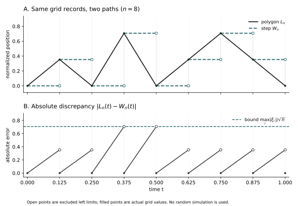

# 第二十五章：随机游走什么时候变成 Brownian motion？——Donsker 不变性原理

一位观察者把随机游走的记录越拍越密，想知道粒子是否曾越过一条固定的水平线。只比较最后一张照片，他会漏掉中途的越界；增加几张照片，也仍可能漏掉发生在缝隙中的运动。第23章的尖峰已经把这个困难说明白了。现在要判断的，是随机游走自己的增量能否排除这种漏看的可能。

Brownian motion已经作为连续路径上的概率存在。困难不再是替极限想象一条曲线，而是证明离散记录真的会靠近这份路径规律。最值得注意的是，最后足够的条件，仍然只是独立、同分布和有限方差。要理解这个“仍然”，必须认真处理那些很大、却并不经常出现的步子。

## 25.1 一维定理没有答应过的事情

设每一步的中心化收益为ξᵢ，独立同分布、均值0、方差1，部分和记为Sₖ。中心极限定理控制Sₙ/√n；多元版本又控制任意固定几组时刻。可是“某时刻曾经越界”涉及所有时刻。把网格上的最大值写出来，就会看见问题的规模正在随n增长，而不是保持一个固定维数。

\[
M_n=\max_{0\le k\le n}\frac{S_k}{\sqrt n}.
\]

不能把一个对每个固定维数成立的极限，直接用于这个维数不断增长的事件。第24章把缺少的东西叫作紧性：绝大多数曲线必须在同一时间精度下受到控制。现在我们不再重新证明Prokhorov，而要从随机游走的独立和结构中制造这种控制。

## 25.2 先明确我们正在放大什么

如果原步子Yᵢ有均值μ、方差σ²∈(0,∞)，先令ξᵢ=(Yᵢ−μ)/σ。减去的是确定的平均漂移，不是这一条样本自己最后的平均值；后者会强迫曲线回到零，产生另一种极限。先采用均值0、方差1的记号，最后再恢复量纲。

\[
\begin{gathered}
S_0=0,\quad S_k=\sum_{i=1}^k\xi_i,\\
 W_n(t)=\frac{S_{\lfloor nt\rfloor}}{\sqrt n},\\
 L_n(t)=\frac{S_k+r\xi_{k+1}}{\sqrt n},\quad k=\lfloor nt\rfloor,\ r=nt-k.
\end{gathered}
\]

Wₙ保留每次记录之后的值，是右连续阶梯；Lₙ把相邻记录连成折线。它们在全部网格点相同。时间步长1/n与空间尺度1/√n不是两项互不相干的选择：经过约nt步的方差为nt，除以n以后留下t，这正是Brownian协方差的时间尺度。

在固定区间[0,T]上，两种路径都只依赖有限个增量。折线插值是从这些增量到C([0,T])的连续映射；固定网格阶梯对一致范数也连续，因而对J₁拓扑连续。于是它们分别是C值、D值随机元素。半轴可测性再由各有限窗口和坐标Borel结构得到，不把不可数条坐标逐一可测误当成已经完成路径可测性。

## 25.3 两种插值之间到底差了多少

在一个网格格子里，折线只沿着这一格的步子移动，阶梯仍停在左端值。因此两种记录的最大差，不超过观察窗口内最大的单步。这个估计比“步子看起来很小”更准确：步长本身随机，最大步长也必须控制。

\[
\|L_n-W_n\|_{[0,T]}
 \le\frac1{\sqrt n}\max_{1\le i\le\lfloor nT\rfloor+1}|\xi_i|.
\]

有限二阶矩正好足够。对任意ε>0，用并集界和尾部二阶矩，有下式。这里不是仅用Markov不等式得到一个常数上界；指标中的阈值随n趋于无穷，尾部积分才使它真正趋零。

\[
P\!\left(\max_{i\le\lfloor nT\rfloor+1}|\xi_i|>\varepsilon\sqrt n\right)
 \le\frac{T+1}{\varepsilon^2}
 E\!\left[\xi_1^2\mathbf1_{\{|\xi_1|>\varepsilon\sqrt n\}}\right]\longrightarrow0.
\]

<figure class="publication-math-figure" id="visual-interpolation-gap"><figcaption>图25.1　阶梯与折线保留相同的网格记录。显示n=8、增量(1,−1,2,−2,1,1,−1,−1)，空间除以√8；下方面板的绝对差始终不超过最大步长2/√8。空心与实心端点区分左极限和记录值。这是确定性误差示意，不是Brownian样本或Donsker证明。<a href="../assets/visuals/donsker-interpolation/interpolation-gap.pdf">矢量PDF</a>。</figcaption></figure>

这说明两种插值会在概率意义下变得接近，却还没有证明任何一种有路径极限。若Lₙ藏有第23章那样的尖峰，两者接近也可能一起失败。最大单步估计解决的是插值选择，不是全部紧性。

## 25.4 有限维Gaussian规律怎样同时出现

取0=t₀<t₁<⋯<tₘ。先不看位置，而看不重叠时间段的增量。第j段含有mₙⱼ=⌊ntⱼ⌋−⌊ntⱼ₋₁⌋个原步子。所有时间间距严格为正，所以充分大的n使每个mₙⱼ>0，下面的标准化才有定义。每段仍是独立和，不同段又相互独立；这才允许我们从一维CLT进入联合极限。

\[
\frac{S_{\lfloor nt_j\rfloor}-S_{\lfloor nt_{j-1}\rfloor}}{\sqrt n}
 =\sqrt{\frac{m_{n,j}}n}\,
 \frac{\sum_{i=\lfloor nt_{j-1}\rfloor+1}^{\lfloor nt_j\rfloor}\xi_i}{\sqrt{m_{n,j}}},
 \qquad \frac{m_{n,j}}n\longrightarrow t_j-t_{j-1}.
\]

由第11章的有限方差CLT和第14章多元特征函数工具，对任意实数θ₁,…,θₘ，块向量的特征函数是各块特征函数之积，其极限如下。多元连续性定理识别出独立Gaussian块；再作累加的连续线性变换，得到各时刻位置的联合分布。

\[
\prod_{j=1}^m E\exp\!\left\{
 i\theta_j\frac{S_{\lfloor nt_j\rfloor}-S_{\lfloor nt_{j-1}\rfloor}}{\sqrt n}\right\}
 \longrightarrow
 \exp\!\left\{-\frac12\sum_{j=1}^m\theta_j^2(t_j-t_{j-1})\right\}.
\]

这恰是第23章Brownian motion的有限维分布，位置协方差为min(s,t)。Lₙ与Wₙ在这些有限坐标上的差由上一节同时趋0，所以折线也有相同有限维极限。没有在这里重新证明CLT；新工作是辨认不同时段的独立结构，并把它和路径问题连接起来。

## 25.5 方差估计为什么停在门槛上

尝试直接使用第24章的共同增量矩判据，会遇到一个真实障碍。网格上的方差是时间间距的一次方，而该判据需要大于一次的幂，才能在越来越多的网格边上求和。单条路径的平均平方振幅小，并未自动变成整族路径的共同连续性。

\[
E\left|\frac{S_j-S_i}{\sqrt n}\right|^2=\frac{j-i}{n}.
\]

若暂时有四阶矩，独立性会多给一个时间幂。可是把这项方便假设永久留在定理中，就会排除不少本来应当具有Brownian极限的步子。例如下面的对称密度已经均值0、方差1，却没有四阶矩。

\[
\begin{gathered}
f(x)=\frac{3}{2(1+|x|)^4},\\
 P(|\xi_1|>x)=(1+x)^{-3}\ (x\ge0),\\
 E\xi_1^2=\int_0^\infty\frac{2x}{(1+x)^3}\,dx=1,\\
 E\xi_1^4=\infty.
\end{gathered}
\]

密度积分为1；对称性与有限一阶矩给均值0。二阶尾积分把u=1+x代入，等于2∫₁∞(u⁻²−u⁻³)du=1；四阶尾积分的被积函数4x³/(1+x)³却不趋零，因而发散。问题不是缺少例子，而是证明怎样越过四阶矩这道技术门槛。

## 25.6 先让四阶矩完成它能完成的工作

先设中心化步子ηᵢ独立同分布，二阶矩v、四阶矩m₄均有限。折线在s到t之间的变化，可以写成独立步子的加权和。系数aᵢ表示这一格有多大比例落在[s,t]内；它们介于0与1之间，总和恰为n(t−s)。

\[
\begin{gathered}
L_n^\eta(t)-L_n^\eta(s)=n^{-1/2}\sum_i a_i\eta_i,\quad
 0\le a_i\le1,\quad \sum_i a_i=n(t-s),
 \\
 E\left(\sum_i a_i\eta_i\right)^4
 =m_4\sum_i a_i^4+6v^2\sum_{i<j}a_i^2a_j^2.
\end{gathered}
\]

展开四次方后，含有某个只出现一次指标的项，由中心化与独立性消失；剩下的正是四次项与两两配对项。因此上式不仅是一个估计，还说明额外时间幂来自哪里。

令u=n(t−s)。若u≥1，则Σaᵢ⁴≤u≤u²，且Σaᵢ²≤u；若u≤1，则Σaᵢ⁴≤u⁴≤u²，且(Σaᵢ²)²≤u⁴≤u²。后一种情况不可忽略，因为s、t可能落在同一个格子里。两种情况合并，得到全部实数时刻上的共同界。

\[
E|L_n^\eta(t)-L_n^\eta(s)|^4
 \le (m_4+3v^2)|t-s|^2.
\]

第24章的矩判据取α=4、β=1，起点又恒为0，便给C([0,T])紧性。有限维极限识别出√v B，v=0时为零过程。四阶矩路线至此完整成立，但它仍只是将来截断论证的一个部件。

## 25.7 截断不是把大步子假装不存在

固定K>0，把ξ分成有界的中心化部分和余项。必须同时调整均值。原变量均值为0，并不保证截断之后均值仍为0；一个很小却固定的均值，累积n次再除√n，仍会产生越来越大的漂移。

\[
\begin{gathered}
\xi_i^{(K)}=\xi_i\mathbf1_{\{|\xi_i|\le K\}}
          -E[\xi_1\mathbf1_{\{|\xi_1|\le K\}}],\\
 \rho_i^{(K)}=\xi_i-\xi_i^{(K)}
 =\xi_i\mathbf1_{\{|\xi_i|>K\}}-E[\xi_1\mathbf1_{\{|\xi_1|>K\}}],
 \\
 \operatorname{Var}(\rho_1^{(K)})\le
 v_K:=E[\xi_1^2\mathbf1_{\{|\xi_1|>K\}}]\downarrow0.
\end{gathered}
\]

对每个固定K，截断步子有有限四阶矩，上一节给出其折线路径Lₙ⁽ᴷ⁾的紧性。它的方差也趋于原方差1，因为余项在L²中趋0。不过我们无需立刻交换K与n的两个极限：先证明尾部路径在整个窗口都很小。

不能估计尾项绝对值之和再希望它足够小。那会破坏中心化带来的抵消，往往留下√n倍的一阶尾量。第12章Kolmogorov最大不等式恰好控制仍保有独立与均值0的尾部部分和。

\[
P\!\left(\|L_n-L_n^{(K)}\|_{[0,T]}>\varepsilon\right)
 \le P\!\left(\max_{k\le\lceil nT\rceil}
       \left|\sum_{i=1}^k\rho_i^{(K)}\right|>\varepsilon\sqrt n\right)
 \le\frac{(T+1)v_K}{\varepsilon^2}.
\]

第一步只用折线在格内是两个端点的凸组合；第二步使用的最大不等式，其条件是独立、中心化与有限方差，不要求四阶矩，也不要求尾部与截断部分相互独立。它们通常并不独立，而这里从未使用这种额外假设。

## 25.8 把两个极限按正确顺序合起来

记w为第24章连续路径的振幅。两条曲线若在一致距离内相差a，它们的振幅至多相差2a。因此原路径的坏振幅事件，可分为截断路径的坏振幅，以及整条尾部路径过大的事件。

\[
\begin{gathered}
P(w(L_n,\delta)>\varepsilon)
 \le P(w(L_n^{(K)},\delta)>\varepsilon/2)
      +P(\|L_n-L_n^{(K)}\|_{[0,T]}>\varepsilon/4),
 \\
 \lim_{\delta\downarrow0}\limsup_n P(w(L_n,\delta)>\varepsilon)
 \le \frac{16(T+1)v_K}{\varepsilon^2}.
\end{gathered}
\]

右边对每个固定K都成立。先让δ趋0，使用固定K的四阶矩紧性；然后令K趋∞，尾部二阶矩使右边归零。起点恒为0，有限个初始n也可由各自连续性补入。于是Lₙ的分布在C([0,T])中一致紧。

四阶矩常数可能随K迅速增加，甚至趋于无穷，这没有破坏证明。我们从未要求它对K统一，只要求固定K时对n统一。错误地先选一个随n变化的截断高度，再把这个常数当成统一常数，会掩盖整个论证最关键的量词。

## 25.9 Donsker定理现在成为路径结论

我们可以正式完成主结论。若ξᵢ独立同分布、Eξ₁=0、Eξ₁²=1，则对每个T<∞，Lₙ的分布在C([0,T])中弱收敛到标准Brownian motion的限制分布。

\[
L_n\Rightarrow B\quad\text{in }C([0,T]),\qquad
 E\,F(L_n)\longrightarrow E\,F(B)\quad(F\in C_b(C([0,T]))).
\]

证明的逻辑已经全部在场：§25.4给有限维极限，§25.6–25.8给共同紧性，第24章的路径识别定理把任意弱子列极限识别为第23章已经存在的Wiener测度，坏子列反证恢复整列。Brownian的存在没有依赖Donsker，所以这里没有用待证明的极限来构造自己。

对一般Yᵢ，结论就是从折线部分和中减去μnt，再除以σ√n。折线对常数μ的累积恰为μnt，故中心化没有额外的网格误差。σ=0时Yᵢ=μ几乎必然，中心化路径恒为零；非退化Brownian版本明确要求σ>0。

## 25.10 阶梯、折线与越来越长的观察窗口

Wₙ本来不在C里，因此不能写成“Wₙ在C中收敛”。连续嵌入C→D把Lₙ的极限传给J₁空间；又因为J₁距离不超过截断一致距离，§25.3的误差和第24章稳定性结论给出Wₙ在D中的同一极限。

\[
W_n\Rightarrow B\quad\text{in }(D([0,T]),J_1),
 \qquad d_{J_1}(W_n,L_n)\le 1\wedge\|W_n-L_n\|_{[0,T]}
 \xrightarrow P0.
\]

主线的紧性证明完全在C中完成，没有调用Aldous准则。D的Polish与Borel结论的对数时钟及坐标生成证明见[T-J1](../foundations/t-j1.md#t-j1-polish)；此处使用的是其中的可测结构、连续嵌入和距离控制。Brownian极限连续，故两种插值的差在比J₁更强的一致距离下已经消失。

在半轴上，对每个整数窗口使用相同证明，再用第24章C_loc紧性和有限维识别，得到Lₙ⇒B于C_loc。阶梯版也在实值半轴局部J₁中成立：在T-J1的积分度量里，一致距离上界对每个固定窗口依概率趋0；有界性将其期望送到0，Tonelli与控制收敛再把窗口积分送到0，最后用Markov得到整个局部距离依概率趋0。这里没有要求所有跳跃极限在整数端点上都稳定；此处极限恰好处处连续。

## 25.11 一条路径极限能带走哪些问题

现在最大值不必再由不断增长的多元积分直接计算。在C([0,T])上，上确界、下确界、极差以及曲线的时间积分都是连续函数；对最大值甚至有差不超过两条曲线一致距离的估计。连续映射于是给出一整批真正的函数型极限定理。

\[
\max_{0\le k\le n}\frac{S_k}{\sqrt n}
 \Rightarrow\sup_{0\le t\le1}B_t,\qquad
 \int_0^1L_n(t)\,dt\Rightarrow\int_0^1B_t\,dt.
\]

关于越界概率，还要尊重Portmanteau：只有在极限最大值的分布不给阈值a质量时，才能直接断言越界概率收敛。本章不提前借用第26章的反射原理来填入最大值分布公式，也不把首次命中时间处处当成连续映射。刚好擦过边界的路径，可能使首次命中非常不稳定。

分布收敛也没有自动许诺期望收敛。这里可以额外使用第15章L²最大不等式：E max_{k≤n}|Sₖ|²/n≤4。因此网格最大值本身一致可积，截断连续读数再取尾部极限，就得到其期望收敛到Brownian最大值的期望。相同估计并未证明最大值平方一致可积，不能未经进一步论证把结论再提高一个矩阶。

## 25.12 有限方差与独立性各自承担什么

有限方差的作用不只是让最后一个位置满足CLT。它还让最大单步在√n尺度下消失，并让截断尾部在整段路径上可忽略。§25.5那个没有四阶矩的密度仍完全满足本定理；额外四阶矩只是证明有界近似时使用的工具。

独立性则控制抵消与时间块的联合结构。取独立对称符号εⱼ，却令ξ₂ⱼ₋₁=εⱼ、ξ₂ⱼ=−εⱼ。每个步子仍均值0、方差1、绝对值1，但每两步完全抵消，折线路径的一致范数不超过1/√n，于是极限是零。单步分布与有界性没有替代独立性。

如果ξᵢ是标准Cauchy，部分和Sₙ/n仍是标准Cauchy，而Sₙ/√n的尺度增大为√n，连终点都不紧。第14章的稳定规律说明这不是“没有极限”，而是平方根尺度已经不适合。这也不意味着所有无限方差都只能产生非Gaussian极限；无限方差Gaussian吸引域需要另外的截断方差与尺度理论，不能从本定理自动得到。

## 25.13 每步方差趋于1，也可能留下大跳

“同分布”还有一个容易忽略的量词：本定理使用一份固定步子分布，不是每当n改变，就另选一份方差1的分布。用第13章的稀有事件可以看见差别。对n≥2的每一行取独立Bernoulli(1/n)变量Iₙₖ，令ξₙₖ=√n(Iₙₖ−1/n)，k=1,…,n。

\[
E\xi_{n,k}=0,\quad\operatorname{Var}(\xi_{n,k})=1-\frac1n,\qquad
 \frac1{\sqrt n}\sum_{k\le\lfloor nt\rfloor}\xi_{n,k}
 =\sum_{k\le\lfloor nt\rfloor}I_{n,k}-\frac{\lfloor nt\rfloor}{n}.
\]

终点趋于Poisson(1)−1而非Gaussian。更直接地，在至少一次成功的事件上，折线有一个宽度1/n、高度1−1/n的上升格。这个事件概率趋于1−e⁻¹；对任何固定δ>0，充分大的n都有振幅至少1−1/n。因此C紧性失败。每个指定小格出现大跳的概率趋零，全部格子中仍有非消失的机会留下一个大跳。

即使再除以√(1−1/n)把每个步子的方差精确改成1，结论也不改变。第14章Lindeberg条件控制的，正是这种总方差中没有消失的大跳贡献。有限方差不变性原理并没有废除这个条件；固定分布的二阶尾积分已经自动提供了这里所需的控制。

## 25.14 固定样本数为什么会留下桥

路径极限不只适用于按时间相加的收益。取独立Uᵢ均匀分布于[0,1]，从左向右移动阈值t，记录样本中落在[0,t]内的比例Gₙ(t)。第12章说明Gₙ一致趋于t；现在把剩下的偏差放大√n。

\[
\begin{gathered}
G_n(t)=\frac1n\sum_{i=1}^n\mathbf1_{\{U_i\le t\}},\\
 \alpha_n(t)=\sqrt n\{G_n(t)-t\},\\
 \operatorname{Cov}(\alpha_n(s),\alpha_n(t))=\min(s,t)-st.
\end{gathered}
\]

t=1时总数固定为n，偏差恰为0；不同阈值增加的计数也不能彼此独立，因为它们在分配同一批样本。协方差不是min(s,t)，而多了−st。第23章的Brownian bridge并不是在这里凭类比出现：固定总量确实改变了Gaussian关联结构。

单看协方差仍不够证明过程极限。我们需要一种把整条经验曲线与已经掌握的独立和连接起来的表示。排序后的均匀点之间是随机间隔；独立指数等待在给定总长度之后，恰好产生这些间隔。这个有限样本的精确等式，比另起一套未经证明的经验过程紧性工具更直接。

## 25.15 指数间隔把随机游走变成经验曲线

取独立均值1的指数变量Eᵢ，部分和记Rₖ，令N=n+1。向量(R₁/R_N,…,Rₙ/R_N)的分布就是n个均匀样本的顺序统计量。变换Eᵢ=r(uᵢ−uᵢ₋₁)的Jacobian为rⁿ，联合密度积分为∫₀∞e⁻ʳrⁿdr=n!，恰等于均匀顺序统计量密度。[T-FCLT](../foundations/t-fclt.md#t-fclt-spacings)给出变量范围、Jacobian与归一化的完整计算。

把Rₖ/R_N在k/N之间线性连接，得到严格递增同胚q_N。记指数中心化折线为H_N。刚证明的Donsker与连续映射给出下式；分母来自把总长度固定为1，它减去了与终点共同涨落的那一部分。

\[
v_N(t):=\sqrt N\{q_N(t)-t\}
 =\frac{H_N(t)-tH_N(1)}{1+H_N(1)/\sqrt N}
 \Rightarrow B_t-tB_1=:B_t^\circ\quad\text{in }C([0,1]).
\]

经验CDF则反过来问：空间阈值走到t，已经经过多少个间隔？因此需要逆函数r_N=q_N⁻¹。它满足√N(r_N−id)=−v_N∘r_N。因为q_N趋近恒等函数，r_N也趋近恒等函数；v_N的C紧性又使这次小时间变化造成的一致误差趋零。于是逆函数的涨落趋于−B°。

由这些间隔形成的经验CDF与r_N相差至多1/N，故√n尺度下差异消失。−B°与B°同分布；这里利用的是中心Gaussian对称性，不能在与原Brownian联合讨论时擅自删掉负号。我们得到真正的经验过程定理：

\[
\alpha_n\Rightarrow B^\circ\quad\text{in }(D([0,1]),J_1),\qquad
 \|G_n-r_N\|_\infty\le\frac1{n+1}.
\]

这里使用D值随机元素和与连续过程一致接近的表示，不把非可分的一致范数函数空间中的Borel弱收敛当作已证明事实。密度表示、逆函数误差及连续映射每一步，均在[T-FCLT的经验过程证明](../foundations/t-fclt.md#t-fclt-empirical)实际展开。

## 25.16 总体分布改变时，桥怎样被重新读出

若样本来自一般分布函数F，经验CDF记Fₙ。使用第七章分位数构造，将样本写成Q_F(Uᵢ)，便有1_{Q_F(Uᵢ)≤x}=1_{Uᵢ≤F(x)}。因此新的偏差过程，就是均匀经验过程在时间F(x)处的读数。

\[
\begin{gathered}
\sqrt n\{F_n(x)-F(x)\}=\alpha_n(F(x)),
 \\
 \sqrt n(F_n-F)\Rightarrow B^\circ\circ F
 \quad\text{in }D([a,b])\quad(a<b\text{ finite}).
\end{gathered}
\]

F不连续时，极限也可以在总体原子的所在地跳跃；我们没有把它强行称为连续过程。从连续函数g到g∘F的映射，对一致距离是压缩的，输出为càdlàg，所以连续近似足以证明这一版本。这里的拓扑理由是：J₁收敛到连续g时等价于一致收敛，因而gₙ∘F的一致误差不超过gₙ与g的一致误差，即使F不连续也成立。上一节的C值近似给出了这一极限操作的严格实现；没有对一般跳跃极限擅用复合映射。若F连续，极限路径也连续。有限区间版本及可测性见[T-FCLT](../foundations/t-fclt.md#t-fclt-general-cdf)。

均匀情形还直接给√n‖Gₙ−id‖∞⇒‖B°‖∞。这说明一次路径极限怎样同时组织所有阈值的误差，而不是把单个阈值的正态近似重复无穷遍。本章不计算桥上确界的显式分布；那需要另行建立相应的路径工具。

## 25.17 等待时间的和，怎样变成到达次数

第19章中，更新次数与等待时间的和互为逆问题。设τᵢ>0独立同分布，均值μ>0、方差σ²∈(0,∞)，到达时刻Rₖ=τ₁+⋯+τₖ，N(t)=max{k:Rₖ≤t}。如果等待总长在平均线之上，给定时间内能发生的到达次数就会减少，极限中的负号来自这个可见的逆关系。

\[
\begin{gathered}
\left(\frac{N(nt)-nt/\mu}{\sqrt n}\right)_{0\le t\le T}
 \Rightarrow
 \left(-\frac{\sigma}{\mu}B_{t/\mu}\right)_{0\le t\le T}
 \quad\text{in }D([0,T]).
 \\
 \left(-\frac{\sigma}{\mu}B_{t/\mu}\right)_t
 \ \overset d=\ \left(\frac{\sigma}{\mu^{3/2}}\widetilde B_t\right)_t.
\end{gathered}
\]

这个结果不是把逆函数形式地求导就结束。先由强律和单调性证明N(nt)/n在紧窗口上一致趋于t/μ；再用有限二阶矩证明前约Cn个等待中的最大值除√n趋0，从而控制随机下标处尚未完成的一个间隔。最后，等待和过程的共同振幅估计允许把随机时间N(nt)/n换成t/μ。[配套更新证明](../foundations/t-fclt.md#t-fclt-renewal)逐项完成这些步骤。

同一最大等待估计还使年龄与剩余寿命除以√n后在紧窗口上一致趋0。这只是当前宏观尺度上的可忽略性，不是它们未缩放的平稳极限定理，更不是重尾更新的函数极限。相同的逆思想，到了无限方差或可能爆炸的模型，需要重新检验自己的尺度与连续性条件。

## 25.18 不变的是什么，不变的又不是什么

不变性说的是，在这些假设和这种尺度下，许多不同的步子分布共享同一份宏观路径规律。微观分布的偏斜、是否有密度、是否有四阶矩，可以不同；中心化与方差归一以后，独立小波动的共同路径极限相同。这里没有声称所有微观信息消失，也没有声称现实运动自动满足这些模型条件。

尤其不能把分布极限读成原有随机游走逐条趋于某条Brownian路径。即使ξᵢ本身就是独立标准正态，令Aₙ=Sₙ/√n，A₂ₙ−Aₙ仍为方差2−√2的中心正态，故Aₙ不是依概率Cauchy。原概率空间上连终点都未必依概率收敛，更谈不上自动逐路径收敛。

\[
\operatorname{Cov}(A_n,A_{2n})=\frac1{\sqrt2},
 \qquad \operatorname{Var}(A_{2n}-A_n)=2-\sqrt2>0.
\]

第24章Skorokhod表示允许在另一共同空间上实现几乎必然逼近，但保留的是各n的边缘路径规律，不是原来的跨n依赖。更精细的强逼近又有自己的额外问题。把这些不同结论分开，才能准确理解我们获得的普适性。

## 25.19 连续运动终于从记录中走出来

最初，那些越来越密的照片只告诉我们：每一个有限窗口的位置看起来像Gaussian。现在我们知道，独立和还提供了照片以外的控制。有界部分的四阶展开约束了细小振荡，尾部二阶矩与最大不等式防止罕见大步破坏整段记录。连续极限不是从图像的平滑外观猜出来的，而是在这两份控制之间得到保证。

把相同的路径思想用于固定样本的计数，会得到两端钉住的桥；把等待之和反过来阅读，会得到到达次数的涨落。路径空间让不同实验之间的联系变得可以证明：不是因为它们有相似的图形，而是因为映射、误差和共同紧性都被明确控制。

不过，连续并不等于光滑。离散折线在每格都有斜率，极限存在也不保证这些斜率趋近某个速度；越界和首次命中，还保留着连续读数无法直接消除的边界困难。Brownian motion如今不只是一份被构造出来的概率，也是许多离散记录共同趋向的对象。接下来需要认真观察的，正是这条已经获得存在与逼近保证的路径本身。

## 25.20 史料、证明方法与范围

Monroe Donsker的An Invariance Principle for Certain Probability Limit Theorems收于1951年Memoirs of the American Mathematical Society第6号Four Papers on Probability；见[AMS正式书目](https://doi.org/10.1090/memo/0006)。1952年的Justification and Extension of Doob’s Heuristic Approach to the Kolmogorov–Smirnov Theorems发表于Annals of Mathematical Statistics 23，277–281，见[原始期刊记录](https://www.jstor.org/stable/2236454)。这些文献为不变性与经验过程的历史归属提供依据，不表示本章复刻其原始证明，也不把当时的函数空间处理等同于后来成熟的Borel弱收敛框架。

本章采用现代重建：以第23章独立构造的Wiener测度为候选极限，用第24章路径紧性识别它；有界四阶矩加固定截断完成一般有限二阶矩，指数间隔与逆映射完成这里陈述的经验过程和有限方差更新版本。[旧Donsker专题](../advanced/donsker.md)保留原推导，当前一般主证明以本章及[T-FCLT](../foundations/t-fclt.md)为准。Brownian停止时刻嵌入、强逼近、一般经验函数类、重尾更新及条件随机树极限均不由本章自动完成。
